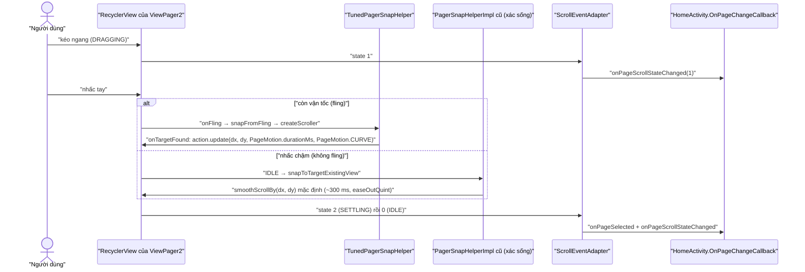
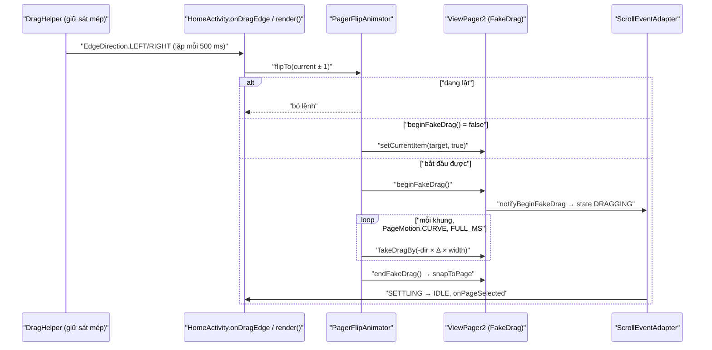
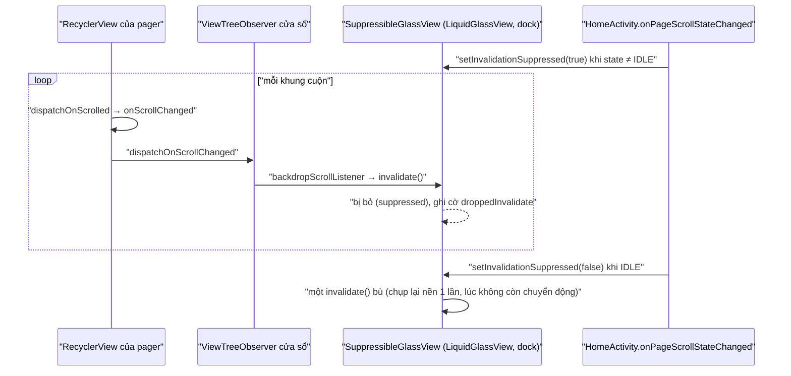
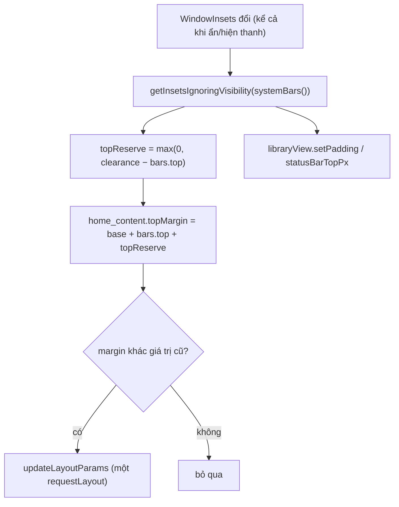
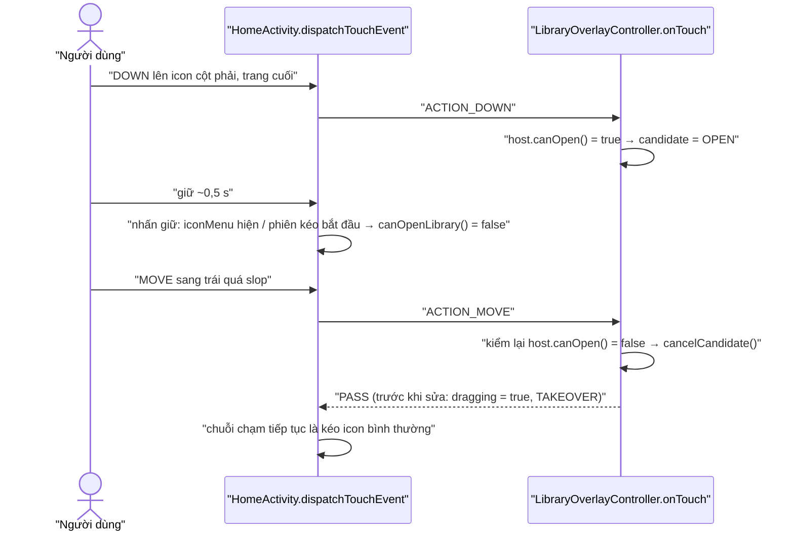

# TL1 — Chỉnh Home theo góp ý tech lead: đọc trước khi review

**Plan:** [plans/TL1-home-polish.md](../plans/TL1-home-polish.md) · **PR:** #2 · **Nhánh:** `fix/tl1-home-polish`

> Trạng thái: đầy đủ (2026-11-03). Phần cơ chế/đo đã kiểm trên Live 4; phần cảm giác (mượt, rung, vị trí pill) chờ bài kiểm cuối của chủ dự án.

## 1. Tóm tắt

Ba chỉnh sửa trên màn Home theo góp ý tech lead 2026-11-03, cộng một lỗi hiệu năng lớn tìm ra khi đo:
1. Đổi trang chậm và mượt hơn kiểu iOS: vuốt tay (thả tay sau fling) và lật tự động khi kéo icon chạm mép / lật sang trang trống dùng chung một đường cong + thời lượng (`PageMotion`).
2. Icon rung nhẹ hơn khi vào chế độ chỉnh sửa (±5° → ±2°).
3. Hai nút Cài đặt / Xong là hai viên pill nổi sát mép trên, không còn đẩy lưới xuống; thanh trạng thái được ẩn khi chỉnh sửa như iOS; lưới chừa sẵn một khoảng cố định (`topReserve`, 26 dp trên Live 4) để hộp chạm 48 dp của pill không đè dấu "−" hàng đầu.
4. (Phát hiện khi đo, Task 1b/2b) Vuốt trang giật nặng (Janky 72,87%) khi dock dùng kính thật: `LiquidGlassView` chụp lại nền mỗi khung cuộn. Chặn `invalidate()` của kính trong lúc pager cuộn đưa Janky về 1,76% (đo được).

## 2. Kiến thức nền

- **`ViewPager2`** là một `RecyclerView` (`LinearLayoutManager` ngang) kèm một `PagerSnapHelper` để "hít" về đúng trang và một `ScrollEventAdapter` để phát callback `onPageScrolled/onPageSelected/onPageScrollStateChanged`. `SnapHelper` là bộ chặn fling (`OnFlingListener`) cộng một bộ nghe cuộn: thả tay thì nó chọn trang đích và chạy một `SmoothScroller`.
- **Ba đường chuyển trang** (đọc bytecode `recyclerview-1.4.0`, `viewpager2-1.1.0`):
  1. *Fling*: `PagerSnapHelper` cắt thời gian cuộn ở 100 ms (`calculateTimeForScrolling = min(100, …)`) rồi chia ~0,3356 cho giảm tốc → ≤ ~300 ms. Đo trên Live 4 trước khi sửa: median ~258 ms.
  2. *Nhấc tay chậm không fling*: bộ nghe `IDLE` của `SnapHelper` gọi `smoothScrollBy(dx, dy)` mặc định: `(|d|/rộng + 1) × 300` ms, ease-out bậc 5. Đo: ~300 ms.
  3. *Lật có chủ đích* `setCurrentItem(.., true)`: `LinearSmoothScroller` mặc định, phụ thuộc dpi (suy luận 170–250 ms, không đo).
- **`ScrollEventAdapter`** chỉ phát `onPageSelected` cho cuộn bắt đầu từ lúc người dùng kéo hoặc do `setCurrentItem`/`FakeDrag` báo trước (đọc bytecode). `smoothScrollBy` bắt đầu từ trạng thái rảnh thì **không** phát — đó là lý do lật chương trình dùng `FakeDrag`, không dùng `smoothScrollBy`.
- **`FakeDrag`** (`beginFakeDrag/fakeDragBy/endFakeDrag`) cho chương trình "kéo giả" bằng tay; `fakeDragBy` âm = sang trang sau (LTR, tài liệu ViewPager2). Trong lúc kéo giả `currentItem` vẫn là trang cũ đến khi settle xong.
- **`ViewTreeObserver.OnScrollChangedListener`**: được gọi khi **bất kỳ** view nào trong cửa sổ phát `onScrollChanged`. `RecyclerView.dispatchOnScrolled` luôn gọi `onScrollChanged` nên mọi lần cuộn của pager đều đánh thức listener loại này (đọc bytecode).
- **Window insets:** `getInsets(systemBars())` đổi khi thanh bị ẩn (về 0); `getInsetsIgnoringVisibility` trả giá trị "như thể thanh đang hiện". Dự án áp inset thành **margin của view con**, không padding lên root (AGENTS.md, B2).
- **Số đo Live 4 (đo được, 2026-11-03):** 1080×2340, density 3,0, 60 Hz. `bars.top` = 96 px = 32 dp; icon 60 dp, `cellH` 80 dp.

## 3. Luồng hoạt động

### 3.1 Vuốt tay đổi trang (Task 2)

`TunedPagerSnapHelper` thay `onFlingListener` của RV (phải đặt `null` trước khi gắn, nếu không `SnapHelper` ném `IllegalStateException`). Helper cũ của ViewPager2 nằm trong field private nên **không gỡ được nếu không reflection**; nó vẫn nghe `IDLE` nhưng sau khi cuộn của ta xong thì view đã thẳng hàng nên không làm gì. Đường "nhấc chậm" vẫn do mặc định xử lý (phương án C của plan, reflection, chỉ mở nếu hai đường lệch cảm giác).

### 3.2 Lật có chủ đích (Task 3)

Lật sang trang trống tạm cũng đi qua `flipTo`, trong callback của `submitList` ở `render()`. `render()` **không** đặt lại trang (`setCurrentItem(.., false)`) khi `pagerFlip.isFlipping`, vì kéo giả giữ `currentItem` ở trang cũ và việc đặt lại sẽ hủy lượt lật.

### 3.3 Kính dock và lỗi vẽ lại mỗi khung (Task 1b, 2b)

Trước khi chặn, mỗi `invalidate()` kéo theo `draw → onDraw → drawGlassEffect → renderGlassEffectSync → captureBackdrop` (chụp nền trên CPU, ~14 ms/khung trên Live 4) vì `enableDynamicBackground = false` chỉ bỏ qua bước làm mờ lại, không bỏ bước chụp (đọc bytecode `liquidglass-v2.0.11`).

### 3.4 Vào/ra edit mode (Task 5, 6)

```mermaid
stateDiagram-v2
    [*] --> Thuong
    Thuong --> Edit: "nhấn giữ icon → HomeViewModel.enterEditMode"
    Edit --> Thuong: "Xong / Back / chạm vùng trống → exitEditMode"
    Thuong: "thanh trạng thái hiện; edit_toolbar ẩn"
    Edit: "applyStatusBarForEditMode(true): hide(statusBars); hai pill hiện ở mép trên"
```

`clearance` = hộp chạm pill 48 dp + khe 2 dp + phần dấu "−" nhô 16 dp − `GridMetrics.PADDING_DP` 8 dp = 58 dp; trên Live 4 `topReserve` = 58 − 32 = 26 dp, **áp mọi lúc** (không phụ thuộc edit mode), nên lưới không dịch khi vào/ra. Việc ẩn thanh trạng thái không đổi margin nào vì mọi giá trị lấy theo "bỏ qua visibility". **Đã đo trên Live 4 (2026-11-03):** khi edit mode, `bars.top=96`, `visibleSystemBars.top=0`, `statusBarsIgnoring.top=96`, `cutout.top=96` — cả inset `statusBars` và `displayCutout` mang 96 px nên `systemBars()` bỏ qua visibility là đúng; cutout mode không letterbox; 0 pixel đổi giữa trước và sau edit mode. Sau Cài đặt → Back thanh vẫn ẩn. **Chưa kiểm:** nháy khi bật/tắt ở mức mắt thường.

**Nhịp lật mép:** `DragHelper` lặp báo mép mỗi 500 ms, trong khi lượt lật `PagerFlipAnimator` mất ~450 ms nên các lượt nối đuôi nhau. `HomeActivity.onDragEdge` vì vậy bỏ lệnh khi đang lật hoặc khi chưa đủ `PageMotion.EDGE_FLIP_REST_MS` (500 ms) sau lần pager về IDLE gần nhất; với nhịp 500 ms của `DragHelper`, nghỉ thực tế ≈ 550 ms.

### 3.5 Library không cướp chuỗi chạm đã thành nhấn giữ (Task 9, lỗi có sẵn từ G2a B2)

Trước khi sửa, `canOpen()` chỉ được hỏi ở `ACTION_DOWN`; ứng viên `OPEN` được giữ qua nhấn giữ rồi chốt kéo ở `MOVE` dù menu/phiên kéo đã xuất hiện. (Đo được trên `main` và trên nhánh sau sửa, Live 4.) Chế độ tách đôi màn hình: chủ dự án muốn **giữ** Library hoạt động; việc co giãn bố cục Library theo cửa sổ nằm ở `CategoryPageView`, không thuộc TL1.

## 4. Thay đổi theo file

| File | Vai trò | Vì sao thêm/sửa | Đọc trước? |
|---|---|---|---|
| `ui/home/PageMotion.kt` (mới) | Hằng chuyển động chung | Một nguồn duy nhất cho `FULL_MS` (450), `MIN_MS` (300), `CURVE` (easeOutQuint) — hằng chỉnh tay | **Có** |
| `ui/home/TunedPagerSnapHelper.kt` (mới) | Thả tay sau fling | Thay `PagerSnapHelper` của ViewPager2 để dùng `PageMotion` | **Có** |
| `ui/home/PagerFlipAnimator.kt` (mới) | Lật có chủ đích | FakeDrag + `PageMotion`, thay `setCurrentItem(.., true)` | **Có** |
| `ui/home/HomeActivity.kt` | Màn Home | Gắn helper/animator trong `setupHomePager`; `onDragEdge`/`render()` dùng `flipTo`; `onStop`/`onDestroy` hủy lật; bỏ cơ chế đẩy lưới; `topReserve`; inset "bỏ qua visibility"; `applyStatusBarForEditMode`; bật/tắt chặn kính theo trạng thái pager | Có |
| `ui/home/LibraryOverlayController.kt` (**ngoại lệ do điều phối cấp**) | Cử chỉ mở Library | Task 9: kiểm lại `canOpen()` khi chốt kéo (nhánh `OPEN`) | Có |
| `res/layout/activity_home.xml` | Layout Home | Pill: nền 28 dp, hộp chạm 48 dp (`insetTop/Bottom`), sát mép trên | Có |
| `res/values/dimens.xml` | Kích thước | Khối `home_edit_pill_*`; xóa `home_edit_toolbar_space`, `home_done_margin_top` | Không |
| `ui/home/view/Jiggler.kt` | Rung icon | `JIGGLE_DEGREES` 5f → 2f | Không |
| `core/glass/GlassSurface.kt`, `RealGlassSurface.kt`, `ui/home/view/DockView.kt` | Kính dock (**vùng GL, ngoại lệ hẹp do điều phối cấp**) | `setInvalidationSuppressed`, lớp con `SuppressibleGlassView`, chuyển tiếp | **Có** |
| *(đã gỡ ở Task 8)* `Tl1Prof.kt` và các hàm bọc `onDraw`/`dispatchDraw` tạm | Công cụ đo Task 1b | Không còn trong nhánh; cách đo ghi ở mục 8 | — |

## 5. Quyết định và đánh đổi

Xem D1–D7 trong plan. Tóm tắt:
- **Vuốt tay (D1):** lớp con `PagerSnapHelper` (A) thay vì tự giữ toàn bộ việc thả tay (B, đụng helper "xác sống") hoặc reflection (C, dự phòng). Đánh đổi: đường "nhấc chậm" vẫn là mặc định (~300–350 ms).
- **Lật chương trình (D2):** `FakeDrag`, không gộp với `smoothScrollBy` vì `onPageSelected` không phát.
- **Chặn invalidate của kính (Task 2b):** lớp con ghi đè `invalidate()` thay vì gỡ backdrop (S2, mất nền) hoặc đổi tier mặc định (S3, quyết định sản phẩm). Đánh đổi: một `invalidate()` bù (một khung chụp nền) mỗi lần vuốt xong; nếu có khựng ở cuối thì trì hoãn bằng `post`.
- **Pill (D5, D6):** nền 28 dp + hộp chạm 48 dp bằng `insetTop/Bottom` (cơ chế Material mặc định; `TouchDelegate` không mở rộng ra ngoài cha nên không giúp); thanh trạng thái ẩn khi edit (như iOS); `topReserve` cố định thay vì đẩy lưới 64 dp chỉ lúc edit. Đánh đổi: Home thấp hơn 26 dp (Live 4) mọi lúc.
- **Ngưỡng Janky:** bỏ số 2,13% của M6 (cảnh đứng yên, không so được với cảnh vuốt).

## 6. Chỗ cần soi khi review

- `TunedPagerSnapHelper`: `onFlingListener = null` trước `attachToRecyclerView`; `findSnapView` null khi `isFakeDragging`; helper cũ vẫn còn (xác sống) — đúng thiết kế, không phải bỏ sót.
- `PagerFlipAnimator`: hủy ở `onStop`/`onDestroy`; `render()` không đặt lại trang khi đang lật; fallback `setCurrentItem(.., true)` khi `beginFakeDrag()` false.
- `SuppressibleGlassView`: mọi `invalidate()` bị bỏ trong lúc cuộn đều được bù một lần; `StaticBlurSurface` dùng mặc định no-op.
- `applySystemBarInsets`: không còn `getInsets(systemBars())` (nếu còn, ẩn thanh làm lưới dịch lên).
- Chỉ-có-code-bảo-vệ (chưa kiểm tay): chiều lật của `fakeDragBy`, cutout mode, nháy khi ẩn/hiện, thanh ẩn sau khi quay lại từ app khác, kính dock sau đổi hình nền/tách đôi, App Library ở trang cuối khi settle dài hơn.
- Công cụ đo tạm (`Tl1Prof`, log `TL1`, các hàm bọc `onDraw`) đã gỡ; nếu cần đo lại, xem phương pháp ở mục 8 (cần viết lại bộ đếm).

## 7. Cách kiểm lại

Xem "Bài kiểm cả tính năng" trong plan (Live 4, ≥ 3 trang icon). Số đo hiệu năng: khối lệnh PowerShell ở Task 1 (`gfxinfo reset`, kịch bản `input swipe`, `gfxinfo framestats`). Kỳ vọng sau sửa với `FORCE_HIGH` (kính thật): Janky ~1,76%, p50 ~6 ms (đo được ở build `2d9d895`).

## 8. Bài học cho AGENTS.md

- **2026-11-03 (đọc bytecode):** `ViewPager2` có ba đường đổi trang với thời lượng khác nhau — fling (`PagerSnapHelper`, ≤ ~300 ms vì `calculateTimeForScrolling = min(100, …)`), nhấc tay chậm (`smoothScrollBy(dx, dy)` mặc định: `(|d|/rộng+1)×300` ms, quintic), và `setCurrentItem(.., true)` (`LinearSmoothScroller` mặc định, phụ thuộc dpi). Không có tham số công khai để chỉnh; muốn chỉnh fling phải thay `SnapHelper` (đặt `onFlingListener = null` trước khi gắn).
- **2026-11-03 (đọc bytecode):** helper snap của `ViewPager2` nằm trong field private `mPagerSnapHelper`; gắn helper khác đè lên để lại một helper "xác sống" vẫn nghe `IDLE`. Vô hại khi view đã thẳng hàng; chỉ gỡ sạch được bằng reflection.
- **2026-11-03 (đọc bytecode):** `ScrollEventAdapter` chỉ phát `onPageSelected` cho cuộn bắt đầu từ kéo hoặc từ `setCurrentItem`/`FakeDrag`; `RecyclerView.smoothScrollBy` thẳng từ trạng thái rảnh thì không. Lật chương trình muốn chuyển động riêng thì dùng `FakeDrag`; kéo giả giữ `currentItem` ở trang cũ đến khi settle xong, nên mã đặt lại trang không animation (như `render()`) phải bỏ qua lúc đang lật.
- **2026-11-03 (đo được, Live 4):** giật khi vuốt trang (Janky 72,87%, `DrawStart→SyncQueued` p50 14,4 ms) không do thời lượng settle mà do `LiquidGlassView` của dock bị vẽ lại **mỗi khung cuộn**: nó đăng ký `ViewTreeObserver.OnScrollChangedListener` (không phụ thuộc `enableDynamicBackground`) gọi `invalidate()`, và `renderGlassEffectSync` chụp lại nền trên CPU ở mỗi lần vẽ. `RecyclerView.dispatchOnScrolled` luôn gọi `onScrollChanged`, nên mọi cuộn trong cửa sổ đánh thức nó. Chặn `invalidate()` lúc pager cuộn đưa Janky về 1,76%. **Mọi `GlassSurface` kính thật mới (thư mục, ô nhóm, pill) cần cùng cách chặn.** Kính thật là mặc định trên máy tier LENS (API 33+) và khi chủ dự án đặt `glass_level_override = FORCE_HIGH`; Live 4 mặc định là `StaticBlurSurface`.
- **2026-11-03 (phương pháp đo):** khi thời lượng không giải thích được "không mượt", tách khung theo giai đoạn bằng `dumpsys gfxinfo <pkg> framestats` (cột `DrawStart→SyncQueued` = luồng UI ghi display list), đo từng `onDraw` bằng bộ đếm có `android.os.Trace.beginSection`, rồi dùng **perfetto** với cấu hình `atrace_apps` (atrace cũ lỗi "record-tgid: Out of memory" trên kernel Live 4) và **simpleperf** (`--app`, `-g`, ~6 s lúc vuốt) để thấy chuỗi hàm tốn CPU. Kiểm giả thuyết bằng đổi một biến (đổi `glass_level_override` sang AUTO) trước khi sửa. Ngưỡng Janky 2,13% của M6 là cảnh đứng yên, không dùng cho cảnh vuốt.
- **2026-11-03 (đọc tài liệu + hình học code):** pill nổi trong thanh trạng thái phải có hộp chạm ≥ 48 dp (`MaterialButton insetTop/insetBottom`, nền vẽ nhỏ hơn hộp) và hộp đó không được chồng lên dấu "−" của icon hàng đầu (nhô lên `iconSize/4` trên mép icon); `topReserve = max(0, 48+2+16−8 − bars.top)` dp. Inset phải lấy `getInsetsIgnoringVisibility` nếu có chỗ ẩn thanh hệ thống, nếu không `bars.top` về 0 lúc ẩn và nội dung dịch.
