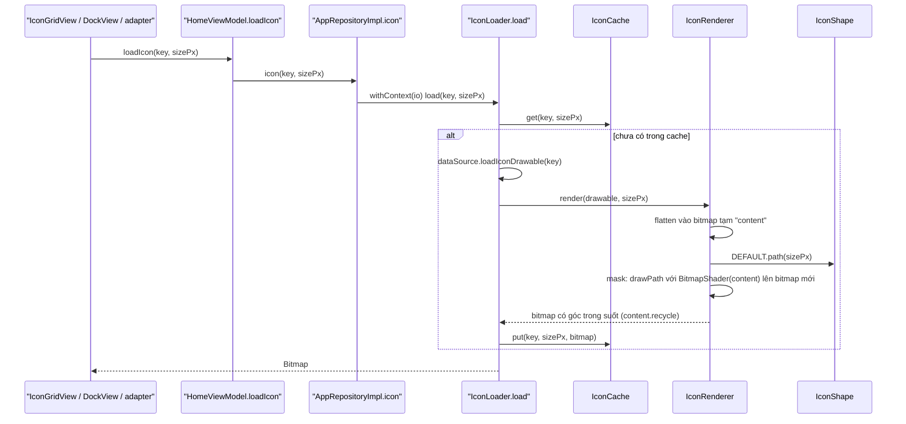
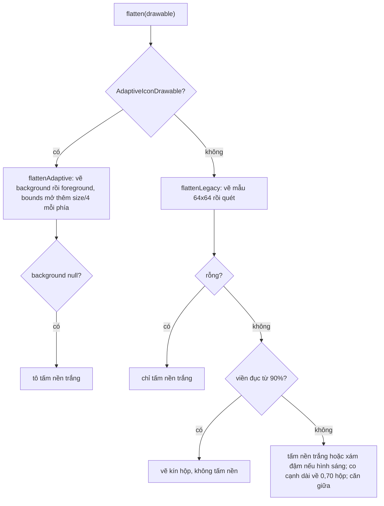

# TL2 — Bo góc icon kiểu iOS: đọc trước khi review

**Plan:** [plans/TL2-icon-shape.md](../plans/TL2-icon-shape.md) · **PR:** #1 · **Nhánh:** `fix/tl2-icon-shape`

## 1. Tóm tắt
Mọi icon app (lưới, dock, thư mục, App Library, tìm kiếm, màn "Ứng dụng đã ẩn") hiện cùng một hình vuông bo góc "liên tục" kiểu iOS, bất kể app đưa vào icon tròn, giọt nước hay PNG trong suốt. Hình được cắt một lần ở nơi nạp icon (`IconLoader` → `IconRenderer`), nên không view nào phải sửa. Không có tùy chọn trong Cài đặt (đó là việc của G2b).

## 2. Kiến thức nền
- **Bo góc liên tục (continuous corner / "squircle"):** bo tròn thường có độ cong nhảy từ 0 (cạnh thẳng) lên 1/R (cung) ngay chỗ nối nên nhìn "cứng"; iOS cho độ cong tăng dần. `IconShape` dựng mỗi góc bằng hai đường Bézier bậc 3 kẹp một cung tròn ngắn (công thức corner smoothing công khai của Figma, tự viết lại theo trí nhớ, không dùng thư viện). `smoothing = 0` cho bo tròn thường. Đã kiểm bằng tính toán: tiếp tuyến liên tục tại chỗ nối, độ cong tăng từ 0 lên 1,47/R rồi nhảy xuống 1,00/R ở cung (liên tục bậc 1, chưa liên tục độ cong; đúng cấu trúc của công thức).
- **Adaptive icon:** icon gồm hai lớp (nền, trước), mỗi lớp rộng 108dp, vùng nhìn thấy là 72dp ở giữa; ROM tự phủ một mặt nạ (tròn, giọt nước...) nên cùng một icon hiện khác nhau giữa các máy. Ta tự vẽ hai lớp rồi cắt bằng hình của mình để hình đồng nhất. [Tài liệu](https://developer.android.com/develop/ui/views/launch/icon_design_adaptive).
- **`BitmapShader` + `drawPath`:** tô path bằng chính ảnh icon. Chỉ vùng trong path được tô, ngoài path giữ trong suốt (alpha 0). Không dùng `drawPath` với `PorterDuff.Mode.DST_IN`: chế độ đó chỉ chạm điểm ảnh nằm dưới path, bốn góc ngoài path vẫn đục.
- **Icon legacy:** PNG/vector không phải adaptive, thường có nền trong suốt. Ta đặt lên tấm nền trắng (xám đậm nếu hình quá sáng) và co cho cạnh dài bằng 70% hộp.

## 3. Luồng hoạt động

`flatten` rẽ nhánh theo loại icon:

Hai giai đoạn `flatten` và `mask` tách riêng để G2b (tô màu, 3D) chèn bước kiểu icon vào giữa (có comment đánh dấu trong `IconRenderer.render`). Cache không đổi: không lên đĩa nên không cần vô hiệu hóa; khi G2b thêm kiểu icon thì gọi `IconCache.clear()` hoặc thêm id kiểu vào khóa.

## 4. Thay đổi theo file
| File | Vai trò | Vì sao thêm/sửa | Đọc trước? |
|---|---|---|---|
| `core/bitmap/IconShape.kt` | Dựng `Path` bo góc liên tục theo `cornerRatio`, `smoothing` | `ui` có thể dùng sau này nên đặt ở `core`, không ở `data` | Có |
| `data/apps/IconRenderer.kt` | `render` = `flatten` + `mask`; nhánh adaptive và legacy; hằng số chỉnh tay | Một chỗ duy nhất tạo hình | Có |
| `data/apps/IconLoader.kt` | Gọi `renderer.render` thay đoạn vẽ trực tiếp | Giữ nguyên cache, kiểm `sizePx`, bắt lỗi | |

Không sửa view, adapter, `GridMetrics`, `IconCache`.

## 5. Quyết định và đánh đổi
Xem "Vì sao chọn thiết kế này" và D1–D7 trong plan. Điểm đáng nhớ:
- Nướng hình vào bitmap ở loader thay vì cắt trong từng view: một đường nạp duy nhất, không đụng vùng file của TL1/GL, G2b cần xử lý ở nguồn.
- Tự vẽ hai lớp adaptive thay vì dựa mặt nạ OEM: hình đồng nhất.
- Bitmap tạm cùng cỡ mỗi lần `render` (tạm thời, thu hồi ngay) đổi lấy góc trong suốt đúng theo cấu trúc.
- Phương án dự phòng D3 (mặt nạ `ALPHA_8` dựng sẵn) không cần dùng: xem số đo ở mục 6.

## 6. Chỗ cần soi khi review
- **Góc trong suốt thật:** đo trên Live 4, `cornerOpaque=0` ở mọi lượt.
- **Hiệu năng (đo trên Live 4, 3 lượt mở nguội):** `render` trung bình icon adaptive 2,95 / 7,53 / 3,42 ms, thấp hơn "vẽ gốc" cũ (5,65 / 10,35 / 4,81 ms) vì không còn mặt nạ OEM; 28 icon đầu 88 / 206 / 102 ms so với 153 / 302 / 131 ms. Một lượt (lượt 2) có icon chậm nhất 43,9 ms, vượt ngưỡng 30 ms, nhưng cả đường cũ cũng tăng vọt trong lượt đó nên là máy chậm lúc ấy, không phải do tính năng.
- Chỉ ~1 trên 20 icon trên Live 4 là legacy: tấm nền, màu và tỉ lệ 0,70 cần nhìn bằng mắt ở bài kiểm cuối.
- `content.recycle()` chạy trên mọi đường (khối `finally`); kết quả không phải `content`.
- Hai lần nạp liên tiếp cùng app ở hai cỡ không ảnh hưởng nhau (bounds nằm trên instance drawable, mỗi lần nạp lấy drawable mới).
- Ô thư mục đóng vẫn vẽ nền bằng `drawRoundRect` 0,225, hơi khác `IconShape`; chủ ý để sau khi GL merge.
- Dấu "−" ở edit mode vẫn đặt ở góc hộp icon; sau khi cắt góc trống nên dấu có thể trông "lơ lửng" (câu Q4 ở bài kiểm cuối).

## 7. Cách kiểm lại
Bài kiểm cả tính năng nằm trong plan (mục "Bài kiểm cả tính năng"), máy Vsmart Live 4: mở Home, thư mục, App Library, tìm kiếm, "Ứng dụng đã ẩn", kéo và nhấn giữ icon, đổi cỡ lưới; so `smoothing` 0 và 0,6 bằng cách sửa `IconShape.SMOOTHING`.

## 8. Bài học cho AGENTS.md
- 2026-11-03 (đọc tài liệu + suy luận, chưa đo): `Canvas.drawPath` với `PorterDuff.Mode.DST_IN` không xóa điểm ảnh ngoài path; muốn cắt hình phải tô path bằng `BitmapShader` lên bitmap trong suốt (hoặc dùng mặt nạ phủ cả hình chữ nhật).
- 2026-11-03 (đo trên Live 4, 3 lượt mở nguội): vẽ hai lớp adaptive + cắt bằng `BitmapShader` rẻ hơn vẽ `AdaptiveIconDrawable` nguyên (trung bình 3,0–7,5 ms so với 4,8–10,4 ms mỗi icon, 180px); bản thân việc cắt khoảng 0,75 ms. Cold start bị nhiễu: một lượt cả đường cũ lẫn mới đều tăng vọt.
- 2026-11-03 (đo trên Live 4): ~95% icon là adaptive, chỉ 1 trong ~20 là `BitmapDrawable`; phần xử lý legacy (tấm nền, co, phát hiện kín viền) ít tác động trên máy này.
- 2026-11-03 (suy luận): công thức "corner smoothing" kiểu Figma liên tục bậc 1 (tiếp tuyến) nhưng độ cong nhảy một nấc tại chỗ nối Bézier–cung; chấp nhận cho icon, chủ dự án đánh giá bằng mắt.
- 2026-11-03 (quy trình): script sửa file bằng Python trên Windows ghi `\r\n` và làm `indexOf("\n\n...")` hụt, dễ chèn nhầm chỗ; chuẩn hóa về LF trước khi sửa hoặc dùng Edit.
- 2026-11-03 (đo trên Live 4, điều phối): lưới với nhãn bị chặn theo CHIỀU CAO, không phải bề rộng ô. `GridMetrics.measure` lấy min(bề rộng ô, chiều cao còn lại cho icon) rồi nhân `ICON_SCALE`, sau đó làm tròn xuống bội 4dp. Ô cao ≈ 82,7dp, trừ 24dp nhãn và khoảng cách còn ≈ 58,7dp: 0.75 → 44,0dp → 44dp; 0.8 → 46,9dp → vẫn 44dp (đo 128px ở density 3,0), tức là đổi 0.75 sang 0.8 không làm icon to lên. 0.9 → 52dp. Sau khi TL1 thêm `topReserve` 26dp, chỗ còn ≈ 54,3dp: 0.8 → 40dp (nhỏ hơn hiện tại), 0.9 → 48dp (≈ +9% so với 44dp). Chọn 0.9. Phép tính "chặn theo bề rộng 80dp × 0.8 = 64dp" ghi lúc đầu là sai (không đo, chỉ suy). Bài học: bước làm tròn 4dp nuốt các thay đổi nhỏ của hệ số; đo icon thật trên máy sau mỗi lần đổi `ICON_SCALE`.
- 2026-11-03 (đo, hai ảnh chụp cạnh nhau): ở bản dựng từ `main`, vào edit mode icon nhỏ đi vì `home_content` bị đẩy xuống 64dp, chiều cao ô giảm và `GridMetrics.measure` tính icon nhỏ hơn (cùng bài học "Demo polish" trong AGENTS.md). Không thuộc TL2; TL1 gỡ bỏ.
