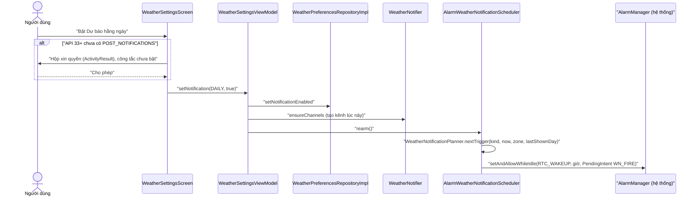
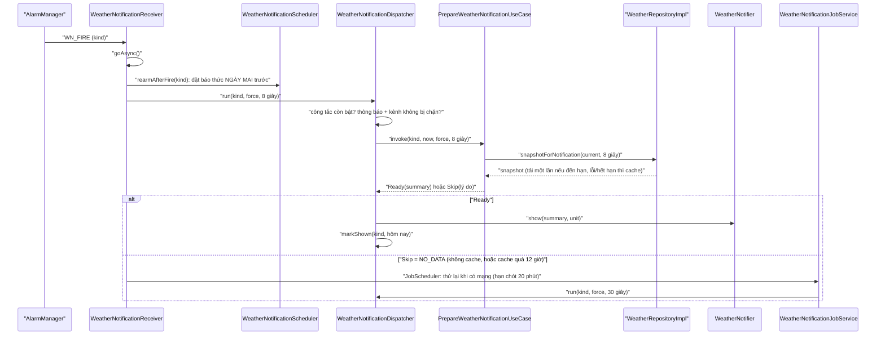
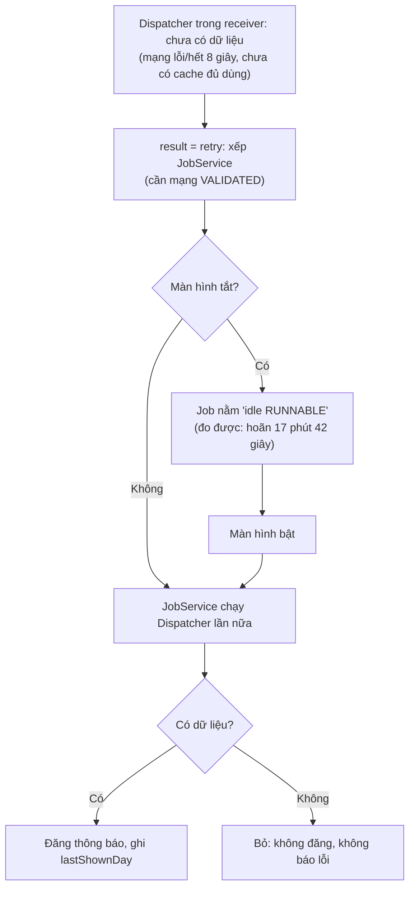
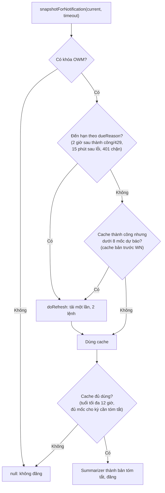

# WN — Thông báo thời tiết: đọc trước khi review

**Plan:** [plans/WN-weather-notifications.md](../plans/WN-weather-notifications.md) · **PR:** #58 · **Nhánh:** `feature/wn-weather-notifications`

Nhãn nguồn: **đo được** (có log/số trên máy), **đọc tài liệu** (tài liệu chính thức Android/AndroidX, đọc 2026-11-13), **đọc code**, **suy luận chưa kiểm chứng**. Mọi số đo ở đây là trên **Vsmart Live 4 (Android 11, API 30), bản debug**, do điều phối chạy ngày 2026-11-13 (bản a9c0ee1 lúc 15:43–16:22 và bản bce6875 lúc 16:39–16:44; dữ liệu của chủ dự án được sao lưu rồi khôi phục). **Chưa kiểm:** Oppo A3x (Android 14, ColorOS) và mọi thứ ghi ở mục 7; **khởi động lại máy chưa chạy** (cần chủ dự án đồng ý).

## 1. Tóm tắt

Ở **Cài đặt → Thời tiết → nhóm "Thông báo"** có hai công tắc: **Dự báo hằng ngày (07:00)** và **Dự báo ngày mai (21:00)**. Khi bật, app đặt báo thức hệ thống; đến giờ nó lấy thời tiết của **"Vị trí hiện tại" như đang lưu** (không bao giờ xin vị trí), dùng cache nếu chưa quá 2 giờ, quá hạn thì tải một lần, rồi đăng một thông báo im lặng: `Hà Nội · Hôm nay` / `Ít mây, cao 23°C, thấp 21°C` (°F nếu đã chọn °F). Chạm thông báo mở Home. Báo thức **không chính xác**: có thể trễ tới khoảng 1 giờ trên Android 12+ (chủ dự án chấp nhận). Không có cảnh báo thời tiết xấu (One Call 3.0 là gói riêng).

## 2. Kiến thức nền

- **`AlarmManager` báo thức không chính xác (đọc tài liệu):** `setAndAllowWhileIdle(RTC_WAKEUP, giờ, PendingIntent)` không bao giờ nổ trước giờ đặt; từ Android 12 hệ thống nổ trong vòng 1 giờ sau giờ đó, trừ khi có hạn chế pin; nổ được cả khi máy đang **Doze** (chế độ ngủ sâu tiết kiệm pin: mạng và báo thức thường bị hoãn tới "cửa sổ bảo trì"). Báo thức **chính xác** cần quyền đặc biệt "Báo thức & lời nhắc" mà app cài mới target ≥ 13 không có sẵn, nên không dùng (D1; hằng `WeatherNotificationConfig.USE_EXACT_ALARMS` = false để đổi sau).
- **Báo thức mất khi nào (đọc tài liệu, F5):** tắt máy thì mất hết (phải đặt lại từ `BOOT_COMPLETED`). **Dừng ép buộc** thì mất (đo được ở mục 6). Vì vậy lịch được đặt lại ở nhiều chỗ, và mỗi lần chỉ có **một** báo thức mỗi loại, nối nhau: khi nổ, đặt cái của ngày mai **trước**, rồi mới làm việc.
- **`BroadcastReceiver` và `goAsync()` (đọc tài liệu, F7):** `onReceive` chạy trên luồng chính và phải xong nhanh; `goAsync()` cho phép làm tiếp ở luồng khác nhưng hệ thống vẫn mong xong dưới 10 giây. Tiến trình chỉ chứa receiver có thể bị giết ngay sau đó. Vì thế phần chờ dữ liệu có hạn chót 8 giây.
- **`JobScheduler` (đọc tài liệu):** hệ thống tự chọn lúc chạy theo ràng buộc (mạng, pin, màn hình). **Đo được:** với màn hình tắt, một job "cần mạng" chỉ chạy lúc người dùng bật màn hình (xem mục 6). Nên dự án dùng job làm **đường lùi** chứ không làm đường chính.
- **Quyền `POST_NOTIFICATIONS` (đọc tài liệu, F8):** từ Android 13 là quyền chạy, app cài mới có thông báo **tắt** mặc định; app target ≥ 13 tự quyết lúc hỏi (ở đây: khi người dùng bật công tắc). Android 12 trở xuống (Live 4) không có hộp hỏi, chỉ có "người dùng có tắt thông báo của app không" (`areNotificationsEnabled()`).
- **Kênh thông báo (notification channel):** từ Android 8 mỗi thông báo thuộc một kênh; mức quan trọng của kênh **không đổi được bằng code** sau khi tạo (chỉ người dùng đổi). Hai kênh `weather_daily`, `weather_tomorrow`, mức `IMPORTANCE_LOW` (im lặng).
- **Hilt trong receiver:** Kotlin báo `Abstract member cannot be accessed directly` khi gọi `super.onReceive` của receiver `@AndroidEntryPoint` (**đo được** lúc build). Dự án lấy phụ thuộc bằng `@EntryPoint` + `EntryPointAccessors.fromApplication` (hai receiver; `JobService` vẫn `@AndroidEntryPoint` được).
- **Quy tắc 2 giờ của WX (đọc code):** `WeatherRepositoryImpl.dueReason` chỉ nhìn `lastAttemptAt` và kết quả lần thử gần nhất của mục cache của từng địa điểm; thông báo dùng đúng hàm đó (không đường vòng).

## 3. Luồng hoạt động

### 3.1 Bật công tắc và đặt báo thức

Chỗ dễ sai: công tắc **chỉ đổi theo dữ liệu thật** (khi chưa có quyền thì `rerender(true)` đưa nó về tắt, không "bật giả"); `PendingIntent` giống nhau theo (gói, request code theo loại) nên đặt lại là **thay**, không nhân đôi.

### 3.2 Báo thức nổ và đăng thông báo (đường chính, bản bce6875)

Chỗ dễ sai: (1) **thứ tự** — báo thức kế được đặt trước mọi thứ, nên job hỏng cũng không làm đứt chuỗi; dùng `rearm()` ở đây sẽ sai vì trong thời gian ân hạn nó trả "ngay" và báo thức nổ lặp (`rearmAfterFire` ép mục tiêu ngày mai). (2) Việc **tải** chạy ở `ApplicationScope` chứ không phải con của người gọi: HTTP chặn luồng nên `withTimeout` trực tiếp không ngắt được; người gọi chỉ **chờ** tối đa 8 giây, hết hạn thì dùng cache, việc tải vẫn chạy tiếp. (3) Job **chỉ** là đường lùi: đo được nó bị hoãn tới lúc bật màn hình.

### 3.2b Đường lùi: job thử lại

Vì job có thể bị hoãn lâu nên nó **không** là đường chính (D2 phương án c); khung giờ và ân hạn 3 giờ chặn đăng quá muộn.

### 3.3 Dữ liệu: khi nào gọi mạng

Điểm khác biệt duy nhất so với widget là **ngoại lệ một lần** ở nhánh E: cache từ bản trước WN không có danh sách mốc `forecast` (khóa `f`), nên thông báo được tải một lần dù chưa đến 2 giờ (tốn 2 lệnh, **đo được** đúng một lần tải trên cache thật của chủ dự án). Sau đó có 12 mốc nên không lặp. Lỗi/429 vẫn theo quy tắc thường.

### 3.4 Quy tắc tóm tắt (của APP, không phải của OWM)

`WeatherForecastSummarizer` (hàm thuần, ví dụ trong KDoc): ngày theo múi giờ **của địa điểm**; "hôm nay" = mốc cùng ngày chưa kết thúc (cần ≥ 2 mốc), "ngày mai" = mốc của ngày kế (cần ≥ 4 mốc), thiếu thì không đăng; cao/thấp = max/min của °C thô (làm tròn một lần lúc hiển thị, WU1); tình trạng = nặng nhất trong các mốc 06:00–21:59 (giông > tuyết > mưa > sương mù > nhiều mây > ít mây > quang); khoảng mưa = từ đầu mốc mưa/giông/tuyết đầu tới cuối mốc cuối. **Đo được:** "Hôm nay" cho `Ít mây, cao 23°C, thấp 21°C`, "Ngày mai" cho `Nhiều mây, cao 28°C, thấp 19°C` (Hà Nội), khác cao/thấp "24 giờ tới" của widget vì dùng ngày dương lịch.

### 3.5 Khi nào đặt lại lịch

`rearm()` được gọi khi: bật/tắt công tắc; `BOOT_COMPLETED`; `MY_PACKAGE_REPLACED`; `TIME_SET`; `TIMEZONE_CHANGED` (kèm `TimeZone.setDefault(null)` cho chắc); và một lần mỗi khi tiến trình tạo (`LauncherApp`, ở nền, qua `dagger.Lazy`, không chặn khởi động). `WeatherNotificationPlanner.nextTrigger`: đã đăng hôm nay → mục tiêu ngày mai; chưa tới mục tiêu → mục tiêu hôm nay; quá mục tiêu nhưng trong **ân hạn 3 giờ** và chưa đăng → "ngay" (bù thông báo bị lỡ vì máy tắt/ngủ); còn lại → ngày mai.

## 4. Thay đổi theo file

Đường dẫn từ `app/src/main/java/gambi/global/os26launcher/` (trừ ghi chú). **Không** sửa file độc quyền nào (không `HomeActivity`, `data/layout/*`, `core/glass/*`, lớp widget); không đổi Room; không thư viện mới.

| File | Vai trò | Vì sao thêm/sửa | Đọc trước? |
|---|---|---|---|
| `ui/weather/notify/WeatherNotificationReceiver.kt`, `WeatherNotificationDispatcher.kt` | Điểm vào của báo thức và các sự kiện hệ thống; lượt "kiểm tra, lấy dữ liệu, đăng" | Đường chính (D2c) | **Có** |
| `data/weather/WeatherRepositoryImpl.kt` (`snapshotForNotification`, `needsForecastOnce`) | Dữ liệu cho thông báo, cùng quy tắc 2 giờ, không lấy vị trí | D3 | **Có** |
| `domain/weather/WeatherNotificationPlanner.kt`, `WeatherForecastSummarizer.kt`, `domain/model/weather/WeatherNotification.kt` | Giờ nổ tiếp theo, tóm tắt, hằng chính sách (`WeatherNotificationConfig`) | Hàm thuần, soi kỹ ngưỡng | **Có** |
| `data/weather/notify/AlarmWeatherNotificationScheduler.kt`, `domain/weather/WeatherNotificationScheduler.kt` | Đặt/hủy báo thức, hằng intent | D1, D7 | Sau |
| `ui/weather/notify/WeatherNotifier.kt`, `WeatherNotificationJobService.kt`, `res/drawable/ic_stat_weather.xml` | Kênh, nội dung, chạm mở Home; job thử lại | D5, D6 | Sau |
| `domain/usecase/PrepareWeatherNotificationUseCase.kt` | Khung giờ đăng, ngày đã đăng, khóa, địa điểm, tuổi cache | D3, D6 | Sau |
| `data/weather/OwmParser.kt`, `WeatherStore.kt`, `domain/model/weather/WeatherModels.kt`, `domain/weather/WeatherRepository.kt` | `cnt` 9 → 12, `WeatherSnapshot.forecast`, khóa `f` tùy chọn, hợp đồng repository | D4 | Sau |
| `data/weather/WeatherPrefsKeys.kt`, `WeatherPreferencesRepositoryImpl.kt`, `domain/weather/WeatherPreferencesRepository.kt` | Hai công tắc và ngày đã đăng (khóa riêng, không `SettingsKeys`) | Chung | |
| `ui/settings/WeatherSettingsScreen.kt`, `WeatherSettingsViewModel.kt`, `SettingsRow.kt` (hằng id, chỉ thêm) | Nhóm "Thông báo", luồng xin quyền, chú thích | Task 5 | |
| `LauncherApp.kt` (một khối riêng), `di/WeatherModule.kt` (một `@Binds`), `AndroidManifest.xml` (2 quyền, receiver, service), `res/values/strings.xml` (khối `wn_` ở cuối) | Nối, khai báo | Chỉ thêm | |
| `app/src/debug/*` (`WeatherNotificationDebugReceiver`, manifest debug) | **Chỉ bản debug**: `WN_DEBUG_FIRE`, `SHIFT`, `ENABLE`, `STATE`; bảo vệ bằng `android:permission=DUMP` như CP | Để đo mà không đợi 07:00/21:00 | Không (không vào release) |

## 5. Quyết định và đánh đổi

Chi tiết và bảng so sánh ở plan (D1–D7, N1–N15); tóm tắt:
- **D1 báo thức không chính xác nối nhau.** Bỏ: báo thức chính xác (quyền đặc biệt, chính sách Play), WorkManager 2.12.0 (thêm dependency + initializer khởi động, `initialDelay` tương đối nên vẫn phải tự xử lý đổi giờ/múi giờ), WorkManager chu kỳ (không có "07:00"). Đánh đổi: trễ tới ~1 giờ trên Android 12+; phụ thuộc ROM (chưa đo Oppo). Nếu Oppo đo xấu thì chuyển sang WorkManager, phần `Dispatcher`/`Notifier` giữ nguyên.
- **D2 lai: đăng ngay trong `goAsync`, job là đường lùi** (sửa sau đo, N15). Bản đầu dùng job làm đường chính; **đo được** (Run 1, bản a9c0ee1, SHIFT +3 phút, màn hình tắt) báo thức nổ đúng lúc nhưng job chỉ chạy khi bật màn hình, trễ 17 phút 42 giây (`dumpsys jobscheduler`: "idle RUNNABLE", mạng VALIDATED); vì vậy chọn phương án (c) lai. Cùng lượt đo lộ **khoảng hở nâng cấp**: cache v1 chưa có dự báo cho `skipped:nodata`, sửa bằng `needsForecastOnce` (N15).
- **D3 hàm `snapshotForNotification` riêng** thay vì `refreshIfStale`: cái sau kích hoạt `CurrentLocationUpdater` (vi phạm "không vị trí nền") và không chờ được kết quả.
- **D4 mở rộng snapshot** (cùng một lệnh `forecast`) thay vì thêm lệnh API.
- **D5 quyền xin khi bật công tắc; hai kênh LOW tạo lười.** **D6 chạm mở Home** (mở bảng Thời tiết cần sửa `HomeActivity`, độc quyền G3c đợt này).
- **Ngân sách (suy luận từ chính sách, đo được một phần):** mỗi thông báo tối đa 1 lần làm mới = 2 lệnh; 2 thông báo/ngày = **+4 lệnh/ngày**; tổng tối đa 72 + 4 = 76 so với giới hạn gói Free 60 lệnh/phút và 1.000.000/tháng. Lần tải của thông báo cũng ghi `lastAttemptAt` nên widget không tải lại trong 2 giờ kế (**đo được**: TOMORROW bắn ngay sau DAILY không tải thêm, `attempt` giữ nguyên). Ngoại lệ một lần sau khi cập nhật app: +2 lệnh.
- **Đánh đổi chấp nhận:** thông báo có thể trễ; ngoại tuyến + không cache thì **không** đăng (không thông báo lỗi); chưa có tên địa điểm thì không đăng; bản công khai trên màn hình khóa không có tên địa điểm (riêng tư).

## 6. Hành vi Android đã kiểm

| Điều | Nguồn | Nhãn | Kết quả |
|---|---|---|---|
| F1 báo thức không chính xác trễ tới 1 giờ (Android 12+) | tài liệu alarms | đọc tài liệu | **Chưa đo trên Oppo (API 34)**; Live 4 là API 30 (chưa áp quy tắc này) |
| Độ trễ báo thức thật, màn hình tắt, Live 4 | `WN_DEBUG_SHIFT` +3 phút | **đo được** | đặt 15:55:05, `recv:WN_FIRE:DAILY` 15:58:19 (+3 phút 14 giây) |
| F3 `setAndAllowWhileIdle` nổ trong Doze sâu | tài liệu + đo | **đo được (Live 4)** | SHIFT TOMORROW +3 phút lúc 16:40:10, màn hình tắt, `dumpsys battery unplug`, `deviceidle force-idle` (deep IDLE): `recv:WN_FIRE:TOMORROW` 16:43:13.580, `result:TOMORROW:skipped` 16:43:13.617 (37 ms sau; `skipped` đúng vì đường sản xuất ngoài khung 21:00–24:00). **Đăng trong Doze (cần mạng) chưa kiểm** |
| Job `JobScheduler` khi màn hình tắt | bản a9c0ee1 | **đo được** | báo thức nổ đúng, job chỉ chạy 16:16:01, đúng lúc bật màn hình (trễ 17 phút 42 giây); `dumpsys jobscheduler`: "idle … RUNNABLE", chờ mạng VALIDATED → chuyển job thành đường lùi |
| Broadcast tường minh (`-p`) tới app đã `force-stop` | đo | **đo được** | Không được giao cho tới khi app chạy lại; script đo phải mở app trước, nếu không dễ tưởng receiver hỏng |
| F5 báo thức mất khi dừng ép buộc, trở lại khi mở app | tài liệu + đo | **đo được** | `force-stop` → 0 báo thức; mở app → 2 (do `rearm()` lúc tiến trình tạo) |
| F6 cài đè (`adb install -r`) | suy luận → đo | **đo được** | không mở app: còn 2 báo thức và log `recv:MY_PACKAGE_REPLACED` |
| Số báo thức theo công tắc | đo | **đo được** | trước khi bật: 0; mỗi loại bật: một (DAILY kế tiếp 2026-11-14 07:00, TOMORROW 2026-11-13 21:00); tắt: 0 |
| Đăng thông báo, kênh | đo | **đo được** | kênh `weather_daily`/`weather_tomorrow` `importance=2` (LOW); DAILY với cache quá 2 giờ 5 phút: tải đúng một lần, đăng "Hà Nội · Hôm nay"; TOMORROW ngay sau: không tải thêm |
| Cache nâng cấp (khóa `f`) | đo | **đo được** | `weather.json` v2: `"e":` = 16 (4 mốc `h` + 12 mốc `f`); cache thật của chủ dự án (không có `f`, còn mới): FIRE tải đúng một lần rồi đăng ngay từ receiver |
| Múi giờ | đo | **chưa kết luận** | `settings put global auto_time_zone 0` + `service call alarm 3 s16 Asia/Tokyo` đổi `persist.sys.timezone` nhưng **không** có `recv:TIMEZONE_CHANGED` (đường lệnh này có thể không phát broadcast). `WN_DEBUG_STATE` giờ in `zone`, `jvmDefault`, `nowLocal`. Thử lại bằng giao diện Cài đặt |
| F7 `goAsync` dưới 10 giây | tài liệu | đọc tài liệu | Hạn chót chờ dữ liệu 8 giây; chưa có ca mạng chậm thật |
| F8 `POST_NOTIFICATIONS` Android 13+ (hộp xin, từ chối, "không hỏi lại") | tài liệu | đọc tài liệu | **Chưa đo** (cần Oppo A3x); Live 4 (API 30) không có hộp xin |
| F10 ColorOS giết nền/chặn tự khởi động | dontkillmyapp.com | đọc tài liệu bên thứ ba, độ tin thấp | Trang không nhắc báo thức, chỉ có Oppo F1S ColorOS 6; **phải đo trên Oppo A3x** |
| `exported=false` vẫn nhận `BOOT_COMPLETED`/`TIME_SET`/`TIMEZONE_CHANGED` | tài liệu không nói rõ | suy luận chưa kiểm chứng | `MY_PACKAGE_REPLACED` đã nhận được (đo); các cái còn lại chưa |

## 7. Chỗ cần soi khi review

1. `snapshotForNotification`: không gọi `locationUpdater` (có chú thích tại chỗ); dùng chung `dueReason`/`doRefresh`/`mutex`; ngoại lệ `needsForecastOnce` chỉ cho cache thành công và không lặp; việc tải ở `scope.async`, người gọi chỉ `await` có hạn chót.
2. Thứ tự receiver: `rearmAfterFire` **trước** `Dispatcher.run`; `rearm()` thường **không** được dùng ở nhánh nổ (sẽ lặp trong ân hạn).
3. `lastShownDay` theo loại, `dayKey` và `today.toString()` cùng định dạng ISO `yyyy-MM-dd` (đã đối chiếu); `force` (chỉ debug) không ghi "đã đăng".
4. Kiểm `areNotificationsEnabled()` + kênh **trước khi tải**: bị chặn thì `attempt` không đổi.
5. Cache cũ không có `f` đọc được (`optJSONArray`); widget không đổi (`hourly` 4 mốc, cao/thấp 8 mốc, vẫn `FORECAST_COUNT` chỉ ảnh hưởng số mốc xin về).
6. Log: chỉ tên hành động, mã loại, kết quả (`shown|off|blocked|skipped|retry`), tên lớp ngoại lệ; **không** tên địa điểm, tọa độ, nội dung, khóa (đã `grep` toàn bộ `Log.` ở `ui/weather/notify`, `data/weather/notify`, debug receiver).
7. Debug receiver chỉ ở `src/debug` (không vào release), `android:permission=DUMP`.
8. **Chỉ được code bảo vệ, chưa kiểm tay (cần Oppo/chủ dự án):** luồng xin quyền Android 13+ (cho phép/từ chối/"không hỏi lại"/thu hồi khi đang bật); độ trễ và Doze/cài đè/vuốt khỏi đa nhiệm trên ColorOS; đăng trong Doze (cần mạng); ca ngoại tuyến + không cache (→ `retry` rồi job); đổi múi giờ/giờ qua giao diện; **khởi động lại máy** (`BOOT_COMPLETED`, và "Tự khởi động" của ColorOS); màn hình khóa riêng tư; build không khóa (chú thích, không công tắc).

## 8. Cách kiểm lại

Kịch bản gộp đầy đủ (lệnh, thứ tự: không cần quyền/không khởi động lại trước, bước cần chủ dự án đồng ý ở cuối) nằm ở plan, mục "Kịch bản gộp Task 2-5". Tóm tắt: Live 4 (xác nhận máy rảnh, sao lưu dữ liệu): bật công tắc, `dumpsys alarm` đúng số báo thức; `WN_DEBUG_FIRE` DAILY/TOMORROW xem nội dung, °F, cache so với tải; `WN_DEBUG_SHIFT` +3 phút với màn hình tắt (kỳ vọng `recv` và `result:…:shown` sát nhau, không có dòng `(job)`); Doze `force-idle` rồi **`unforce` và `battery reset`**; `adb install -r`; `force-stop`. Oppo A3x: hộp xin quyền và các ca ColorOS. Cuối cùng (chủ dự án đồng ý): đổi múi giờ qua Cài đặt, khởi động lại máy không mở app.

## 9. Bài học cho AGENTS.md

- (2026-11-13, **đo được**, Live 4) **Job `JobScheduler` cần mạng khi màn hình tắt có thể bị hoãn tới lúc bật màn hình** (17 phút 42 giây, `dumpsys jobscheduler` hiện "idle … RUNNABLE"): việc cần xong ngay lúc báo thức nổ phải làm trong receiver (`goAsync`, vài giây), job chỉ là đường lùi. Chủ đề: `permissions-and-device-testing`.
- (2026-11-13, **đo được**) `setAndAllowWhileIdle` nổ đúng giờ (+3 phút 14 giây) và nổ cả khi `deviceidle force-idle` (Doze sâu), receiver chạy ngay (37 ms tới lúc ghi kết quả). Chủ đề: `permissions-and-device-testing`.
- (2026-11-13, **đo được**) Receiver `@AndroidEntryPoint` bằng Kotlin không gọi được `super.onReceive` (`Abstract member cannot be accessed directly`): dùng `@EntryPoint` + `EntryPointAccessors.fromApplication`; tên hàm trong các `@EntryPoint` cùng `SingletonComponent` phải khác nhau (trùng tên khác kiểu trả về là lỗi biên dịch Hilt `Found conflicting entry point declarations`). Chủ đề: `settings-and-data` hoặc AGENTS.md mục môi trường.
- (2026-11-13, **đo được**) Báo thức mất khi `force-stop` và tự có lại khi tiến trình tạo (`rearm()` ở `LauncherApp`); `adb install -r` giữ báo thức và gửi `MY_PACKAGE_REPLACED`. Chủ đề: `permissions-and-device-testing`.
- (2026-11-13, **đo được**) Chuỗi báo thức tự nối: đặt báo thức kế tiếp **trước** khi làm việc, và ở nhánh "vừa nổ" dùng hàm riêng (không dùng hàm đặt lại chung vì ân hạn trả "ngay" làm báo thức nổ lặp). Chủ đề: `settings-and-data`.
- (2026-11-13, **đo được**) Chờ I/O chặn luồng với hạn chót: `withTimeout` không ngắt được lời gọi HTTP chặn; chạy việc ở scope khác và `await` có hạn chót, việc vẫn tiếp tục sau hạn. Chủ đề: `widgets` (mục thời tiết).
- (2026-11-13, **đo được**) Cache định dạng cũ thiếu trường mới (khóa `f`) làm tính năng mới bỏ qua âm thầm: kiểm "dữ liệu đủ dùng cho tính năng này" chứ không chỉ "dữ liệu còn mới". Chủ đề: `widgets`.
- (2026-11-13, **chưa kết luận**) `service call alarm 3 s16 <múi giờ>` đổi `persist.sys.timezone` nhưng không thấy `TIMEZONE_CHANGED` tới app: thử đổi múi giờ bằng giao diện Cài đặt. Chủ đề: `permissions-and-device-testing`.
- (2026-11-13, đọc tài liệu) Android 13+: app cài mới có thông báo tắt, tự quyết lúc xin quyền; kiểm `areNotificationsEnabled()` trước khi tải dữ liệu cho thông báo; kênh tạo lười, mức quan trọng không đổi được bằng code. Chủ đề: `permissions-and-device-testing`.
- (2026-11-13, đọc tài liệu bên thứ ba) dontkillmyapp.com không có dữ liệu báo thức trên Oppo A3x (chỉ F1S/ColorOS 6): đừng suy ra hành vi ColorOS hiện tại từ đó. Chủ đề: `permissions-and-device-testing`.
- (2026-11-13, **đo được**) Sau `am force-stop`, broadcast tường minh (`-p`) không tới app cho đến khi app chạy lại: script kiểm phải mở app trước khi gửi broadcast debug. Chủ đề: `permissions-and-device-testing`.
