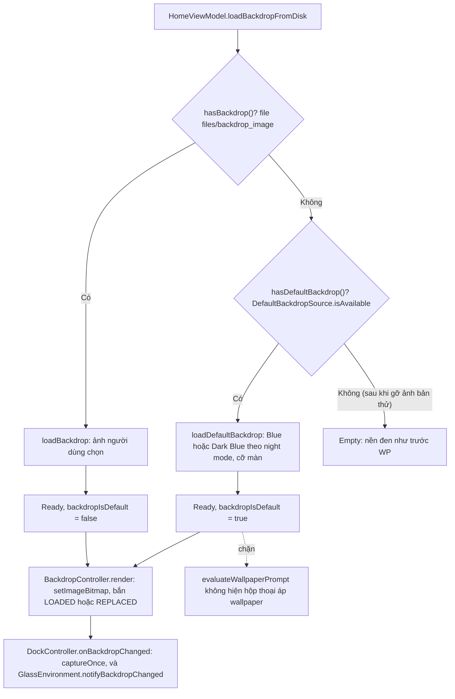
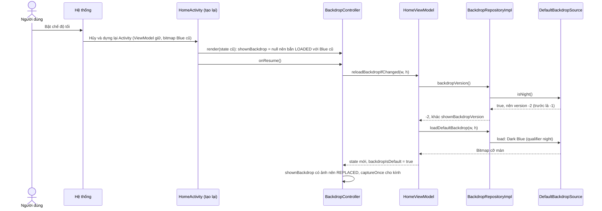
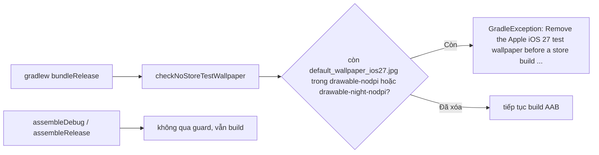

# WP — Ảnh nền mặc định iOS 27 (bản thử): đọc trước khi review

**Plan:** [plans/WP-default-wallpaper.md](../plans/WP-default-wallpaper.md) · **PR:** #24 · **Nhánh:** `feature/wp-default-wallpaper`

## 1. Tóm tắt
Khi người dùng chưa chọn ảnh nền (không có `files/backdrop_image`), Home hiện ảnh iOS 27: "Blue" khi hệ thống sáng, "Dark Blue" khi tối. Có trong cả APK debug lẫn release để tech lead thử. Ảnh của Apple, không có giấy phép, **phải xóa trước bản cửa hàng**; task Gradle `checkNoStoreTestWallpaper` làm `bundleRelease` (AAB cửa hàng) thất bại cho tới khi xóa. Cài đặt "Ảnh nền" ghi "Mặc định (iOS 27, bản thử)" ở trạng thái đó.

## 2. Kiến thức nền
- **Qualifier tài nguyên `night`:** hai file cùng tên `default_wallpaper_ios27.jpg` nằm ở `drawable-nodpi/` và `drawable-night-nodpi/`; Android tự chọn bản đúng với chế độ sáng/tối hiện tại khi gọi `R.drawable.default_wallpaper_ios27`. `nodpi` bảo hệ thống đừng co giãn ảnh theo mật độ điểm ảnh khi giải mã. (đọc tài liệu Android)
- **`inSampleSize`:** tùy chọn của `BitmapFactory` giải mã ảnh nhỏ đi 2, 4, 8... lần ngay từ đầu, tiết kiệm bộ nhớ. Chỉ nhận lũy thừa của 2 nên thường còn dư, phải thu nốt bằng `createScaledBitmap`.
- **Activity tạo lại khi đổi sáng/tối:** `HomeActivity` không khai `uiMode` trong `configChanges`, nên đổi chế độ tối làm Activity bị hủy và dựng lại, còn `HomeViewModel` được giữ nguyên (cùng bitmap cũ). (đọc code manifest)
- **Task Gradle và configuration cache:** Gradle lưu đồ thị task lần đầu rồi dùng lại; task an toàn với cache khi mọi đầu vào được khai báo (`@InputFiles`) và không đọc `Project` lúc chạy. (đọc tài liệu Gradle)

## 3. Luồng hoạt động

Quyết định ảnh nền của Home (nhánh WP là nhánh giữa):

Đổi sáng/tối khi Home đang mở (chỗ dễ sai nhất):

Giải thích: ngay sau khi tạo lại, Home vẽ một nhịp Blue cũ rồi mới thay Dark Blue (chủ dự án đã chấp nhận). Việc nạp lại **không** cần sửa `HomeActivity`: `backdropVersion()` trả -1 (sáng) / -2 (tối) khi chưa chọn ảnh, và `reloadBackdropIfChanged` ở `onResume` vốn đã so version. Ảnh người dùng chọn có version = `lastModified` (số dương) nên không bao giờ trùng -1/-2.

Store guard:

## 4. Thay đổi theo file

| File | Vai trò | Vì sao thêm/sửa | Đọc trước? |
|---|---|---|---|
| `data/backdrop/DefaultBackdropSource.kt` | Nạp ảnh mặc định ở cỡ màn, biết sáng/tối, chứa cảnh báo bản quyền | Mới | **Có** |
| `data/backdrop/BackdropRepositoryImpl.kt`, `domain/repository/BackdropRepository.kt` | `hasDefaultBackdrop`, `loadDefaultBackdrop`, `backdropVersion()` trả -1/-2 | Cầu nối ra ViewModel | **Có** |
| `ui/home/HomeViewModel.kt`, `HomeUiState.kt` | Nhánh dự phòng, `backdropIsDefault`, chặn prompt | Nóng, sửa tối thiểu (G3e cũng đụng) | **Có** |
| `ui/settings/*` + `strings.xml` | Nhãn "Mặc định (iOS 27, bản thử)" | Hiển thị trạng thái | Không |
| `app/build.gradle.kts` (cuối file) | `CheckNoStoreTestWallpaper` + `checkNoStoreTestWallpaper` nối vào `bundleRelease` | Store guard | Có |
| `res/drawable-nodpi/`, `res/drawable-night-nodpi/` `default_wallpaper_ios27.jpg` | Hai ảnh JPG gốc (990.051 B và 1.095.508 B) | Nội dung thử | Không |

## 5. Quyết định và đánh đổi
- Ảnh ở `main` (không phải `src/debug`) vì tech lead thử APK release; thay cho ràng buộc "release không chứa ảnh" là guard chặn AAB (D1, D10 trong plan).
- Bắt đổi sáng/tối bằng dấu phiên bản âm thay vì sửa `HomeActivity` và chữ ký hàm (ít đụng file nóng); đổi lại là một quy ước ngầm, đã ghi ở KDoc của `backdropVersion()`.
- Guard chỉ chặn `bundleRelease`. APK release build bằng `assembleRelease` luôn chứa ảnh (đã đo, xem mục Số đo); chỉ AAB cửa hàng được bảo vệ.
- Không tách debug/release, một lớp duy nhất (D4).

## 6. Chỗ cần soi khi review
- `R.drawable.default_wallpaper_ios27` chỉ có trong `DefaultBackdropSource.kt` (grep): nếu nơi khác dùng, việc xóa ảnh sẽ vỡ nhiều chỗ.
- `loadBackdropFromDisk`: ảnh người dùng vẫn thắng; chỉ rẽ sang mặc định khi `hasBackdrop()` sai.
- `evaluateWallpaperPrompt` đã chặn `backdropIsDefault`; nếu thiếu, hộp thoại áp wallpaper sẽ hiện cho ảnh mặc định rồi `applyAsWallpaper` thất bại.
- `isNight()` đọc cấu hình của **application context**; app dùng theme DayNight theo hệ thống và không gọi `setDefaultNightMode`, nên khớp với Activity. Nếu sau này có công tắc sáng/tối riêng của app, chỗ này phải đổi (suy luận chưa kiểm chứng).
- Chưa kiểm tay trên máy: nháy ảnh cũ khi đổi sáng/tối, kính chụp lại (DG), bộ nhớ.

## 7. Cách kiểm lại
Xem "Bài kiểm cả tính năng" trong plan (mục a-h). Lệnh guard (CMD/PowerShell): `.\gradlew.bat bundleRelease` phải thất bại với thông báo "Remove the Apple iOS 27 test wallpaper ..."; `.\gradlew.bat assembleRelease` phải xanh. Liệt kê tài nguyên APK: `aapt2 dump resources <apk> | findstr default_wallpaper_ios27`.

## 8. Bài học cho AGENTS.md
- **Ảnh có bản quyền chỉ để thử thì kèm "store guard" Gradle, đừng dựa vào ghi chú** (2026-11-09, đo được): task có `@InputFiles` là hai file ảnh, nối bằng `tasks.matching { it.name == "bundleRelease" }.configureEach { dependsOn(...) }`; `bundleRelease` thất bại, `assembleRelease` vẫn xanh, cache cấu hình dùng lại được (lần chạy thứ hai "Reusing configuration cache" và vẫn thất bại đúng).
- **Tài nguyên theo `night` + dấu phiên bản âm cho nguồn mặc định:** tái dùng cơ chế "so version ở onResume" của M8a Task 5 thay vì thêm tham số (2026-11-09, đọc code).
- **Với `release` bật tài nguyên rút gọn đường dẫn:** `aapt2 dump resources` vẫn thấy tên tài nguyên nhưng file trong zip đổi tên (`res/aJ.jpg`); kiểm bằng kích thước byte (đo được 2026-11-09).
- **Công cụ Bash trong phiên agent trên máy này bị lỗi parse với heredoc dài có ký tự nháy; dùng Write cho file, script Python bằng file** (2026-11-09, đo được).

## 9. Số đo (cho điều phối)
Đo 2026-11-09, build trên máy phát triển Windows, **chưa cài lên máy nào**.

| Mục | Giá trị |
|---|---|
| JPG Blue | 990.051 B (0,94 MiB), 1320x2868, SHA-256 `4cac0ea0...0d142` |
| JPG Dark Blue | 1.095.508 B (1,04 MiB), 1320x2868, SHA-256 `8b95d7af...df10` |
| APK debug | 12.128.798 B (`app/build/outputs/apk/debug/app-debug.apk`) |
| APK release unsigned | 10.046.616 B (`app/build/outputs/apk/release/app-release-unsigned.apk`) |
| Tài nguyên trong debug | `res/drawable-nodpi-v4/default_wallpaper_ios27.jpg` 990.051 B; `res/drawable-night-nodpi-v8/default_wallpaper_ios27.jpg` 1.095.508 B |
| Tài nguyên trong release | `res/ac.jpg` 990.051 B; `res/aJ.jpg` 1.095.508 B (có mặt, tên rút gọn) |
| `bundleRelease` khi ảnh còn | THẤT BẠI ở `:app:checkNoStoreTestWallpaper` (cả lần đầu lẫn khi dùng lại cache cấu hình), không sinh AAB |
| `checkNoStoreTestWallpaper` khi ảnh bị dời đi tạm | xanh |
| `assembleDebug lintDebug assembleRelease` | xanh |
| Bitmap mặc định ước tính trên Oppo 720x1604 | ≈738x1604 ≈ 4,7 MB (suy luận chưa kiểm chứng, cần `dumpsys meminfo`) |

Mục cần điều phối đo trên máy: nháy ảnh cũ khi đổi sáng/tối, kính chụp lại (sai khác trung bình 0), `dumpsys meminfo` ở trạng thái mặc định, và hồi quy hộp thoại wallpaper với ảnh người dùng chọn.

**Kết quả điều phối (Oppo A3x, 2026-11-09 17:15, APK debug `2e96ebf`):** xóa `files/backdrop_image` → Home hiện ảnh Blue ở chế độ sáng; `cmd uimode night yes` → Home hiện Dark Blue; kính ô thư mục, pill, dock lấy theo ảnh mới; crash buffer rỗng; `dumpsys meminfo` Graphics 25 MB, Native Heap 25 MB (toàn app). Chưa đo: Live 4, chớp ảnh khi đổi sáng/tối, hộp thoại áp wallpaper, chọn ảnh rồi xóa. Máy đã khôi phục ảnh nền và dữ liệu của chủ dự án (so hash khớp), chế độ sáng.
