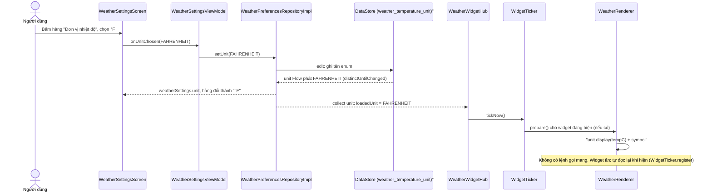
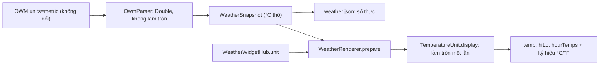

# WU — Đơn vị nhiệt độ °C/°F: đọc trước khi review

**Plan:** [plans/WU-weather-units.md](../plans/WU-weather-units.md) · **PR:** #50 · **Nhánh:** `feature/wu-weather-units`

## 1. Tóm tắt

Cài đặt → **Thời tiết** → hàng "Đơn vị nhiệt độ" mở hộp thoại chọn **Độ C (°C)** hoặc **Độ F (°F)**; mặc định °C. Widget thời tiết 2x2 và 4x2 (cả bản xem trước trong bảng chọn widget) hiện mọi nhiệt độ kèm đơn vị: "24°C" hoặc "75°F" (số hiện tại, cao/thấp, 4 mốc theo giờ). Đổi đơn vị không gọi mạng; widget đổi ngay khi quay về Home. Màn Thời tiết hiện chỉ có hàng này; nhánh WX sẽ thêm hàng (nhiều địa điểm, thông báo) vào cùng màn.

## 2. Kiến thức nền

- **DataStore Preferences** (đã có trong dự án): kho khóa-giá trị bất đồng bộ cho cài đặt, đọc bằng `Flow`. App dùng chung một `DataStore<Preferences>` (`launcher_settings`); mỗi khối có file khóa riêng để khỏi sửa file chung (mẫu `SearchPrefsKeys`).
- **Widget tự vẽ (G2c/G3e):** widget thời tiết không phải `AppWidget` của hệ thống mà là một `WidgetRenderer` vẽ Canvas. `prepare()` dựng chuỗi và tọa độ (mỗi phút hoặc khi dữ liệu đổi), `draw()` chỉ vẽ, không cấp phát. `WidgetTicker.tickNow()` làm mọi widget đang hiện gọi lại `prepare()`; widget không hiện thì không làm gì, và khi hiện lại (vd quay về từ Cài đặt) `WidgetTicker.register` tự gọi lại `prepare()` (đọc code).
- **Làm tròn:** °F = °C × 9/5 + 32. Nếu đổi từ số °C **đã làm tròn** thì lệch tới ±0.9 °F (suy luận từ công thức). Ví dụ: 24.4 °C thật là 75.9 °F → hiện 76; nhưng lưu 24 rồi đổi ra 75.2 → hiện 75. Vì vậy dữ liệu lưu °C thô (Double), làm tròn một lần lúc hiển thị.

## 3. Luồng hoạt động

**Đổi đơn vị và widget cập nhật.**

Chỗ dễ sai: (1) `display` nhận `Double` °C thô, không phải số đã tròn; (2) `WeatherWidgetHub.state` trả `Loading` cho tới khi đọc được đơn vị lần đầu, để khởi động không chớp °C rồi mới sang °F; (3) hàng Cài đặt đọc đơn vị từ ViewModel riêng, không từ `SettingsUiState`.

**Từ dữ liệu OWM tới chữ trên widget.**

**Mọi chỗ nhiệt độ hiện ra (đọc code, không có "cảm giác như", gió, độ ẩm):**

| Chỗ | Nơi dựng | Ghi chú |
|---|---|---|
| Nhiệt độ hiện tại | `WeatherRenderer.prepareData` → `temp` | 2x2 và 4x2 |
| Cao/thấp | `weather_hi_lo_short` / `_long` (tham số thứ 3 = ký hiệu) | Cực trị 24 giờ tới, tính trên số thô rồi mới làm tròn |
| 4 mốc theo giờ | `hourTemps[i]`, `hourTempPaint.fitWidth` theo mốc dài nhất | Một paint dùng chung nên co theo chuỗi dài nhất |
| Mô tả truy cập | `weather_description` (tham số thứ 6 = "độ C"/"độ F") | `contentDescription` của widget |
| Dữ liệu mẫu (bảng chọn widget) | `WeatherWidgetHub.sample()` → cùng đường `prepare` | Theo đơn vị đang chọn |
| Bảng Thời tiết (G3e) | — | Không hiện nhiệt độ nào, không đổi |

## 4. Thay đổi theo file

| File | Vai trò | Vì sao thêm/sửa | Đọc trước? |
|---|---|---|---|
| `domain/model/weather/TemperatureUnit.kt` | enum + `display` + `fromName` | Chỗ duy nhất làm tròn và đổi đơn vị | **Có** |
| `ui/widget/WeatherWidgetHub.kt` | Thu flow đơn vị, `tickNow`, `Loading` tới khi có đơn vị | Làm mới tức thì, không chớp sai đơn vị | **Có** |
| `ui/widget/WeatherWidgetRenderers.kt` | Mọi số đi qua `unit.display` + ký hiệu; co chữ dải 4 mốc | Hiển thị | **Có** |
| `domain/model/weather/WeatherModels.kt`, `data/weather/OwmParser.kt`, `WeatherStore.kt` | `Int` → `Double`, bỏ làm tròn lúc parse, `getDouble` | Đổi °F đúng; cache số nguyên cũ vẫn đọc được | |
| `domain/weather/WeatherPreferencesRepository.kt`, `data/weather/WeatherPreferencesRepositoryImpl.kt`, `WeatherPrefsKeys.kt`, `di/WeatherModule.kt` | Lưu lựa chọn trong DataStore | Không đụng `SettingsKeys` và các file chung | |
| `ui/settings/WeatherSettingsScreen.kt`, `WeatherSettingsViewModel.kt` | Màn và hộp thoại | Công thức "thêm màn" của G2d | |
| `ui/settings/SettingsScreen.kt` | Thay một dòng đăng ký | Mục "Thời tiết" ở trang chủ tự bật | |
| `ui/settings/SettingsRow.kt`, `res/values/strings.xml`, `LauncherApp.kt` | `ID_WEATHER_UNIT`, chuỗi, tiêm repository vào Hub | | |

## 5. Quyết định và đánh đổi (trỏ về WU# trong plan)

- **WU1 — lưu °C thô, đổi khi hiển thị.** Bỏ: đổi từ số đã tròn (lệch 1 °F), gọi OWM `units=imperial` (mỗi lần đổi tốn 2 lệnh, khóa lộ trong APK, offline không đổi được, cache phải gắn nhãn đơn vị) và gọi cả hai đơn vị (gấp đôi hạn mức). Chấp nhận: số °F do app tính; người nâng cấp có cache số nguyên có thể thấy °F lệch 1 trong tối đa một chu kỳ làm mới.
- **WU2 — mặc định °C, chỉ °C/°F.** "Theo hệ thống" để sau: Android 14 có Tùy chọn khu vực → Nhiệt độ, có thể đọc qua `androidx.core.text.util.LocalePreferences` (suy luận chưa kiểm chứng, phải đọc tài liệu và thử trên Android 14+; Live 4 không đủ). Dữ liệu lưu là tên enum nên thêm giá trị sau không cần di trú.
- **WU3 — kho riêng thay vì `SettingsKeys`.** Giảm xung đột với HT, AB, RN; WX thêm thành phố và thông báo vào đúng repository này.
- **WU4 — giữ kiểu hàng hiện tại** (FD2), không dựng nút phân đoạn của bản nháp.
- **WU5 (chủ dự án) — ký hiệu rõ "24°C"/"75°F"** ở mọi chỗ; đánh đổi: chuỗi dài hơn nên co chữ (xem mục 6).

## 6. Chỗ cần soi khi review

1. `OwmParser.snapshot` không còn `roundToInt`; cao/thấp là max/min của số thô (đúng bằng làm tròn max/min cũ nên °C không đổi).
2. Mọi chỗ in số đều qua `unit.display(...)`; không có `%d` nhận `Double` (đã grep `tempC`/`highC`/`lowC`, điều phối xác nhận).
3. `WeatherWidgetHub.state` = `Loading` khi `loadedUnit == null`: thử cold start xem có chớp.
4. **Chỉ được code bảo vệ, chưa đo trên máy:** độ rộng ca xấu "-40°F", "104°F", cao/thấp "↑113°F ↓104°F" ở 2x2 và 4x2 (chỉ ước lượng tay: dải theo giờ co còn ~70%, dòng cao/thấp 2x2 co ~12%; suy luận chưa kiểm chứng).
5. Hồi quy: bảng Thời tiết (tìm, vị trí, làm mới), đồng hồ/lịch, các màn Cài đặt khác.
6. Không có lệnh gọi mạng do đổi đơn vị: `lastAttemptAt` trong `weather.json` giữ nguyên.

## 7. Cách kiểm lại

Máy Vsmart Live 4 (xác nhận rảnh), bản debug, widget 2x2 và 4x2 đã có thành phố. (a) Cài đè lên bản `main` có cache cũ: widget vẫn hiện số. (b) Cài đặt → Thời tiết → °F → Back: số đổi ngay, kèm "°F". (c) Bảng chọn widget: bản xem trước theo đơn vị. (d) `adb shell run-as gambi.global.os26launcher cat no_backup/weather.json` trước/sau 5 lần đổi: `attempt`, `at` giữ nguyên. (e) `force-stop`, mở lại: không chớp °C. (f) Máy bay: vẫn đổi được. (g) Tạm đổi `sample()` (không commit) thành −40 °C và 40/45 °C, xem độ rộng. (h) Mô tả truy cập có "độ F". Kết quả: ghi ở mục "Bài kiểm cả tính năng" của plan.

## 8. Bài học cho AGENTS.md

- (2026-11-13, đọc code) Dữ liệu có nhiều đơn vị hiển thị: **lưu giá trị thô, làm tròn một lần ở bước hiển thị**; làm tròn lúc parse rồi đổi đơn vị gây sai số tích lũy (24.4 °C → 24 → 75 °F thay vì 76). Chủ đề đề xuất: `widgets`.
- (2026-11-13, đọc code) Đổi một tùy chọn chỉ ảnh hưởng cách hiển thị thì không gọi lại API: đổi `units` của OWM sẽ tốn lệnh, lộ khóa nhiều hơn và hỏng khi offline. Chủ đề: `widgets`.
- (2026-11-13, đọc code) Widget tự vẽ nhận thay đổi cài đặt bằng cách `object` cầu nối thu `Flow` rồi gọi `WidgetTicker.tickNow()`; trước khi đọc xong cài đặt lần đầu trả trạng thái `Loading` thay vì giá trị mặc định để không chớp sai. Chủ đề: `widgets`.
- (2026-11-13, đọc code) Chuỗi có đơn vị làm dài chữ: cỡ chữ cố định dùng chung nhiều ô (dải theo giờ) phải co theo chuỗi dài nhất (`fitWidth`). Chủ đề: `widgets`.
- (2026-11-13, đọc code) Khối cài đặt mới nên có repository + file khóa riêng (mẫu `SearchPrefsKeys`, `WeatherPrefsKeys`) khi nhiều nhánh song song cùng thêm khóa vào file chung. Chủ đề: `settings-and-data`.
- (2026-11-13, đo được trong phiên làm việc) Bash heredoc dài chứa tiếng Việt có thể báo `unexpected EOF` và không chạy gì; dùng Write/Edit. Build lỗi `compileDebugJavaWithJavac` không kèm lỗi Kotlin (cache tăng dần cũ) hết khi chạy `:app:compileDebugKotlin --rerun`. Chủ đề: `permissions-and-device-testing` hoặc AGENTS.md mục môi trường.
