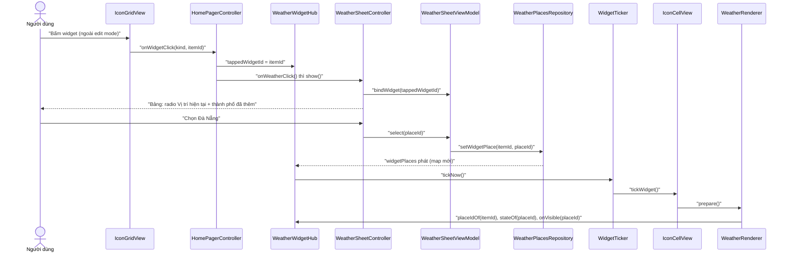
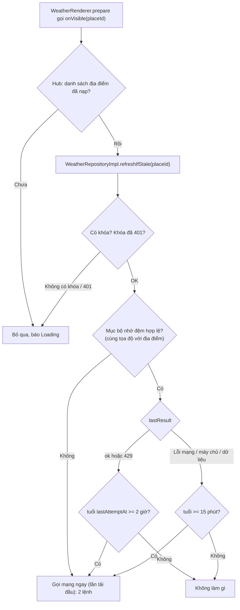
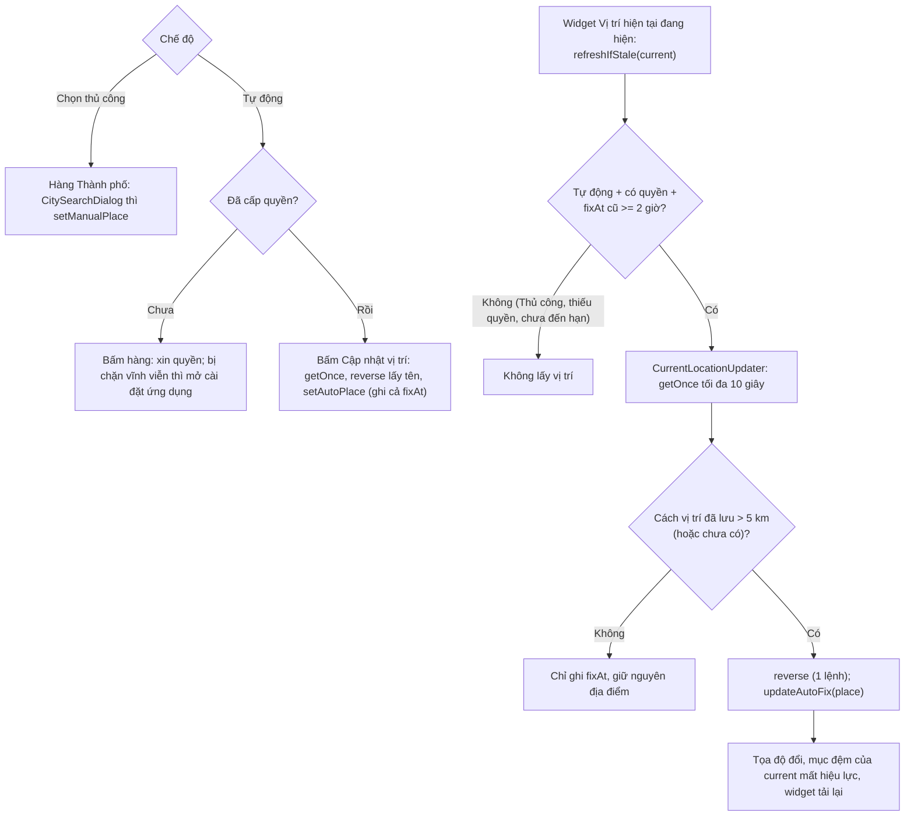

# WX — Thời tiết nhiều địa điểm: đọc trước khi review

**Plan:** [plans/WX-weather-cities.md](../plans/WX-weather-cities.md) · **PR:** #55 · **Nhánh:** `feature/wx-weather-cities`

Nhãn nguồn: **đo được** (có log/số trên máy), **đọc tài liệu**, **đọc code**, **suy luận chưa kiểm chứng**. Mọi số đo ở đây là trên **Vsmart Live 4 (Android 11, API 30), bản debug**, do điều phối chạy ngày 2026-11-13 (dữ liệu của chủ dự án được sao lưu rồi khôi phục theo mã băm). **Chưa kiểm:** Oppo A3x (nhánh này không đụng kính nên không cần), bản release trên máy, các ca ở mục 6 ghi "chỉ đọc code".

## 1. Tóm tắt

Người dùng theo dõi **tối đa 3 địa điểm**, kể cả "Vị trí hiện tại". Danh sách ở **Cài đặt → Thời tiết** ("+ Thêm địa điểm" tìm thành phố bằng OpenWeather Geocoding, bấm một thành phố để xóa). **Cài đặt → Vị trí** chọn cách xác định "Vị trí hiện tại": **Tự động** (vị trí gần đúng, cần quyền) hoặc **Chọn thủ công** (một thành phố, không cần quyền). Mỗi widget thời tiết hiện **một** địa điểm: **bấm widget** để mở bảng chọn (radio), mặc định "Vị trí hiện tại". Mỗi địa điểm làm mới **tối đa 2 giờ một lần** và **chỉ khi có widget đang hiện nó**; đổi °C/°F vẫn không gọi mạng. Không có thông báo thời tiết và cảnh báo thời tiết xấu (ngoài phạm vi).

## 2. Kiến thức nền

- **`itemId` và `AUTOINCREMENT` (đọc code, `app/schemas/.../1.json`):** mỗi widget trên Home là một hàng của bảng `launcher_items`; cột `id` khai `INTEGER PRIMARY KEY AUTOINCREMENT` nên một số id đã dùng **không bao giờ cấp lại** cho hàng khác. Nhờ vậy "widget số 124 hiện Đà Nẵng" lưu ở ngoài Room vẫn đúng mãi, không sợ trỏ nhầm sang widget khác. Điều này chỉ đúng nếu **không có đường nào xóa hàng rồi tạo lại với id mới**: đã đọc từng đường (mục 5, D1).
- **Widget tự vẽ (G2c/G3e):** widget thời tiết là một `View` ô lưới (`IconCellView`) vẽ bằng Canvas qua `WeatherRenderer`, không phải `AppWidget` của hệ thống. `WidgetTicker` gọi `prepare()` mỗi phút (chỉ khi widget đang hiện). Ô được **tái dùng** giữa widget và giữa loại item (bài học A1a), nên mọi cấu hình riêng phải được đưa vào ở **mỗi lần bind**.
- **`StateFlow`:** luồng trạng thái giữ giá trị mới nhất; không phát lại giá trị bằng nhau. Hệ quả ở đây: đổi *chỉ* ánh xạ widget → địa điểm không làm `places` phát, nên có thêm `widgetPlaces` riêng (mục 4).
- **`noBackupFilesDir` + `AtomicFile`:** thư mục không vào sao lưu đám mây, ghi nguyên tử (ghi file phụ rồi đổi tên). Tọa độ là dữ liệu cá nhân nên cả hai file thời tiết nằm ở đây.
- **Vị trí gần đúng (`ACCESS_COARSE_LOCATION`):** quyền chạy; app dùng `LocationManager` lấy **một lần** (tối đa 10 giây), không `LocationListener` sống lâu, không dịch vụ nền (G3e, đọc code).
- **OpenWeather Geocoding (đọc tài liệu, https://openweathermap.org/api/geocoding-api):** `geo/1.0/direct?q=&limit=` (tối đa 5), trả `name`, `local_names`, `lat`, `lon`, `country`, `state` (tùy nơi). **Cảnh báo thời tiết** (đã bỏ khỏi nhánh): trang One Call 3.0 liệt kê "government weather alerts", nói endpoint "included in the One Call API subscription only" kèm 1.000 lệnh/ngày miễn phí, **không nói** có cần thẻ thanh toán hay không, và **không nói** `/weather` hay `/forecast` có trường cảnh báo hay không ("gói Free không có" là suy luận chưa kiểm chứng).

## 3. Luồng hoạt động

### 3.1 Bấm widget, chọn địa điểm

`tappedWidgetId` đi qua `WeatherWidgetHub` (một `object`) để không phải đổi chữ ký `onWeatherClick` trong `HomeActivity` (file độc quyền). Đây là chỗ nối hơi "ngầm": id được đặt ngay trước khi gọi `show()` và đọc ngay trong `show()` trên luồng chính. `IconCellView.bindWidget(..., itemId)` gọi `renderer.bindItem(itemId)` **ở mỗi lần bind** (ô tái dùng), trước `tickWidget()`. Chọn địa điểm **không gọi mạng**: widget vừa đổi sẽ tải nơi mới ở lần `prepare` kế nếu nơi đó chưa có dữ liệu.

### 3.2 Khi nào gọi mạng cho một địa điểm

Quyết định đến hạn **chỉ đọc `lastAttemptAt` và `lastResult`** của mục (`WeatherRepositoryImpl.dueReason`); `snapshot.at` chỉ dùng cho nhãn "dữ liệu cũ" (4 giờ). Giờ máy chỉnh lùi (tuổi âm) coi là đã hết hạn. Mục bị bỏ khi địa điểm không còn trong danh sách hoặc đổi tọa độ (`reconcile`). Địa điểm không có widget nào hiện thì không ai gọi `onVisible`, nên **0 lệnh** (đo được: thêm/xóa địa điểm trong Cài đặt không sinh lệnh).

### 3.3 Cài đặt → Vị trí và cập nhật im lặng

Cập nhật im lặng không bao giờ tự xin quyền, không chạy ở chế độ Thủ công, không có `Handler`/dịch vụ nền: nó chỉ là một lời gọi thêm trong `refreshIfStale("current")`, mà hàm đó chỉ được widget đang hiện "Vị trí hiện tại" gọi. Không tra được tên thì **không** đổi địa điểm (không đặt tên giả), thử lại sau 15 phút (trong RAM). Chuyển sang Thủ công giữa lúc đang lấy vị trí thì `updateAutoFix` trả `false` và bỏ kết quả.

### 3.4 Dữ liệu nằm ở đâu

| Nơi | Nội dung | Ghi chú |
|---|---|---|
| `no_backup/weather_places.json` (version 1) | `mode`, `auto`, `manual`, `saved[]` (tối đa 2), `widgets` (`itemId` → mã địa điểm, chỉ widget không dùng "current"), `fixAt` | người dùng sở hữu; do `WeatherPlacesStore`; **tọa độ**, không vào sao lưu |
| `no_backup/weather.json` (version 2) | `entries[<mã địa điểm>]` = `place`, `snapshot`, `attempt`, `result` | bộ nhớ đệm, xóa được mà không mất lựa chọn của người dùng; đọc được version 1 của G3e |
| DataStore `weather_temperature_unit` | °C / °F | WU, không đổi |
| Room | **không đổi** | không `launcher_items` mới, không migration, không khóa schema |

Mã địa điểm: `"current"` hoặc `"<lat×100>_<lon×100>"` (số nguyên, vd `2103_10585`), nên cùng tọa độ cho cùng mã (chặn trùng) và không phụ thuộc locale.

## 4. Thay đổi theo file

Đường dẫn tính từ `app/src/main/java/gambi/global/os26launcher/`. **Không** sửa file độc quyền nào (`HomeActivity`, `HomeViewModel`, `HomeUiState`, `activity_home.xml`, `data/layout/*`, `core/glass/*`, `DragHelper`), không sửa manifest, gradle, `app/schemas/*` (đọc `git diff --stat`).

| File | Vai trò | Vì sao thêm/sửa | Đọc trước? |
|---|---|---|---|
| `data/weather/WeatherRepositoryImpl.kt` | Trạng thái và làm mới theo từng địa điểm, quy tắc 2 giờ / 15 phút | Toàn bộ chính sách tần suất nằm ở đây | **Có** |
| `ui/widget/WeatherWidgetRenderers.kt`, `ui/widget/WeatherWidgetHub.kt` | Renderer tra địa điểm của chính widget; Hub nối repository ↔ widget, cổng "danh sách đã nạp" | Lớp widget | **Có** |
| `ui/home/view/IconCellView.kt`, `IconGridView.kt`, `ui/home/HomePagerAdapter.kt`, `ui/home/controller/HomePagerController.kt` | Đưa `itemId` vào ô widget (mỗi lần bind) và vào lần bấm | Chỗ rủi ro cao nhất; chỉ thêm tham số, nhưng soi kỹ | **Có** |
| `data/weather/WeatherPlacesRepositoryImpl.kt`, `WeatherPlacesStore.kt`, `domain/weather/WeatherPlacesRepository.kt`, `domain/model/weather/WeatherPlaces.kt` | Danh sách địa điểm, chế độ, ánh xạ widget, `fixAt`; di trú từ G3e | D1/D3 | Sau |
| `data/weather/WeatherStore.kt`, `GeoPlaceJson.kt` | `weather.json` version 2, JSON dùng chung của `GeoPlace` | Mục theo địa điểm | Sau |
| `data/weather/CurrentLocationUpdater.kt` | Cập nhật vị trí tự động im lặng | Task 6 | Sau |
| `ui/weather/CitySearchDialog.kt`, `CitySearchViewModel.kt`, `res/layout/dialog_city_search.xml` | Hộp tìm thành phố dùng chung | Thêm địa điểm (1.4) và chọn thành phố (1.5) | Sau |
| `ui/weather/WeatherSheetController.kt`, `WeatherSheetViewModel.kt`, `res/layout/view_weather_sheet.xml`, `item_weather_choice.xml` | Bảng thành bộ chọn địa điểm | D2 | Sau |
| `ui/settings/WeatherSettingsScreen.kt`, `WeatherSettingsViewModel.kt`, `LocationSettingsScreen.kt`, `LocationSettingsViewModel.kt`, `SettingsScreen.kt` (1 dòng), `SettingsRow.kt`, `SettingsAdapter.kt` | Màn 1.4 và 1.5 | Công thức "thêm màn/hàng" của G2d; `Value.titleText` có mặc định | Sau |
| `domain/usecase/RemoveWidgetUseCase.kt`, `LauncherApp.kt`, `di/WeatherModule.kt`, `domain/model/weather/WeatherModels.kt` (`WeatherPolicy`), `res/values/strings.xml` (khối `wx_`) | Dọn mục khi xóa widget; nối Hilt; hằng chính sách; chuỗi | | Sau |

## 5. Quyết định và đánh đổi

Chi tiết và bảng so sánh phương án ở plan (D1–D6); tóm tắt:

- **D1 — ánh xạ widget → địa điểm ngoài Room** (không khóa schema). Bỏ: dùng lại cột `title` của hàng loại 4 (phải đặt nghĩa mới cho một cột + sửa `LauncherItemDao`/`LayoutReconciler`, file độc quyền), thêm cột + `Migration 1→2` (khóa schema, kịch bản cài đè, crash khi chuyển nhánh). **Đã kiểm (đọc code) không đường nào xóa rồi tạo lại hàng widget với id mới**: đổi cỡ lưới (`reflowInTransaction`: `updateAll` + `copy`), `ensureFitsGrid`, sửa bố cục FX3/FX1 (`catchUp`, `renameComponent` chỉ `itemType = 0`), gỡ app (`doomed` chỉ app), `removeUser` (thoát với user 0, widget luôn user 0), xóa/gộp trang (chỉ xóa trang trống), kéo qua trang (`updateAll`), gộp thư mục (`copy`), ẩn app, seed (chỉ khi DB rỗng), undo (không có tính năng). Hai nơi duy nhất `insertAll` hàng widget là `addWidget`/`addWidgetAt` (widget mới). Đo được thêm trên máy: đổi cỡ lưới 4×6 → 4×5 làm widget 124 reflow sang trang 2 và vẫn giữ Đà Nẵng; kéo sang trang khác giữ địa điểm.
- **D2 — bấm widget để chọn** (không nhấn giữ: nhấn giữ widget ngoài edit mode đã là vào edit mode). Edit-mode → bấm widget có thể làm sau với cùng bảng.
- **D3 — "Vị trí hiện tại" luôn là mục đầu, không xóa được**; nguồn do 1.5 quyết định, giữ riêng giá trị Tự động và Thủ công.
- **D4 — làm mới do widget kéo, 2 giờ / địa điểm**; lỗi thử lại sau 15 phút; `STALE_AFTER` 4 giờ; không có nút Làm mới (hệ quả của "tối đa 2 giờ"). Hằng ở `WeatherPolicy`. **Ngân sách lệnh (suy luận từ chính sách):** 1 lần làm mới = 2 lệnh; 3 địa điểm × 12 lần/ngày × 2 = **72 lệnh/ngày** tối đa, so với giới hạn gói Free 60 lệnh/phút và 1.000.000/tháng (đọc tài liệu, G3e). Thêm: tìm thành phố 1–2 lệnh mỗi lần bấm Tìm; cập nhật vị trí im lặng tối đa 1 lệnh `reverse` mỗi 2 giờ và chỉ khi đi xa hơn 5 km.
- **Mã địa điểm theo tọa độ**: thêm "Hà Nội" khi "Vị trí hiện tại" (thủ công) cũng là Hà Nội vẫn được chấp nhận, vì mã khác nhau (`"current"` so với `"2103_10585"`); nếu hai widget hiện cả hai thì tải riêng, tốn thêm 2 lệnh mỗi 2 giờ. Điều phối chấp nhận (2026-11-13, sau khi đo trên Live 4); không có cảnh báo trùng với mục hiện tại.
- **Đánh đổi chấp nhận:** cấu hình widget không đi theo sao lưu bố cục (khôi phục máy → widget về "Vị trí hiện tại", an toàn); `tappedWidgetId` truyền qua `object` thay vì đổi `HomeActivity`; mục ánh xạ mồ côi vô hại (id không dùng lại, tối đa 64 mục, dọn khi xóa widget qua `RemoveWidgetUseCase`).

## 6. Chỗ cần soi khi review

1. **Lớp widget** (`IconCellView.bindWidget`, `IconGridView.bindWidgetCell`, callback bấm): `bindItem` ở mỗi lần bind, **trước** `tickWidget()`; ảnh kéo từ bảng "Tiện ích" dùng `itemId = 0` (renderer thật, không phải bản mẫu) nên gọi `onVisible("current")` khi nó hiện, như trước khi có WX.
2. **`WeatherWidgetHub` cổng `placesLoaded`:** trước khi danh sách địa điểm nạp xong, Hub báo Loading và **không** kích hoạt làm mới, kẻo tải nhầm "current" cho một widget đang dùng nơi khác.
3. **`dueReason` không đọc `snapshot.at`.** Bài học đo (mục 8): ca "lùi cả `attempt` và `snapshot.at` 1h59" từng bị đọc nhầm là lỗi vì chờ nhịp phút vượt 2 giờ.
4. **Mục bộ nhớ đệm hỏng/sai tọa độ bị bỏ và tải lại ngay** (cố ý): file sửa tay làm hỏng `place`/`snapshot` thì địa điểm tải lại một lần.
5. **Nâng cấp từ G3e:** địa điểm cũ thành "Vị trí hiện tại" ở chế độ Thủ công (không phân biệt được nó từ vị trí hay gõ tay); thêm `fixAt` vắng = 0 nên bản đầu có thể lấy vị trí một lần ngay khi một widget "current" hiện ở chế độ Tự động.
6. **`RemoveWidgetUseCase` giờ phụ thuộc `WeatherPlacesRepository`** (domain → domain, một dòng); xóa widget qua đường khác (trang bị dồn) để lại mục mồ côi vô hại.
7. **Chuỗi không còn dùng, KHÔNG xóa** (quy ước không tự xóa), điều phối quyết: `weather_sheet_current`, `weather_sheet_none`, `weather_sheet_use_location`, `weather_sheet_refresh`, `weather_sheet_locating`, `weather_sheet_location_denied`, `weather_sheet_location_unavailable`, `weather_sheet_refresh_too_soon`, `weather_sheet_current_location`. Còn dùng: `weather_sheet_hint`, `weather_sheet_search`, `weather_sheet_searching`, `weather_sheet_not_found`, `weather_sheet_refreshing` (hộp tìm và bảng).
8. **Chỉ được code bảo vệ, chưa kiểm tay:** từ chối quyền vị trí / "không hỏi lại" mở cài đặt ứng dụng; thu hồi quyền khi đang ở màn Vị trí; tắt dịch vụ vị trí (hết 10 giây thông báo, không treo); xoay màn hình (Home là `nosensor`); build không có khóa (widget "Chưa cấu hình khóa", bảng báo); xóa widget bằng "−" rồi thêm lại (mặc định "Vị trí hiện tại"); thêm widget bằng kéo thẻ từ "Tiện ích"; đồng hồ/lịch không đổi; bản xem trước theo đơn vị; đổi °C/°F không gọi mạng (đọc code: không có lời gọi mạng ở đường đổi đơn vị; làm mới chỉ khi đến hạn như mọi lần `prepare`); công tắc chuyển sang Thủ công đúng lúc đang lấy vị trí; Oppo A3x.
9. **Mọi `Log` mới** chỉ ghi tên lớp ngoại lệ; không khóa, URL, tọa độ, tên địa điểm (đã `grep` toàn diff). Log tạm `WXNET` đã gỡ.

## 7. Cách kiểm lại

Máy Vsmart Live 4 (xác nhận rảnh; dữ liệu của chủ dự án sao lưu trước), bản debug có khóa; quyền vị trí đã cấp. Danh sách: "Vị trí hiện tại" + "Đà Nẵng" + "Huế"; widget A (2×2) và B (4×2) ở hai trang.
1. Bấm A → chọn Đà Nẵng: A đổi, B giữ nguyên; `force-stop`, mở lại: vẫn đúng. Xóa Đà Nẵng ở Cài đặt: A về "Vị trí hiện tại".
2. Kéo A sang trang khác, đổi cỡ lưới 4×6 → 4×5: A vẫn đúng địa điểm.
3. Cài đặt → Vị trí: Tự động → Cập nhật vị trí (tên sau vài giây); chuyển Thủ công → chọn thành phố; Tự động lại: giá trị cũ còn.
4. **Chính sách 2 giờ (cần log tạm, đã gỡ nên phải dựng lại nếu muốn đếm):** chỉnh `entries.current.attempt` trong `no_backup/weather.json` lùi **2 giờ 5 phút** (không phải 1h59: xem bài học dưới) rồi `force-stop`, mở Home: đúng một lần tải; lùi 1 giờ 55: không tải.
5. Vị trí im lặng: `fixAt` trong `weather_places.json` lùi 2 giờ 5 phút, Tự động + widget "current" hiện: một lần lấy vị trí (`dumpsys location | findstr gambi`), không đổi nếu đứng yên; sửa `auto.la` cộng 0,3 (≈ 33 km) thì đổi tên về nơi thật và tải lại một lần; Thủ công thì không có yêu cầu vị trí nào.
Ghi vào plan: máy, ngày, nhánh@commit.

## 8. Bài học cho AGENTS.md

- (2026-11-13, đo được, Live 4) **Kiểm bộ đệm "đã cũ N phút" phải chừa lề cho nhịp phút:** đặt tuổi 1h59 rồi chờ nhịp phút ~70 giây thì tuổi thật là 2h01 và làm mới chạy, bị đọc nhầm là lỗi. Dùng 1h55 (hoặc ngưỡng − 5 phút) và đọc log lý do (`why=… attemptMin=…`) trước khi kết luận. Chủ đề đề xuất: `permissions-and-device-testing`.
- (2026-11-13, đọc code) **Cấu hình riêng từng widget tự vẽ lưu ngoài Room, khóa theo `itemId`** an toàn vì `launcher_items.id` là `AUTOINCREMENT`; trước khi dựa vào đó phải đọc mọi đường ghi (danh sách ở mục 5) xem có xóa-rồi-tạo-lại không. Khi nhiều loại widget cần cấu hình thì xét cột `config` + migration một lần cho tất cả. Chủ đề: `widgets`.
- (2026-11-13, đọc code) **Ô widget được tái dùng giữa widget và giữa loại item:** danh tính của widget (`itemId`) phải được đưa vào renderer ở **mỗi** lần bind, trước lần vẽ đầu của lần bind đó; không lưu trong renderer khi tạo. Chủ đề: `widgets`.
- (2026-11-13, đọc code) **Cổng "cấu hình đã nạp":** cầu nối (`object`) giữa repository và widget không được kích hoạt tác dụng phụ (gọi mạng) trước khi cấu hình riêng của widget đã nạp, kẻo xử lý nhầm địa điểm mặc định. Chủ đề: `widgets`.
- (2026-11-13, đọc code) `StateFlow` không phát lại giá trị bằng nhau: một thay đổi chỉ chạm một phần dữ liệu (ánh xạ widget) cần luồng riêng nếu có view phải vẽ lại. Chủ đề: `widgets`.
- (2026-11-13, đo được, Live 4) Gõ phím Enter (`adb shell input keyevent 66`) vào `EditText` một dòng có `imeOptions=actionSearch` gọi listener với `actionId = IME_NULL` kèm `KeyEvent`, không phải `IME_ACTION_SEARCH`: xử lý cả hai. Kết quả geocoding của OpenWeather có thể trùng (tên + tỉnh + nước giống nhau): bỏ bản trùng. Chủ đề: `settings-and-data`.
- (2026-11-13, đo được, Live 4) Lấy vị trí một lần bằng `LocationManager` ở API 30 ra tên nơi sau khoảng 4,8 giây; `dumpsys location` thấy yêu cầu mạng thêm rồi gỡ sau khoảng 2 giây (không sót). Chủ đề: `permissions-and-device-testing`.
- (2026-11-13, đo được trong phiên làm việc) Trong Git Bash của Claude Code: heredoc dài chứa tiếng Việt báo `unexpected EOF` và không chạy gì (dùng Write/Edit); `sed -i 'N a\\\\n...'` chèn chữ `n` thật ở đầu dòng; công cụ Edit/Write yêu cầu đã Read file đó trong phiên. Chủ đề: `permissions-and-device-testing` hoặc AGENTS.md mục môi trường.
- (2026-11-13, đọc tài liệu) OpenWeather One Call 3.0 mới có cảnh báo thời tiết của cơ quan quốc gia và nằm trong gói đăng ký riêng (1.000 lệnh/ngày miễn phí); trang không nói có cần thẻ, và không nói gói Free có cảnh báo. Chủ đề: `widgets` (mục thời tiết).
