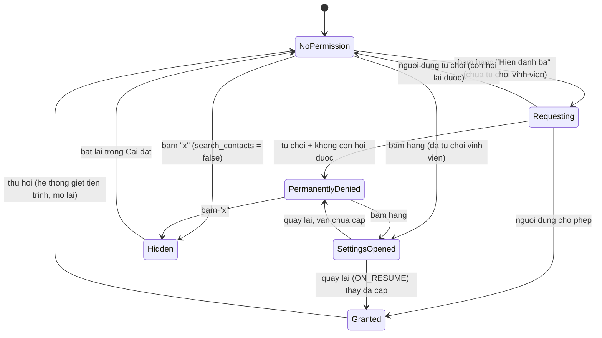

# G3a — Tìm danh bạ trong ô tìm kiếm (TT#18) — Implementation Plan

> **Dành cho agent thực thi:** làm theo `docs/AGENTS.md` và `docs/MultiAgent-Workflow.md` — code từng Task, báo cáo điều phối, qua review mới tick và sang Task sau; Task "bắt buộc kiểm tay" thì chờ chủ dự án kiểm; cả tính năng kiểm tay một lần ở cuối. Tối đa 5 vòng mỗi Task. Không có test tự động; kiểm chứng tay trên Vsmart Live 4 (Oppo A3x chỉ khi cần kính hoặc khi Live 4 không tái hiện được). Lệnh viết cho CMD/PowerShell.

**Nhánh:** `feature/g3a-contacts-search` · **Worktree:** `E:\SourceTree\IosLauncher-wt\G3a-contacts-search` · **PR:** (draft, điền số khi mở) · **Bắt đầu:** 2026-11-09 · **Plan duyệt:** 2026-11-09 (chủ dự án)
**Trạng thái:** Xong, chờ merge (điều phối kiểm tay 2026-11-09 trên Live 4 và Oppo A3x; Task 7 đã cắt khỏi nhánh này)
**Khóa:** không (không đổi schema Room; không đụng file nóng độc quyền — xem "Vùng file"). Có thêm **quyền runtime** `READ_CONTACTS`.

**Goal:** Khi người dùng cấp quyền Danh bạ, gõ tên một người trong ô tìm kiếm thì hiện hàng người đó (ảnh hoặc chữ cái đầu, tên, số điện thoại); bấm hàng mở danh bạ hệ thống, bấm nút gọi/nhắn thì mở trình quay số/soạn tin với số đã điền sẵn. Chưa cấp quyền thì ô tìm kiếm chỉ có một hàng "Hiện danh bạ" để xin quyền, và hàng đó ẩn được.

**Architecture:** Thêm một nguồn nữa vào đường M8d thay vì dựng đường mới. `SearchResult` thêm `Contact` (tìm được, vào `SearchIndex`) và `ContactsPermissionPrompt` (không tìm được, như `Header`); `SearchKind` thêm `CONTACT`. Một `ContactsRepository` mới (domain interface + `data/search/ContactsRepositoryImpl`) là nơi **duy nhất** chạm `ContactsContract`. Tên người liên hệ nạp **vào RAM** mỗi lần mở lớp tìm kiếm (không ghi đâu cả, bỏ khi đóng lớp) để dùng lại chỉ mục chuẩn hóa bỏ dấu của M8b/M8d; số điện thoại **không** nạp hàng loạt, chỉ hỏi provider cho tối đa 5 hàng đang hiện. Xin quyền do `SearchOverlayController` (đã nằm ngoài file nóng) giữ `ActivityResultLauncher`.

**Tech Stack:** View/XML, MVVM + StateFlow, Hilt, DataStore Preferences (đã có). **Không thêm dependency, không đổi schema Room.** Manifest thêm đúng một `<uses-permission>`; không thêm `<queries>` (xem Quyết định 4).

**Spec:** TT#18 trong `Launcher-Features.md` (Cấp 4, "Quyền `READ_CONTACTS`, xử lý trên máy, bật trong cài đặt"); `plans/M8b-search.md` (luật xếp hạng D2), `plans/M8d-search-extras.md` (`SearchResult`, `SearchIndex`, khối Cài đặt Tìm kiếm); `AGENTS.md` (M8d: `<queries>` theo package, dữ liệu riêng tư và `allowBackup`, logcat Oppo).

---

## Vì sao chọn thiết kế này

### Vấn đề cần giải (ràng buộc thật)

- **Dữ liệu danh bạ là dữ liệu riêng tư nhạy cảm hơn mọi thứ launcher đang giữ.** Bài học M8d: `allowBackup="true"` và `launcher_prefs` nằm trong Auto Backup, nên bất cứ thứ gì lưu trong DataStore/Room/file thường đều có thể rời máy. Chủ dự án chốt: **không lưu bản sao nào**. Hệ quả thiết kế: mọi tên và số chỉ đi từ `ContactsContract` vào RAM, không ghi đĩa, không log.
- **Chuẩn hóa tiếng Việt.** `AppSearchMatcher.normalize` đã xử lý đúng (`Normalizer.NFD` + xóa `\p{Mn}`, `đ` thay tay). Muốn "nguyen" ra "Nguyễn Văn A", "duc" ra "Đức" thì tên người liên hệ phải đi qua **cùng hàm** đó. Bộ lọc của chính Contacts provider (`Contacts.CONTENT_FILTER_URI`) có chuẩn hóa tên riêng, nhưng việc nó có bỏ dấu `đ` đúng như M8b hay không là **suy luận chưa kiểm chứng** (Collator ở mức primary bỏ dấu thanh, chưa rõ với `đ`).
- **Quyền runtime cần một `Activity`.** Lớp tìm kiếm là một view của `HomeActivity` (file nóng độc quyền, không đụng). `SearchOverlayController` (R1, ngoài danh sách độc quyền) đã là nơi nối view với Activity nên đặt việc xin quyền ở đó.
- **Quyền có thể bị đổi giữa chừng:** từ Cài đặt hệ thống, hoặc hàng "Hiện danh bạ" đưa người dùng sang màn quyền rồi quay lại khi lớp tìm kiếm **vẫn đang mở** (`isOpen` sống trong ViewModel). Phải đọc lại trạng thái quyền khi quay lại, và coi mọi `SecurityException` từ provider như "mất quyền".
- **Gỡ quyền từ Cài đặt thì hệ thống giết tiến trình** (hành vi Android khi thu hồi quyền runtime của app đang chạy; **đọc tài liệu**, chưa đo trên hai máy). Nên "thu hồi khi đang mở" thực chất là kiểm tra app tự khởi động lại gọn, không crash.
- **Tầm nhìn package (M8d):** `<queries>` mở tầm nhìn theo package, không theo action; `startActivity` không bị lọc, chỉ `resolveActivity`/`queryIntentActivities` bị lọc. Plan này chỉ `startActivity` (try/catch), không `resolve`, nên không cần khai.
- **Chi phí mỗi phím** đã có ngân sách ở M8d (p95 ≤ 4 ms, Oppo). Thêm một nguồn không được phá ngân sách đó, và truy vấn provider (binder) không được nằm trên luồng Main hay chạy cho mỗi phím trên toàn bộ danh bạ.

### Quyết định 1 — Lấy dữ liệu danh bạ ở đâu và khi nào

| Phương án | Cách làm | Ưu | Nhược / rủi ro | Chọn? |
|---|---|---|---|---|
| **A. Nạp tên vào RAM khi mở lớp, bỏ khi đóng; số chỉ hỏi provider cho hàng đang hiện** | Mở lớp (đã có quyền): một truy vấn `Contacts.CONTENT_URI` chỉ lấy `_ID, LOOKUP_KEY, DISPLAY_NAME_PRIMARY, PHOTO_THUMBNAIL_URI`, giới hạn 5000 hàng, ở IO; đưa vào `SearchIndex` cùng app/Cài đặt. Sau khi tìm xong còn ≤ 5 hàng thì một truy vấn `Phone.CONTENT_URI` theo các `CONTACT_ID` đó để lấy số. ContentObserver khi lớp mở để nạp lại khi danh bạ đổi | Dùng lại đúng chuẩn hóa tiếng Việt và xếp hạng của M8b/M8d; mỗi phím chỉ quét chuỗi trong RAM (nhanh như app); không có bản sao trên đĩa; số điện thoại (nhạy hơn tên) không nằm trong RAM hàng loạt | Tên nằm trong RAM trong lúc lớp mở (vẫn là "bản sao" ngắn hạn, cần chủ dự án chấp nhận, câu hỏi 4); mở lớp tốn một truy vấn provider | **Có** |
| B. Truy vấn provider theo từng phím (`Contacts.CONTENT_FILTER_URI`) | Không giữ gì trong RAM, hỏi provider mỗi lần gõ | Không có bản sao nào, kể cả RAM; provider tự lo khớp tên và số | Chuẩn hóa bỏ dấu không đảm bảo cùng luật M8b (`đ` chưa kiểm); một lệnh binder mỗi phím, cần `mapLatest` + debounce, khó giữ ngân sách 4 ms; không trộn xếp hạng với app/Cài đặt trong `SearchIndex` mà không phải ghép tay | Không (giữ làm phương án dự phòng nếu chủ dự án không chấp nhận tên trong RAM) |
| C. Chỉ mục tên lưu bền (Room/file) cập nhật theo ContentObserver | Giữ danh sách đã chuẩn hóa để mở lớp tức thì | Nhanh nhất khi mở | **Trái yêu cầu đã chốt** (không lưu gì ngoài Android), kéo theo backup, schema Room, xóa dữ liệu khi thu hồi quyền | Không |

**Vì sao A:** (1) bám đúng chuẩn hóa tiếng Việt đã chạy ở M8b/M8d thay vì tin vào hành vi provider (**nhãn:** đọc code + suy luận; Task 1 đo B để đối chiếu và để biết quyết định A có đúng không). (2) Không có gì ra đĩa, nên không đụng bài học `allowBackup` của M8d: hai khóa DataStore mới chỉ là cờ bool, không phải dữ liệu danh bạ. (3) Chi phí mở lớp chỉ trả khi người dùng thật sự mở tìm kiếm và đã cấp quyền; mỗi phím vẫn là quét chuỗi trong RAM. (4) Giữ số điện thoại ra khỏi RAM hàng loạt giảm lượng dữ liệu nhạy cảm nằm trong tiến trình xuống mức tối thiểu cần cho hiển thị.

### Quyết định 2 — Hàng xin quyền: ở đâu, ẩn thế nào

| Phương án | Cách làm | Ưu | Nhược / rủi ro | Chọn? |
|---|---|---|---|---|
| **A. Hàng trong kết quả + công tắc trong Cài đặt; nút "x" trên hàng là cách tắt nhanh** | Hàng "Hiện danh bạ" hiện khi chưa cấp quyền **và** công tắc "Tìm trong danh bạ" bật (mặc định bật). Bấm hàng: xin quyền (hoặc mở Cài đặt ứng dụng nếu bị từ chối vĩnh viễn). Bấm "x": tắt công tắc đó và hàng biến mất; bật lại ở Cài đặt | Người dùng gặp lời mời đúng chỗ họ đang tìm; có cách tắt dứt khoát không cần vào Cài đặt; một cờ duy nhất điều khiển cả hai (không có hai trạng thái "đã ẩn" khác nhau) | Hàng nằm trong kết quả nên làm ô tìm kiếm có thêm một dòng cho người không muốn danh bạ cho tới khi họ bấm "x" | **Có** |
| B. Chỉ có công tắc trong Cài đặt, không hàng trong tìm kiếm | Xin quyền từ Cài đặt | Ô tìm kiếm sạch | Trái phạm vi chủ dự án duyệt (hàng "Hiện danh bạ" trong tìm kiếm); người dùng không bao giờ biết có tính năng | Không |
| C. Hàng luôn hiện cho tới khi cấp quyền, không ẩn được | Đơn giản | Người từ chối vẫn bị nhắc mãi | Khó chịu, trái yêu cầu "ẩn được" | Không |

**Vì sao A:** đúng phạm vi đã duyệt (hàng + xin quyền + ẩn được) với số trạng thái ít nhất: một cờ `search_contacts` (mặc định **bật**), hai nơi bật/tắt (nút "x" và công tắc Cài đặt). Mặc định bật vì danh bạ chỉ được đọc sau khi chính người dùng bấm cấp quyền; việc hiện hàng mời không đọc gì cả.

**Nơi hiện hàng mời (đề xuất, câu hỏi 2):** (a) ở ô trống, đứng **cuối** danh sách (dưới Gần đây/Gợi ý, hoặc đứng một mình nếu không có gì khác); (b) khi có truy vấn từ 2 ký tự, đứng **cuối** kết quả, và nếu không có kết quả nào thì hàng này thay cho dòng "Không có kết quả". Không hiện ở chế độ liệt kê toàn bộ app từ App Library (`showAll`).

### Quyết định 3 — Thứ tự, số hàng, dòng phụ, avatar

- **Thứ tự:** `SearchKind.CONTACT` có `priority = 1` (sau App, trước Cài đặt và Shortcut); Cài đặt đổi từ 1 thành 2, Shortcut từ 2 thành 3. Hạng khớp D2 của M8b vẫn là khóa sắp chính; `priority` chỉ phá hòa. Nên gõ "minh": người tên "Minh" (hạng 0) đứng ngang app nhãn "Minh..." (hạng 0, app lên trước), và trên mọi mục Cài đặt cùng hạng. **Không có tiêu đề nhóm "Danh bạ"**; dòng phụ của hàng đã đủ phân biệt (giống Cài đặt/Shortcut ở M8d). Lý do: tiêu đề nhóm đẩy kết quả xuống dưới màn hình, đúng lý do M8d bỏ phương án "nhóm cố định".
- **Truy vấn từ 2 ký tự** mới ra danh bạ (như Cài đặt/Shortcut). 1 ký tự chỉ ra app, tránh "a" đổ hàng trăm người ra.
- **Tối đa 5 người** mỗi lần tìm (đề xuất, câu hỏi 3). Không có nút "xem thêm" ở bản đầu.
- **Dòng phụ:** số điện thoại đã chọn (xem Quyết định 5); người không có số: chữ "Danh bạ".
- **Avatar:** ảnh thumbnail (`PHOTO_THUMBNAIL_URI`) cắt tròn; không có ảnh thì **vòng tròn xám theo kiểu iOS với chữ cái đầu** (chữ cái đầu của từ đầu và từ cuối của tên, in hoa, tối đa 2 ký tự; màu nền xám gradient nhẹ `#A5A9B2 -> #858993`, chữ trắng). Vẽ thành `Bitmap` trong đường `loadIcon` hiện có (cùng cơ chế nạp bất đồng bộ của app/shortcut) nên adapter không phải rẽ nhánh mới. Không thêm thư viện ảnh.

### Quyết định 4 — Hành động trên hàng và `<queries>`

- **Bấm hàng:** `ACTION_VIEW` với `ContactsContract.Contacts.getLookupUri(contactId, lookupKey)`. Khóa tra cứu (`LOOKUP_KEY`) bền hơn `_ID` khi danh bạ gộp/tách; `getLookupUri` tự xử lý trường hợp khóa đã đổi.
- **Nút gọi:** `ACTION_DIAL`, URI `Uri.fromParts("tel", number, null)` (mã hóa đúng `#`, `*`). **Không cần quyền `CALL_PHONE`**, người dùng bấm gọi tiếp trong trình quay số, nên launcher không bao giờ tự gọi.
- **Nút nhắn:** `ACTION_SENDTO`, URI `Uri.fromParts("smsto", number, null)`.
- **Mọi lệnh bọc `try/catch` (`ActivityNotFoundException`, `SecurityException`)**; lỗi thì Toast (chuỗi mới `search_contacts_open_failed`) và **giữ lớp mở**, thành công thì đóng lớp (cùng D8 của M8b).
- **Không thêm `<queries>`:** chỉ `startActivity`, không `resolveActivity`. (Bài học M8d: `<queries>` khai theo package, `PHONE`/`MESSAGES` ở dock đã đo là resolve được không cần khai, M3 Task 4.) Nếu về sau có kiểm `resolveActivity` để ẩn nút, **phải đo trên cả hai máy trước khi khai** và khai theo package nhận được, không theo action.
- Ẩn cả hai nút khi máy không có `FEATURE_TELEPHONY` (`hasSystemFeature` không bị lọc tầm nhìn); hai máy test đều là điện thoại, nên đây là phòng thủ, không kiểm tay được.

### Quyết định 5 — Chọn số cho mỗi người, người không có số

Truy vấn `Phone.CONTENT_URI` cho tối đa 5 `CONTACT_ID` vừa tìm ra, sắp theo `IS_SUPER_PRIMARY DESC, IS_PRIMARY DESC, _ID ASC` rồi lấy số đầu tiên của mỗi người: **số mặc định nếu người dùng đã đặt, nếu không thì số thêm đầu tiên**. Dùng cột `NUMBER` nguyên văn (định dạng người dùng đã nhập) để hiển thị và để quay số. Người không có số nào: không có số trong kết quả truy vấn → **ẩn cả hai nút, dòng phụ "Danh bạ"**, bấm hàng vẫn mở danh bạ. Người có nhiều số: chỉ dùng một, và muốn số khác thì mở danh bạ (ghi rõ trong "Ngoài phạm vi"). Tra số chạy ở IO bên trong `mapLatest` nên phím mới hủy truy vấn cũ.

### Quyết định 6 — Khớp theo số điện thoại: CẮT khỏi nhánh này

Chủ dự án chốt 2026-11-09: **không làm** khớp số trong G3a. Ghi để sau: khi truy vấn chỉ có chữ số (≥ 3 chữ số), hỏi provider (`Phone.CONTENT_FILTER_URI` hoặc `LIKE` trên `NORMALIZED_NUMBER`, giới hạn 5 hàng) ở IO trong `mapLatest`; không nạp mọi số vào RAM vì số nhạy hơn tên và khớp `+84`/`0` provider đã làm sẵn.

### Đánh đổi chấp nhận

- **Tên nằm trong RAM khi lớp tìm kiếm đang mở** (bỏ ngay khi đóng, không ghi, không log). Xét lại sang phương án B (không giữ gì) nếu chủ dự án không chấp nhận.
- **Giới hạn 5000 người:** danh bạ lớn hơn thì người ngoài 5000 hàng đầu (theo `SORT_KEY_PRIMARY`) không tìm ra. Task 1 đo thời gian nạp thật; nếu chậm hơn mong đợi thì giảm giới hạn hoặc chuyển phương án B.
- **Chỉ danh bạ Contacts provider mặc định trả về** (tài khoản trên máy, SIM, Google); danh bạ thư mục doanh nghiệp (`Directory`) và hồ sơ công việc không có.
- **Một số cho mỗi người** trên hàng; muốn số khác thì mở danh bạ.
- **Chưa cấp quyền thì tìm kiếm có thêm một hàng mời** cho tới khi người dùng cấp quyền hoặc bấm "x".
- **Bản phát hành Play:** `READ_CONTACTS` là quyền nhạy cảm, Play yêu cầu khai báo mục đích; **chưa kiểm** chính sách hiện hành, ghi lại để chủ dự án quyết khi tới bước phát hành.

---

## Luồng hoạt động (mô tả để vẽ Mermaid trong knowledgement)

### Trạng thái quyền và hàng mời



### Mở lớp rồi gõ truy vấn

```mermaid
sequenceDiagram
    participant U as Nguoi dung
    participant C as SearchOverlayController
    participant VM as SearchViewModel
    participant R as ContactsRepository
    participant P as ContactsContract (provider)
    U->>VM: mo lop tim kiem (vuot xuong / pill)
    VM->>R: hasPermission()
    alt chua cap quyen
        VM-->>C: ket qua co ContactsPermissionPrompt (neu search_contacts bat)
    else da cap quyen
        VM->>R: loadNames(limit 5000) tren IO
        R->>P: query Contacts (ID, LOOKUP_KEY, ten, anh)
        P-->>R: cac hang
        R-->>VM: danh sach ContactEntry (chi o RAM)
        VM->>VM: dung SearchIndex (app + cai dat + shortcut + danh ba)
    end
    U->>VM: go "nguyen"
    VM->>VM: search -> toi da 5 Contact (chuan hoa bo dau)
    VM->>R: numbersFor(ids) tren IO
    R->>P: query Phone theo CONTACT_ID
    P-->>R: so (uu tien IS_SUPER_PRIMARY, IS_PRIMARY)
    VM-->>C: SearchUiState(results voi so dien thoai)
    U->>VM: bam hang / nut goi / nut nhan
    VM->>R: open(lookupUri) / dial(number) / message(number)
    VM->>VM: thanh cong: close() (xoa ten khoi RAM); that bai: Toast, giu lop
```

### Danh bạ đổi khi lớp đang mở

Lớp mở → `ContentObserver` trên `Contacts.CONTENT_URI` (qua `callbackFlow`, debounce 300 ms) → nạp lại tên → chỉ mục dựng lại. Lớp đóng → hủy observer, **xóa danh sách tên khỏi RAM**. Quay lại từ màn quyền/Cài đặt (`ON_RESUME`) → `refreshContacts()` đọc lại quyền và nạp nếu vừa được cấp.

---

## Quyết định đã chốt

| # | Quyết định | Ghi chú (ai quyết, ngày, cơ sở) |
|---|---|---|
| D1 | Danh bạ chỉ hiện sau khi cấp `READ_CONTACTS`; trước đó chỉ có một hàng "Hiện danh bạ" | Chủ dự án, 2026-11-09 |
| D2 | Khớp trên tên hiển thị bằng `AppSearchMatcher` (bỏ dấu tiếng Việt) | Chủ dự án, 2026-11-09 |
| D3 | Bấm hàng = `ACTION_VIEW` + `Contacts.getLookupUri`; nút gọi = `ACTION_DIAL`, nút nhắn = `ACTION_SENDTO smsto:`; không cần `CALL_PHONE` | Chủ dự án, 2026-11-09 |
| D4 | Không lưu gì ngoài Android (không Room/DataStore/file); truy vấn theo yêu cầu, ngoài Main, có giới hạn | Chủ dự án, 2026-11-09 |
| D5 | Tên vào RAM khi lớp mở, bỏ khi đóng; số chỉ hỏi provider cho ≤ 5 hàng | Chủ dự án duyệt 2026-11-09 |
| D6 | Cờ `search_contacts` (mặc định bật) + cờ `search_contacts_asked`; hai cờ bool trong DataStore, không phải dữ liệu danh bạ | Chủ dự án duyệt 2026-11-09 |
| D7 | `SearchKind.CONTACT`: priority 1, từ 2 ký tự, tối đa 5; không tiêu đề nhóm; dòng phụ = số hoặc "Danh bạ" | Chủ dự án duyệt 2026-11-09 |
| D8 | Chọn số: `IS_SUPER_PRIMARY`, `IS_PRIMARY`, rồi `_ID` nhỏ nhất; không có số thì ẩn nút | Chủ dự án duyệt 2026-11-09 |
| D9 | Avatar: thumbnail cắt tròn, không có thì vòng tròn xám + chữ cái đầu, vẽ trong `loadIcon` | Chủ dự án duyệt 2026-11-09 |
| D10 | Không thêm `<queries>`; chỉ `startActivity` có try/catch | Đề xuất; bài học M8d, đo lại ở Task 5 |
| D11 | Xin quyền từ `SearchOverlayController`, lấy `ComponentActivity` bằng cách tháo `ContextWrapper` của `binding.root.context`; **không sửa `HomeActivity`** | Duyệt 2026-11-09; được sửa **một dòng** truyền `this` ở `HomeActivity` nếu tháo context không gọn (báo trong báo cáo) |
| D13 | Cắt khớp số điện thoại (Task 7) khỏi nhánh | Chủ dự án, 2026-11-09 |
| D12 | Không đổi schema Room; không thêm vào `SettingsKeys.kt` (khóa ở `SearchPrefsKeys`) | Ràng buộc MultiAgent 5.3 và M8d D10 |

## Ngoài phạm vi / ghi để sau

- Khớp theo số điện thoại (Quyết định 6; chủ dự án cắt 2026-11-09).
- Chọn số khác khi người có nhiều số; hiện nhãn số (Di động, Nhà riêng).
- Nút video call, Zalo, Messenger; email.
- Tìm theo email, công ty, ghi chú; danh bạ thư mục doanh nghiệp (`Directory`) và hồ sơ công việc.
- Gọi trực tiếp (`ACTION_CALL`, cần `CALL_PHONE`): không làm, cố ý.
- Hiển thị tên theo `DISPLAY_NAME_ALTERNATIVE` hoặc thứ tự họ trước; dùng đúng thứ tự mà Contacts hệ thống chọn.
- Xóa hoặc chặn dữ liệu danh bạ khi quyền bị thu hồi: không có gì để xóa vì không lưu.
- Khai báo Play Console cho `READ_CONTACTS`.

## Vùng file

| File | Tạo / Sửa | Nóng (độc quyền / dùng chung) |
|---|---|---|
| `domain/model/ContactEntry.kt` | Tạo | Không |
| `domain/repository/ContactsRepository.kt` | Tạo | Không |
| `data/search/ContactsRepositoryImpl.kt` | Tạo | Không |
| `data/search/ContactAvatar.kt` (vẽ avatar chữ cái đầu + cắt tròn ảnh) | Tạo | Không |
| `di/SearchModule.kt` | Sửa (thêm một `@Binds`) | Không (file của M8d) |
| `domain/search/SearchResult.kt` | Sửa (`SearchKind.CONTACT`, `Contact`, `ContactsPermissionPrompt`) | Không |
| `domain/model/SearchPreferences.kt`, `domain/repository/SearchPreferencesRepository.kt` | Sửa (thêm `contacts`) | Không |
| `data/search/SearchPreferencesRepositoryImpl.kt`, `SearchPrefsKeys.kt` | Sửa (thêm khóa) | Không |
| `ui/search/SearchViewModel.kt` | Sửa | Dùng chung với nhánh khác trong vùng tìm kiếm; trong cây hiện tại chưa nhánh nào khác khai |
| `ui/search/SearchUiState.kt` | Sửa (thêm sự kiện) | Không |
| `ui/search/SearchResultAdapter.kt`, `res/layout/item_search_result.xml` (hoặc layout mới `item_search_contact.xml`) | Sửa / Tạo | Không |
| `ui/home/controller/SearchOverlayController.kt` | Sửa (xin quyền, ON_RESUME, nhận sự kiện) | Không (không nằm trong danh sách độc quyền của mục 5.2) |
| `ui/settings/SearchSettingsBlock.kt`, `SearchSettingsViewModel.kt`, `SettingsRow.kt` | Sửa (thêm công tắc + hàng gợi ý) | `ui/settings/*`: dùng chung có kiểm soát, chỉ thêm |
| `ui/settings/SettingsActivity.kt` | Sửa (truyền thêm trạng thái quyền vào `SearchSettingsBlock.rows`) | Dùng chung có kiểm soát; GS/G2d có thể cùng sửa, chỉ thêm |
| `AndroidManifest.xml` | Sửa (một `<uses-permission>`) | Dùng chung có kiểm soát |
| `res/values/strings.xml`, `dimens.xml`, `colors.xml` | Sửa (khối riêng ở cuối, tiền tố `search_contacts_`) | Dùng chung có kiểm soát |
| `res/drawable/ic_contact_call.xml`, `ic_contact_message.xml`, `ic_search_contacts_prompt.xml` | Tạo | Không |

**Không sửa:** `HomeActivity`, `HomeViewModel`, `HomeUiState`, `activity_home.xml`, `core/glass/*`, `data/layout/*`, `core/ui/Drag*`, `SettingsKeys.kt`, schema Room, tài liệu chung. Cần sửa file ngoài bảng này thì dừng và báo điều phối.

## Global Constraints

- **Không lưu, không log danh bạ:** không ghi tên/số/URI ảnh vào DataStore, Room, file, `Log`, crash message. Log chỉ in **số lượng và thời gian** (một dòng tóm tắt, theo bài học Oppo bỏ dòng logcat khi in dồn).
- **Chỉ đọc** `ContactsContract`; không bao giờ `insert/update/delete`.
- **Mọi truy vấn provider ở luồng nền** (IO), có `limit`, đóng `Cursor` bằng `use`, bắt `SecurityException` (mất quyền) và coi như chưa cấp quyền, không crash.
- **Không `CALL_PHONE`, không `ACTION_CALL`.**
- Mỗi phím không được tạo thêm truy vấn provider ngoài bước tra số cho ≤ 5 hàng; không giữ dữ liệu cũ khi truy vấn đổi (`mapLatest`).
- Chuỗi giao diện tiếng Việt có dấu trong `strings.xml`; mô tả trợ năng cho từng nút (tên người trong mô tả).
- Cờ DataStore mới chỉ ở `SearchPrefsKeys`; không đổi `allowBackup`/`backup_rules` (không có dữ liệu danh bạ để loại).
- Không thêm dependency, không thêm test, không sửa `<queries>` trừ khi đo (M8d).
- Commit message tiếng Anh, không dấu, kết thúc bằng dòng `Co-Authored-By`.

## Review Focus

1. **Không có bản sao bền của danh bạ:** tìm trong diff mọi nơi ghi (`edit {`, `AtomicFile`, `writeText`, Room) và mọi `Log.*` có thể chứa tên/số; chỉ còn hai cờ bool và log số lượng.
2. **Mất quyền không crash:** mọi truy vấn có bắt `SecurityException`; quay lại từ màn quyền khi lớp đang mở thì cập nhật đúng (hàng mời ↔ danh bạ).
3. **Danh bạ bị bỏ khỏi RAM khi đóng lớp** (`close()`, và khi quyền mất), kể cả danh sách trong `IndexBundle`.
4. **Chuẩn hóa tiếng Việt** đi qua `AppSearchMatcher.normalize` (không tự viết hàm khác); "duc" ra "Đức", "nguyen" ra "Nguyễn".
5. **Luồng quyền:** từ chối một lần, từ chối vĩnh viễn, cấp từ Cài đặt, `ON_RESUME`; không đăng ký launcher sau khi Activity đã STARTED; không rò `ContentObserver` (hủy khi đóng).
6. **Không chặn Main:** truy vấn ở `Dispatchers.IO`/`Default`; chi phí mỗi phím không vượt ngân sách M8d.
7. **Intent:** `ACTION_DIAL` không phải `ACTION_CALL`; URI qua `Uri.fromParts`; try/catch + Toast và lớp giữ mở khi lỗi.
8. **Người không có số:** không nút; người có số: nút có `contentDescription`, vùng chạm ≥ 48dp; bấm nút không kích hoạt hàng.
9. **Không sửa file ngoài "Vùng file"**, không sửa tài liệu chung.

---

### Task 1: Quyền, repository danh bạ và phép đo trên máy
**Bắt buộc kiểm tay:** có — giả định chỉ máy thật trả lời được và mọi Task sau xây trên nó (mục 4.2): (1) Contacts provider có trả đủ tên với giới hạn 5000 trong thời gian chấp nhận được (mục tiêu: nạp tên ≤ 150 ms khi 500 người, chưa đo) trên Live 4 (Android 11) và Oppo (ColorOS, Android 14); (2) `IN_VISIBLE_GROUP`, `PHOTO_THUMBNAIL_URI`, `IS_SUPER_PRIMARY` có đúng như đọc tài liệu; (3) hành vi `Contacts.CONTENT_FILTER_URI` với "d/đ" để biết phương án B có khả thi không; (4) khi thu hồi quyền khi tiến trình đang chạy thì tiến trình bị giết hay provider ném `SecurityException`. Sai ở đây thì phải làm lại Task 2–7.
**Files:** `AndroidManifest.xml` (thêm `<uses-permission android:name="android.permission.READ_CONTACTS" />` kèm chú thích), `domain/model/ContactEntry.kt`, `domain/repository/ContactsRepository.kt`, `data/search/ContactsRepositoryImpl.kt`, `di/SearchModule.kt`
**Interfaces:** Produces `ContactEntry(contactId: Long, lookupKey: String, name: String, photoUri: String?)`; `ContactsRepository { fun hasPermission(): Boolean; suspend fun loadNames(limit: Int): List<ContactEntry>; suspend fun numbersFor(ids: Collection<Long>): Map<Long, String>; fun changes(): Flow<Unit>; fun openContact(entry): Boolean; fun dial(number): Boolean; fun message(number): Boolean }`. Consumes `@IoDispatcher` hiện có (kiểm tên trong `DispatcherModule`).
- [x] **Step 1:** Khai quyền; viết `ContactEntry` và interface; viết `ContactsRepositoryImpl` (`Contacts.CONTENT_URI`, `IN_VISIBLE_GROUP = 1`, sắp `SORT_KEY_PRIMARY`, giới hạn bằng `Bundle` `QUERY_ARG_LIMIT` nếu `minSdk 26` cho phép; kiểm tên hằng số trong SDK, không đoán), bỏ hàng tên rỗng, bắt `SecurityException` trả rỗng.
- [x] **Step 2:** `numbersFor` theo `Phone.CONTENT_URI` với `CONTACT_ID IN (...)`, sắp `IS_SUPER_PRIMARY DESC, IS_PRIMARY DESC, _ID ASC`, lấy số đầu mỗi người; `changes()` bằng `callbackFlow` + `ContentObserver` trên `Contacts.CONTENT_URI`, hủy khi collector ngừng.
- [x] **Step 3:** Tạm một dòng log số lượng + thời gian nạp (tag `G3A`, **không in tên/số**), gỡ trước khi đóng Task nếu điều phối không giữ.
- [x] **Step 4: Kịch bản kiểm (Live 4, điều phối cấp quyền bằng `adb shell pm grant gambi.global.os26launcher android.permission.READ_CONTACTS` rồi mở lớp tìm kiếm; sau đó Oppo)** — (a) số người nạp khớp số người trong app Danh bạ; (b) thời gian nạp trong dòng log, ghi cả hai máy (và với bộ ~1000 người thử nếu điều phối chuẩn bị); (c) người chỉ có số điện thoại, người không có số, người có hai số có số mặc định; (d) tên có `Đ`, `ê`, `ơ` nằm trong kết quả; (e) `pm revoke` khi lớp đang mở: ghi tiến trình bị giết hay còn sống; (f) đối chiếu `CONTENT_FILTER_URI` cho "duc"/"nguyen" (chỉ để ghi nhận, không dùng).

### Task 2: Mô hình kết quả, chỉ mục và ViewModel
**Bắt buộc kiểm tay:** không (logic thuần + nối nguồn; kiểm gộp ở Task 3 và 4)
**Files:** `domain/search/SearchResult.kt`, `domain/model/SearchPreferences.kt`, `domain/repository/SearchPreferencesRepository.kt`, `data/search/SearchPreferencesRepositoryImpl.kt`, `data/search/SearchPrefsKeys.kt`, `ui/search/SearchViewModel.kt`, `ui/search/SearchUiState.kt`
**Interfaces:** Consumes `ContactsRepository` (Task 1). Produces `SearchKind.CONTACT(priority = 1, minQueryLength = 2, maxResults = 5)`, `SearchResult.Contact(entry, phone: String?)`, `SearchResult.ContactsPermissionPrompt(mode: REQUEST | OPEN_SETTINGS)`; `SearchEvent.RequestContactsPermission`, `OpenAppPermissionSettings`, `ContactActionFailed`; `SearchViewModel.refreshContacts()`, `dismissContactsPrompt()`, `onContactPermissionResult(granted, permanentlyDenied)`, `onContactCall/Message(contact)`.
- [x] **Step 1:** Đổi priority Setting 2, Shortcut 3; thêm `CONTACT`; thêm hai lớp con; `stableId` của `Contact` theo `lookupKey` (không dùng tên).
- [x] **Step 2:** `SearchPreferences.contacts` (mặc định `true`), `setContacts`, khóa `search_contacts` và `search_contacts_asked`.
- [x] **Step 3:** ViewModel: `contactEntries: MutableStateFlow`; `open()` gọi `refreshContacts()` (kiểm quyền → nạp tên nếu có quyền và `prefs.contacts`); `close()` xóa `contactEntries`; collect `changes()` chỉ khi lớp mở (debounce 300 ms); thêm nhánh `Contact` vào `buildIndex`; thêm bước tra số trong `mapLatest` (đổi `compute` thành suspend hoặc thêm bước sau), chạy IO.
- [x] **Step 4:** Hàng mời: thêm vào cuối kết quả khi `!hasPermission && prefs.contacts`, theo "Nơi hiện hàng mời" của Quyết định 2; trạng thái `NO_RESULTS` + hàng mời thành `RESULTS` chỉ có hàng đó. Build xanh. (Chưa có UI nên chưa kiểm tay.)

### Task 3: Hàng danh bạ, avatar và nút gọi/nhắn
**Bắt buộc kiểm tay:** không (hiển thị; kiểm ở bài kiểm cuối)
**Files:** `ui/search/SearchResultAdapter.kt`, `res/layout/item_search_result.xml` hoặc `item_search_contact.xml`, `data/search/ContactAvatar.kt`, `res/drawable/ic_contact_*.xml`, `res/values/*.xml`
**Interfaces:** Consumes `SearchResult.Contact`, `loadIcon` (nhánh `Contact` trả avatar `Bitmap`). Produces hàng có icon tròn, tên, dòng phụ (số hoặc "Danh bạ"), hai nút (ẩn khi `phone == null`).
- [x] **Step 1:** `loadIcon` nhánh `Contact`: đọc thumbnail qua `contentResolver.openInputStream`, cắt tròn; thiếu ảnh hoặc lỗi thì vẽ avatar chữ cái đầu. Nạp ảnh ở nền (đường `loadIcon` đã chạy trong `iconScope`).
- [x] **Step 2:** Layout: hai `ImageButton` 48dp ở cuối hàng, `contentDescription` có tên người (`Gọi %s`, `Nhắn tin cho %s`), nền ripple riêng như hàng hiện có; bấm nút không lan lên hàng.
- [x] **Step 3:** Hàng mời: layout đơn giản (icon, "Hiện danh bạ", dòng phụ, nút "x" 48dp với `contentDescription` "Ẩn gợi ý danh bạ"); chế độ `OPEN_SETTINGS` đổi dòng phụ.
- [x] **Step 4: Kịch bản kiểm (Live 4)** — (a) người có ảnh, không ảnh, tên một từ, tên có dấu; (b) chữ lớn 1.3 và 2.0: nút còn bấm được, tên không đè nút; (c) người không có số không có nút; (d) cuộn nhanh không nháy avatar sai người.

### Task 4: Xin quyền, từ chối vĩnh viễn, ẩn hàng
**Bắt buộc kiểm tay:** có — giả định chỉ máy thật trả lời: hộp thoại quyền khác nhau giữa Android 11 (Live 4) và Android 14 (Oppo ColorOS), `shouldShowRequestPermissionRationale` sau lần từ chối thứ nhất và thứ hai, và cách ROM trả về khi hộp thoại không hiện nữa; luồng này quyết định Task 5 và 6 có đúng không (mục 4.2).
**Files:** `ui/home/controller/SearchOverlayController.kt`, `ui/search/SearchViewModel.kt`, `ui/search/SearchResultAdapter.kt`
**Interfaces:** Consumes các sự kiện của Task 2. Produces xin quyền bằng `activityResultRegistry.register(..., RequestPermission())` trong `setup()` (trước khi Activity STARTED), `Lifecycle` observer ON_RESUME → `refreshContacts()`, mở `Settings.ACTION_APPLICATION_DETAILS_SETTINGS` với `Uri.fromParts("package", packageName, null)`.
- [x] **Step 1:** Lấy `ComponentActivity` bằng cách tháo `ContextWrapper`; không tìm được thì báo điều phối (phương án dự phòng D11), không `!!`.
- [x] **Step 2:** Bấm hàng mời: nếu `asked && !shouldShowRequestPermissionRationale` thì mở Cài đặt ứng dụng, ngược lại đặt cờ `asked` rồi xin quyền. Kết quả: cấp → nạp tên, hàng biến mất; từ chối → hàng giữ và nội dung đổi nếu vĩnh viễn.
- [x] **Step 3:** Nút "x" → `search_contacts = false`; hàng và danh bạ đều biến mất.
- [x] **Step 4: Kịch bản kiểm (Live 4, rồi Oppo)** — xem "Bài kiểm" mục A và B. Báo điều phối kết quả rồi mới sang Task 5.

### Task 5: Mở danh bạ, gọi, nhắn
**Bắt buộc kiểm tay:** không (kiểm trong bài kiểm cuối; thất bại intent chỉ cần Toast)
**Files:** `data/search/ContactsRepositoryImpl.kt`, `ui/search/SearchViewModel.kt`, `ui/home/controller/SearchOverlayController.kt` (Toast)
- [x] **Step 1:** `openContact`: `ACTION_VIEW` + `Contacts.getLookupUri(id, key)`; `dial`/`message`: `Uri.fromParts`; cờ `FLAG_ACTIVITY_NEW_TASK` vì dùng context ứng dụng; try/catch → `false`.
- [x] **Step 2:** `onResultTapped` nhánh `Contact` + hai hàm gọi/nhắn; thành công đóng lớp, thất bại `ContactActionFailed` (Toast, giữ lớp).
- [x] **Step 3: Kịch bản kiểm (Live 4, Oppo)** — mở danh bạ hệ thống đúng người; gọi/nhắn mở trình quay số/soạn tin với số đã điền, **không gọi tự động**; xác nhận không cần khai `<queries>` (nếu `startActivity` lỗi `ActivityNotFoundException` trên một máy thì báo, không tự khai).

### Task 6: Công tắc trong Cài đặt
**Bắt buộc kiểm tay:** không
**Files:** `ui/settings/SearchSettingsBlock.kt`, `SearchSettingsViewModel.kt`, `SettingsRow.kt`, `SettingsActivity.kt`, `res/values/strings.xml`
- [x] **Step 1:** Công tắc "Tìm trong danh bạ" (`search_contacts`); khi bật mà chưa có quyền, hàng gợi ý "Chưa cấp quyền Danh bạ" bấm mở Cài đặt ứng dụng (cùng mẫu hàng gợi ý của Lối tắt ứng dụng). Quyền đọc lại ở `onResume` của màn Cài đặt.
- [x] **Step 2:** Tắt công tắc **không** thu hồi quyền hệ thống, chỉ ngừng đọc: ghi rõ trong chuỗi mô tả ("Quyền vẫn được cấp trong Cài đặt hệ thống").
- [x] **Step 3: Kịch bản kiểm (Live 4)** — bật/tắt công tắc khi có/không có quyền; "x" ở hàng mời đồng bộ với công tắc; mở lại tìm kiếm thấy đúng trạng thái.

### Task 8: Đóng nhánh
**Bắt buộc kiểm tay:** không
- [x] **Step 1:** Rà `Log.*` không chứa tên/số. Log đo thời gian nạp đã gỡ (commit `chore: drop the G3a load-time log`), chỉ còn các `Log.w` ghi tên lớp ngoại lệ.
- [x] **Step 2:** Viết `docs/knowledgements/G3a-contacts-search.md` theo mẫu mục 8 (sơ đồ khớp luồng thật; mục "Bài học cho AGENTS.md": số đo Task 1, hành vi quyền trên hai máy).
- [x] **Step 3:** Điền "Bằng chứng Review Focus", "Đề xuất cập nhật tài liệu chung", rebase lên `main`, build xanh.

---

## Bài kiểm cả tính năng (điều phối gộp ở bước 5)

**Máy:** Vsmart Live 4 là chính (Android 11); **Oppo A3x** cho mục A, B, F (ColorOS khác hộp thoại quyền và trình quay số/Tin nhắn). Cả hai máy là máy chung của chủ dự án: xác nhận máy rảnh trước khi cài hoặc chạy script (memory "Phone availability").
**Bản cài:** ghi rõ debug hay release và `git rev-parse --short HEAD` (bản debug khởi động chậm hơn khoảng 4 lần trên Oppo, memory "Release vs debug").
**Dữ liệu chuẩn bị (chủ dự án tự làm, đây là dữ liệu cá nhân nên **dùng danh bạ thử, không dùng danh bạ thật nếu có thể**):**
- "Nguyễn Văn An" (có số di động `0912 345 678`), "Đức Anh" (không có số, chỉ email), "Đặng Thị Hoa" (hai số, đặt một số làm mặc định), "Lê Quân" (có ảnh), "Trần Minh" (không ảnh), một người chỉ có số, tên là số.
- Một cặp tên trùng đầu từ ("Minh Anh", "Minh Tuấn") để xem xếp hạng; một app có nhãn bắt đầu bằng chữ trùng để xem App đứng trước.
- (Tùy chọn) ~1000 người nhập từ file vCard để đo thời gian mở lớp và gõ.

**A. Cấp quyền (Live 4 và Oppo):**
1. Gỡ quyền Danh bạ của app (Cài đặt hệ thống). Mở tìm kiếm: ô trống hiện hàng "Hiện danh bạ" dưới Gần đây; gõ "an": có hàng mời ở cuối; gõ chữ không khớp gì: hàng mời thay dòng "Không có kết quả".
2. Bấm hàng → hộp thoại quyền hiện. **Cho phép**: danh bạ tìm được, hàng mời biến mất ngay, lớp vẫn mở.
**B. Từ chối:**
3. Gỡ quyền, bấm hàng → **Từ chối**: hàng còn, bấm lần nữa → hộp thoại quyền (nếu còn) → **Từ chối lần hai** (Android 11 trở lên coi là vĩnh viễn): hàng đổi sang "Mở Cài đặt để cấp quyền Danh bạ".
4. Bấm hàng → màn "Thông tin ứng dụng"/Quyền mở ra → cấp quyền → bấm Back về launcher: lớp tìm kiếm **vẫn mở** và danh bạ tìm được ngay (ON_RESUME), không phải đóng mở lại.
5. Chưa cấp quyền, bấm **"x"**: hàng biến mất; mở lại tìm kiếm: vẫn không có; vào Cài đặt → khối Tìm kiếm → công tắc "Tìm trong danh bạ" đang tắt; bật lại: hàng mời trở lại.
**C. Thu hồi khi đang mở:**
6. Đã cấp quyền, mở lớp tìm kiếm, thu hồi quyền từ Cài đặt hệ thống (qua màn hình chia đôi hoặc thông báo nếu có): ghi lại app bị giết hay còn; mở lại launcher thì không crash, hàng mời trở lại, không còn danh bạ nào hiện.
**D. Tìm kiếm tiếng Việt:**
7. "nguyen" ra Nguyễn Văn An; "van an" cũng ra; "duc" ra Đức Anh; "dang" ra Đặng Thị Hoa; "ĐẶNG" (hoa, có dấu) ra Đặng Thị Hoa; "an" ra tối đa 5 người, không có người ngoài 5; gõ 1 ký tự chỉ ra app.
8. Thứ tự: app nhãn cùng hạng đứng trước người; người đứng trước Cài đặt và Shortcut khi cùng hạng.
**E. Hàng và nút:**
9. Có ảnh → ảnh tròn; không ảnh → vòng tròn xám chữ cái đầu ("NA" cho Nguyễn Văn An, "TM" cho Trần Minh); dòng phụ là số mặc định (Đặng Thị Hoa hiện số mặc định, không phải số đầu); Đức Anh không số: không nút, dòng phụ "Danh bạ".
10. Bấm nút gọi: trình quay số mở với số đã điền, **chưa gọi**; Back về launcher an toàn. Bấm nút nhắn: ứng dụng tin nhắn mở với người nhận đã điền. Bấm thân hàng: danh bạ hệ thống mở đúng người (kể cả sau khi đổi tên người trong danh bạ, `lookupKey` còn dùng được).
11. Chữ hệ thống lớn 1.3 và 2.0: tên cắt ba chấm, nút còn bấm được; TalkBack đọc "Gọi Nguyễn Văn An".
**F. Thay đổi danh bạ khi lớp đang mở:**
12. Mở tìm kiếm, gõ "test", ở app Danh bạ sửa/thêm người "Test X" rồi quay lại (hoặc dùng chia đôi màn hình): người mới xuất hiện trong khoảng 1 giây sau khi danh bạ đổi, không cần đóng lớp.
**G. Quyền riêng tư (xác nhận):**
13. `adb shell run-as gambi.global.os26launcher find . -type f` (bản debug) sau khi dùng: không có file nào chứa tên danh bạ (`grep -r "Nguyen"` trên thư mục dữ liệu không ra gì); `adb shell dumpsys backup` không liệt kê dữ liệu mới. Logcat bộ lọc tag `G3A` (Task 1) không in tên hay số.
**H. Hồi quy:**
14. Tìm app, Cài đặt hệ thống, shortcut, Gần đây/Gợi ý vẫn đúng; chế độ `showAll` từ App Library không hiện hàng mời; số khung gõ nhanh không tệ hơn M8d trên Oppo (so số khung tuyệt đối).

**Kết quả kiểm chứng (máy, ngày, nhánh@commit):** Live 4 (Android 11) và Oppo A3x (Android 14, ColorOS), 2026-11-09, bản debug, do điều phối chạy. Mục A-C, D, E (trừ ảnh và TalkBack), F, G đạt trên Live 4; Oppo đạt luồng quyền và tìm kiếm, lỗi số mặc định đã sửa ở `3fdaea2` và đo lại đạt (APK 16:37, người hai số quay đúng số mặc định). **Chưa kiểm:** avatar ảnh (người thử không có ảnh), TalkBack, chữ lớn 2.0. Chi tiết: knowledgement mục 9.

## Nhật ký

| Ngày | Task | Việc đã làm | Commit | Ghi chú (vòng x/5, chặn, câu hỏi, đổi kế hoạch) |
|---|---|---|---|---|
| 2026-11-09 | — | Viết plan, mở PR draft | 88017bf | Chủ dự án duyệt cùng ngày; cắt Task 7 |
| 2026-11-09 | 1 | Manifest, `ContactsRepository(Impl)`, `ContactAvatar`; plan ghi quyết định | d6aff3f | Build xanh. **Chưa kiểm tay** (đo số: knowledgement mục 9) |
| 2026-11-09 | 2 | `SearchKind.CONTACT`, `Contact`, hàng mời, cờ DataStore, nối ViewModel | b816e3b | Build xanh |
| 2026-11-09 | 3 | Hàng danh bạ, avatar, nút gọi/nhắn/x | db14079 | Build xanh |
| 2026-11-09 | 4 | Xin quyền ở `SearchOverlayController`, ON_RESUME, Cài đặt ứng dụng | 1936e09 | Build xanh. **Bắt buộc kiểm tay, chưa kiểm**. Không sửa `HomeActivity` |
| 2026-11-09 | 5 | Mở danh bạ, gọi, nhắn: code nằm trong commit Task 1, 2 và 4 (repository, ViewModel, Toast) | (như trên) | Không có commit riêng |
| 2026-11-09 | 6 | Công tắc "Tìm trong danh bạ" + hàng gợi ý ở Cài đặt | 9f44ab3 | Build xanh |
| 2026-11-09 | 2 | Sửa: đổi cờ `search_contacts` thì nạp/xóa tên ngay | 0d37a8b | Phát hiện khi tự rà |
| 2026-11-09 | 6 | Chủ dự án duyệt thêm dòng mô tả dưới công tắc danh bạ (`feat: explain the contacts switch in search settings`) | ca52946 | Build xanh |
| 2026-11-09 | 1 | Sửa lỗi Oppo: chọn số mặc định bằng code, không dựa ORDER BY (`fix: pick the default number in code, not by provider order`) | 3fdaea2 | Build xanh; chờ đo lại trên Oppo |
| 2026-11-09 | 8 | Knowledgement; điều phối kiểm tay Live 4 + Oppo, đo lại số mặc định trên Oppo đạt | 35d7d20 + docs | Gỡ log đo (`chore: drop the G3a load-time log`); plan Xong, chờ merge |

## Bằng chứng Review Focus (điền khi đóng)

| # | Dòng Review Focus | Bằng chứng | Kết quả |
|---|---|---|---|

## Đề xuất cập nhật tài liệu chung (điều phối áp dụng sau merge)

- `Launcher-Features.md`: TT#18 "Tìm danh bạ" Chưa → Xong (kèm ghi chú: quyền `READ_CONTACTS`, không lưu bản sao, hàng mời ẩn được); mục 5 bỏ ý "tìm danh bạ" khỏi câu hỏi mở; dòng Tìm kiếm ở mục 2 bỏ "danh bạ để sau".
- `project_structure.md`: thêm `ContactsRepository`, `ContactsRepositoryImpl`, `ContactEntry`, `ContactAvatar` vào cây; ghi quyền `READ_CONTACTS` ở mục manifest.
- `room-schema.md`: không đổi.
- `AGENTS.md`: xem mục "Bài học cho AGENTS.md" trong knowledgement (số đo nạp tên, hành vi quyền trên hai máy, thu hồi quyền khi đang chạy).
- `MultiAgent-Workflow.md`: bảng trạng thái nhánh G3a.
