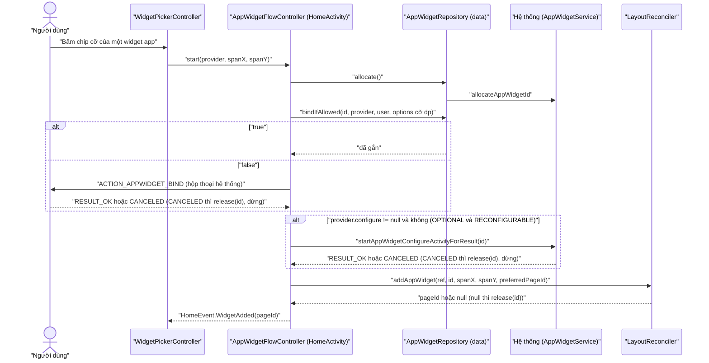

# G3c — AppWidgetHost: chứa widget của app khác trên Home (TT#19) — Implementation Plan

> **Dành cho agent thực thi:** làm theo `docs/AGENTS.md` và `docs/MultiAgent-Workflow.md` — code từng Task, báo cáo điều phối, qua review mới tick và sang Task sau; Task "bắt buộc kiểm tay" thì chờ chủ dự án kiểm; cả tính năng kiểm tay một lần ở cuối. Tối đa 5 vòng mỗi Task. Không có test tự động; kiểm chứng tay trên Vsmart Live 4 (Oppo A3x khi cần xem hành vi ColorOS, API 34). Lệnh viết cho CMD/PowerShell. Agent không chạm máy: điều phối chạy các kịch bản trên máy.

**Nhánh:** `feature/g3c-appwidget-host` · **Worktree:** `E:\SourceTree\IosLauncher-wt\G3c-appwidget-host` · **PR:** #59 · **Bắt đầu:** 2026-11-13 · **Plan duyệt:** 2026-11-13 (điều phối)
**Trạng thái: Sẵn sàng review (2026-11-16).** Task 1-6 xong; phần dọn khi gỡ app của Task 7 đã code (Task 2/4) và kiểm bằng hàng giả; D9 đóng; kịch bản gộp đã chạy ở dạng rút gọn trên Oppo A3x và Vsmart Live 4 (chi tiết ở Nhật ký 2026-11-16). **Phạm vi kiểm rút gọn do chủ dự án duyệt:** "happy case và vài trường hợp biên người dùng gặp được"; không chạy: cuộn danh sách trong widget, kéo chéo trang một widget thật, dọn khi gỡ thật trên máy, Task 7 (cấu hình lại/khôi phục), Task 8 (hồ sơ công việc), Task 9 (hiệu năng) → để sau. Knowledgement: `docs/knowledgements/G3c-appwidget-host.md`.
**Khóa:** không có khóa schema (dùng cột `appWidgetId` và `itemType = 3` đã có ở schema v1). Cần Oppo A3x cho Task 1 và Task 9 (hành vi ColorOS, đo hiệu năng).
**Rủi ro:** CAO (Home, lớp widget, edit mode, lớp ô lõi). Model/effort đề xuất cho agent thực thi: Sonnet 5.5, effort high (cử chỉ chạm/kéo-thả, đổi lớp ô lõi).

**Goal:** Người dùng thêm widget thật của app khác (AppWidget) lên lưới Home như một widget tự vẽ: chọn trong bảng "Tiện ích" (widget của ta trước, rồi từng app một mục), chọn cỡ theo ô, cấp quyền gắn và cấu hình nếu app đòi, rồi widget sống trên lưới: cập nhật nội dung, bấm được, kéo-thả được, vào edit mode rung và xóa bằng dấu "−", không rò id, tự dọn khi app bị gỡ.

**Architecture:** Một `AppWidgetHost` duy nhất (singleton Hilt, host id cố định) ở `core/appwidget`. Mỗi widget app trên lưới là hàng `itemType = 3` (`appWidgetId`, `packageName`, `className` = lớp provider, `userSerial`, `spanX/spanY`), model `PlacedAppWidget` cùng họ hình học với `PlacedWidget` (tự vẽ). `AppWidgetHostView` là **con của `IconCellView`** (ô được đổi thành `ViewGroup`, giữ nguyên "con i = ô i"), tái dùng qua bộ nhớ đệm theo `appWidgetId` của Activity để chuyển trang không tạo lại view. Luồng thêm (cấp id, gắn, hộp thoại quyền, cấu hình, ghi hàng) do một controller ở `HomeActivity`, trạng thái luồng ở singleton sống qua `recreate()`. Rò id được chặn bằng "giải phóng ngay sau khi xóa hàng" cộng "quét `getAppWidgetIds()` lúc khởi động".

**Tech Stack:** Android framework (`android.appwidget.*`), không thêm thư viện, không đổi `libs.versions.toml`. Manifest thêm `BIND_APPWIDGET` và một khối `<queries>` (cần đo, Task 1).

**Spec:** TT#19 trong `Launcher-Features.md`; `room-schema.md` mục `itemType` 3 và `appWidgetId`; G2c (widget tự vẽ trên lưới) và WX (`itemId` bền, `bindItem` mỗi lần bind); FX2/FX3 (edit mode, bộ điều hợp bố cục); `lessons/widgets.md`, `drag-and-layout.md`, `glass.md`.

**Nhãn nguồn dùng trong plan:** **đo được** (số hoặc log trên máy; plan này chưa có số đo nào của G3c), **đọc tài liệu** (developer.android.com, đọc 2026-11-13), **đọc code** (code dự án trong worktree), **suy luận chưa kiểm chứng** (kèm Task sẽ đo).

---

## Vì sao chọn thiết kế này

### Vấn đề cần giải (ràng buộc thật của dự án)

1. **Widget tự vẽ không phải view.** G2c vẽ widget bằng Canvas trong `IconCellView` (đọc code `IconCellView.drawWidget`); `IconGridView` giữ đúng "con i = ô i" (`getChildAt(index) as IconCellView`, đọc code ~25 chỗ ép kiểu, cộng `Jiggler`, `LeavingIcons`, `DockView`, `FolderPanelView`). Widget thật là một cây `View` (`AppWidgetHostView`) do app khác định nghĩa nội dung: phải nằm trong cây view để nhận chạm và vẽ RemoteViews.
2. **Nội dung và chạm do app khác quyết.** Con của widget có thể là nút, `ListView`, `ViewFlipper`. Các con này tiêu thụ `ACTION_DOWN`/nhấn giữ, mà luật dự án là nhấn giữ widget ngoài edit mode phải vào edit mode (G2c, WX D2) và trong edit mode phải kéo được. Cả hai chạy bằng `OnTouchListener`/`setOnLongClickListener` của ô, mà `ViewGroup` chỉ gọi chúng khi không con nào nhận chạm (đọc tài liệu `ViewGroup.dispatchTouchEvent`).
3. **`ViewPager2`/`RecyclerView` tái dùng và tháo trang** (`HomePagerAdapter`, bài học M7: trạng thái không được nằm trong view). Hai `AppWidgetHostView` cho cùng `appWidgetId` thì cái đến sau thay cái trước trong sổ của host (suy luận từ `AppWidgetHost.createView` "retains a pointer to the newly-created View", đọc tài liệu; xác nhận ở Task 4), nên view phải là một bản duy nhất theo id và được gắn lại giữa các ô.
4. **Id là tài nguyên hệ thống.** `allocateAppWidgetId` cấp id cho host của ta; hệ thống giữ tới khi `deleteAppWidgetId` (đọc tài liệu). Mọi đường tạo-rồi-hủy, xóa, gỡ app, xóa dữ liệu, khôi phục sao lưu đều có thể làm rò.
5. **Quyền gắn do hệ thống và ROM quyết**: `bindAppWidgetIdIfAllowed` có thể trả `false`, khi đó phải mở hộp thoại hệ thống (đọc tài liệu). Cách ColorOS (Oppo A3x, API 34) khác Live 4 (API 30) thế nào: **chưa biết**, Task 1 đo.
6. **File độc quyền:** nhánh này giữ `HomeActivity`, `HomeViewModel`, `LayoutReconciler`, `activity_home.xml` (brief 2026-11-13 và `MultiAgent-Workflow.md` 5.2). `WidgetPickerController` và `IconGridView`/`IconCellView` dùng chung với G3b (G3b merge trước, ta rebase).

### Quyết định 1 — Hosted view nằm đâu trong mô hình ô

| Phương án | Cách làm | Ưu | Nhược / rủi ro | Chọn? |
|---|---|---|---|---|
| **A. `IconCellView` đổi từ `View` sang `ViewGroup`; ô widget thật có một con `AppWidgetHostView`** | Ô vẫn là con thứ i của lưới; con duy nhất của ô là host view; nền, dấu "−", ảnh chụp kéo vẫn do ô vẽ | "con i = ô i" giữ nguyên; mọi biến đổi của ô (lò xo trượt, `Jiggler` xoay, co phình, `alpha` ẩn khi kéo, `layout()` của lưới) tự áp xuống con (biến đổi của cha áp cho cả cây con, đọc tài liệu `View`); mọi `as? IconCellView` (~25 chỗ) vẫn đúng; `snapshotWithoutBadge` vẫn dùng được | Mọi ô icon (hàng trăm view) đổi lớp cha: rủi ro hồi quy chạm/vẽ/trợ năng cho cả Home; `ViewGroup` mặc định `willNotDraw = true` (phải `setWillNotDraw(false)`); dấu "−" phải vẽ SAU con (chuyển sang `dispatchDraw` với ô widget thật) | **Có** — nhưng tách riêng thành Task 3 chỉ đổi lớp cha, kiểm hồi quy toàn Home trước khi xây tiếp |
| B. Lớp ô riêng `AppWidgetCellView : FrameLayout` cùng interface `GridCell` với `IconCellView` | Lưới giữ con i là một trong hai loại, mọi chỗ gọi `springOffsetTo`, `popIn`, `setBadgeVisible`... qua interface | Ô icon không đổi lớp cha | Diff lớn trong `IconGridView` (1434 dòng) và `Jiggler`/`LeavingIcons`/`DockView`; sao chép dấu "−", kéo, spring; tái dùng ô theo chỉ số bị đổi loại tại chỗ (phải thay view con khi loại đổi); lỗi "ô loại mới ở chỉ số cũ" là đúng lớp lỗi A1a | Chỉ khi Task 3 cho thấy hồi quy không sửa được (đường lui của A) |
| C. Lớp phủ riêng: host view ở một `FrameLayout` trên `ViewPager2`, đồng bộ vị trí theo trang | Lưới chỉ vẽ ô trống | Không động tới ô | Phải đồng bộ cuộn trang, lật trang khi kéo, rung, ghost, ẩn khi kéo, theo từng khung; trang `ViewPager2` bị tháo thì lớp phủ lệch (đúng bài học M7); phá "con i = ô i" ở dạng khó gỡ | Không |
| D. Host view là con thêm cuối `IconGridView` (chỉ số ≥ `items.size`), `IconCellView` chuyển tiếp mọi biến đổi sang nó | Ô i vẫn là `View` | Ô icon không đổi | `removeViewAt` khi `childCount > items.size` và mọi vòng `0 until childCount` sẽ chạm host view; host view vẽ SAU mọi ô nên dấu "−" của ô bị che; chuyển tiếp 7 setter (translation, scale, rotation, alpha, pivot) dễ lệch | Không |

**Vì sao A:** là phương án duy nhất không thêm trạng thái "host view đứng riêng" cần đồng bộ (C, D) và không nhân đôi lớp ô (B). Rủi ro thật nằm ở việc đổi lớp cha của mọi ô; vì vậy Task 3 làm đúng việc đó và **bắt buộc kiểm tay hồi quy** trước khi gắn host view vào. Tiền lệ trong dự án: GS đã đổi một view tự vẽ sang `FrameLayout` (đọc `lessons/glass.md` mục GS: `setWillNotDraw(false)`, tự đặt con trong `onLayout`, vẽ phần phủ trong `dispatchDraw`, chặn chạm ở `onInterceptTouchEvent`).
**Đánh đổi chấp nhận:** mỗi ô icon thêm vài chục byte của `ViewGroup` (suy luận, đo ở Task 9 bằng `dumpsys meminfo`); lớp `IconCellView` lớn thêm. Xét lại khi Task 3 không đạt (chuyển B).

### Quyết định 2 — Chạm: nhấn giữ vào widget vẫn phải vào edit mode

| Phương án | Cách làm | Ưu | Nhược | Chọn? |
|---|---|---|---|---|
| **A. Chặn có điều kiện** (kiểu Launcher3 `CheckLongPressHelper`) | Ngoài edit mode: ô theo dõi DOWN, hẹn `getLongPressTimeout`; hết hạn mà chưa vượt slop thì chặn (`onInterceptTouchEvent` trả `true`, con nhận `ACTION_CANCEL`), gọi nhấn giữ của lưới (vào edit mode) và đưa chính DOWN đó cho `IconDragGesture` để "giữ rồi kéo liền" còn chạy. Trong edit mode: chặn mọi chạm từ DOWN | Nút/danh sách trong widget dùng được ngoài edit mode; nhấn giữ, kéo, dấu "−" y như widget tự vẽ | Phải đưa DOWN thủ công cho `IconDragGesture` (listener chỉ chạy khi ô tự xử lý sự kiện), một trạng thái mới trong ô | **Có** |
| B. Tấm chắn trong suốt: widget chỉ để xem, ô chặn mọi chạm; bấm vào mở app của widget | Giống widget tự vẽ | Đơn giản, không xung đột | Mất tương tác (nút phát nhạc, tick việc cần làm): đây là lý do dùng widget thật | Không |
| C. Để widget tự xử lý nhấn giữ | — | Không code | Con tiêu thụ nhấn giữ thì không vào edit mode được; mất luật G2c | Không |

**Vì sao A:** B làm widget thật mất ý nghĩa, C vi phạm luật đã chốt. A cần Task 5 kiểm tay vì lỗi loại này review code khó thấy (bài học M7, `MultiAgent-Workflow.md` 4.2).

### Quyết định 3 — Chống rò id

| Phương án | Cách làm | Ưu | Nhược | Chọn? |
|---|---|---|---|---|
| **A. Giải phóng sau khi xóa hàng + quét lúc khởi động** | Mọi đường xóa hàng `itemType = 3` (`removeItem`, `removePackages`, `removeUser`, `catchUp`) ghi lại id; **sau commit**, trong cùng vùng khóa `mutex`, gọi `deleteAppWidgetId`. Lúc khởi động (`catchUp`): `host.getAppWidgetIds()` trừ id có trong DB trừ id của luồng thêm đang chạy (bộ nhớ) → xóa phần còn lại | Phủ cả crash giữa chừng, tiến trình bị giết trong luồng thêm, xóa dữ liệu, sao lưu/khôi phục; không cần file nhật ký; `getAppWidgetIds()` là API công khai từ API 26 = minSdk (đọc tài liệu) | Không nguyên tử với DB (lệnh binder không nằm trong transaction Room; xem ghi chú dưới); quét phụ thuộc `getAppWidgetIds` chạy đúng trên ColorOS (Task 1 đo) | **Có** |
| B. Nhật ký file (ghi id trước khi cấp, trước khi xóa, xóa sau commit) | Như WAL tự làm | Không phụ thuộc `getAppWidgetIds` | Thêm file, thêm trạng thái, vẫn rò khi xóa dữ liệu | Không (giữ làm đường lui nếu Task 1 thấy `getAppWidgetIds` hỏng) |
| C. Chỉ `deleteHost()` khi DB trống | Theo tài liệu "gọi khi khởi tạo database vì có thể do xóa dữ liệu" | Gọn | Không phủ rò khi DB còn hàng khác | Dùng làm lớp bổ sung ở `seedIfEmpty` |

**Lưu ý với `room-schema.md` ("giải phóng id trong cùng `@Transaction` với lệnh xóa hàng"):** `deleteAppWidgetId` là lệnh binder, không tham gia transaction SQLite. Cách làm tương đương: ghi nhận id **trong** transaction, gọi `deleteAppWidgetId` **ngay sau commit** trong cùng đoạn `mutex.withLock`; crash giữa hai bước để lại id mồ côi mà lần quét khởi động kế tiếp dọn. Đề xuất sửa câu đó trong `room-schema.md` (mục cuối plan). Đây là điểm lệch nhỏ với brief, nêu để điều phối duyệt.

### Quyết định 4 — Kính quanh widget của app khác (CHỦ DỰ ÁN CHỐT 2026-11-13: có thẻ kính sau MỌI widget)

| Phương án | Ưu | Nhược | Chọn? |
|---|---|---|---|
| A. Không kính; widget tự vẽ nền của nó, ô chỉ bo góc | Rẻ (không trừ ngân sách `cellsPerPageLimit`, không lát cắt nền) | Widget trong suốt hiện thẳng trên ảnh nền, khác widget tự vẽ | Không (đề xuất ban đầu của plan, chủ dự án chọn khác) |
| **B. Thẻ kính tại chỗ sau mọi widget app, cùng đường kính với widget tự vẽ** | Đồng bộ nhìn với đồng hồ/lịch/thời tiết; không thêm loại kính mới (`GlassRole.FOLDER_CELL` qua `GlassEnvironment`, `BackdropBlurDrawable`, cùng `GlassMode.FLAT` khi tier thấp hoặc người dùng tắt); `Launcher-Features.md` ghi "chưa kiểm chứng kính quanh widget của app khác" thì Task 9 đo | Widget nền đục che mất kính mà vẫn tốn lệnh vẽ; mỗi widget trừ vào `cellsPerPageLimit`; phải giữ lát cắt nền đúng khi trang trượt (bài học G2c Task 5: `invalidateGlass` theo cuộn) | **Có** |

**Hình thức:** thẻ giống hệt thẻ widget tự vẽ: cùng `widgetGlass` (`BackdropBlurDrawable`), cùng `WIDGET_CORNER_RATIO` (bán kính = 0.12 x cạnh ngắn), cùng viền/tint (`widget_glass_*`). `AppWidgetHostView` nằm TRONG thẻ, cắt bo góc bằng `clipToOutline` theo cùng bán kính trừ lề trong. Lề trong là MỘT hằng số chỉnh tay `APP_WIDGET_INSET_DP` (mặc định 0, tức host view phủ kín thẻ như renderer của widget tự vẽ phủ kín ô; chỉnh theo mắt khi kiểm). Placeholder cũng nằm trên cùng thẻ. Không đổi `core/glass`, không thêm `GlassRole`.
**Đo:** Task 9 đo chi phí kính với nhiều widget thật trên Oppo (cách GL/FX8: Janky %, p50/p95, ghép cặp xen kẽ). Đường lui nếu quá chậm: thẻ phẳng `widget_glass_flat` (không kính) hoặc nền mờ tĩnh dựng một lần; **đổi sang đường lui cần chủ dự án đồng ý** (không tự áp).

### Quyết định 5 — Bảng "Tiện ích"

| Phương án | Ưu | Nhược | Chọn? |
|---|---|---|---|
| **A. Giữ `ScrollView` hiện có: phần dựng sẵn giữ nguyên chữ từng dòng (vòng `for (kind in WidgetKind.entries)`), thêm bên dưới danh sách app dạng gập/mở lười** | Thẻ của G3b (thêm `WidgetKind`) tự nằm vào phần dựng sẵn, ít xung đột khi rebase; tiêu đề app rẻ (không dựng ảnh xem trước tới khi mở); không đổi cơ chế `CardDragGesture`/`PickerSheet` | Mỗi lần mở một app mới dựng thêm view trong `ScrollView` | **Có** |
| B. Viết lại bằng `RecyclerView` nhiều `viewType` | Tái dùng view tốt | Đổi toàn bộ `buildContent`, xung đột chắc với G3b, phải làm lại kéo thẻ | Không |

### Quyết định 6 — Chọn cỡ

Chủ dự án đã chốt (2026-11-13): người dùng chọn cỡ khi thêm, không có tay kéo đổi cỡ trên Home ở v1. Ta tính các cỡ hợp lệ bằng một hàm thuần `AppWidgetSizePlanner` (domain) từ `minWidth`, `minHeight`, `minResizeWidth/Height`, `resizeMode`, `maxResizeWidth/Height` và (API 31+) `targetCellWidth/Height`, làm tròn lên theo ô thực của lưới hiện hành (dp), kẹp tối đa 4×4. Hiện dạng chip cỡ dưới thẻ widget; chip đầu là cỡ mặc định.

### Đánh đổi chung chấp nhận

- v1 **không** kéo thẻ widget app từ bảng xuống lưới (hộp thoại quyền và cấu hình là Activity chen giữa cử chỉ kéo, không làm được trong một nét kéo); bấm chip là thêm vào ô trống đầu tiên bắt đầu từ trang đang xem (như `addWidget`). Xét lại ở v2 (cấp id và gắn trước khi bắt đầu kéo).
- Không đổi cỡ sau khi thêm (xóa rồi thêm lại).
- Một bản `AppWidgetHostView` mỗi id, luôn được giữ khi Activity sống (đổi lại bộ nhớ lấy tốc độ chuyển trang); xét lại nếu Task 9 đo thấy tốn.

---

## Câu hỏi cho chủ dự án (đã trả lời 2026-11-13)

| # | Câu hỏi | Trả lời của chủ dự án |
|---|---|---|
| 1 | Cỡ tối đa widget app | **4×4 ô**. Hằng số duy nhất `AppWidgetLimits.MAX_SPAN_X/MAX_SPAN_Y` (domain), không rải số 4 ở nơi khác |
| 2 | Kính sau widget app | **Có thẻ kính sau mọi widget** (khác đề xuất: không kính). Xem Quyết định 4 |
| 3 | Kéo thẻ widget app xuống lưới | Hoãn v2; v1 thêm bằng cách bấm chip cỡ |
| 4 | Widget hồ sơ công việc | Làm trong v1; cắt Task 8 nếu ROM chặn |
| 5 | Khôi phục sao lưu | Placeholder + dấu "−", không tự gắn lại |

Các điểm còn lại (giữ edit mode trong lúc đi qua hộp thoại quyền/cấu hình, bấm ô widget trong edit mode để cấu hình lại, tên mục "Tiện ích của app") tôi tự quyết, ghi ở bảng "Quyết định đã chốt" để điều phối rà.

---

## Quyết định đã chốt

| # | Quyết định | Ghi chú (ai quyết, ngày, cơ sở) |
|---|---|---|
| D1 | Cỡ do người dùng chọn lúc thêm trong các cỡ widget hỗ trợ, làm tròn theo ô; không tay kéo trên Home | Chủ dự án, 2026-11-13 |
| D2 | Cùng bảng "Tiện ích": widget của ta (đồng hồ, lịch, thời tiết, sắp có ảnh) trước, rồi mỗi app một mục kèm ảnh xem trước/nhãn | Chủ dự án, 2026-11-13 |
| D3 | `HomeActivity` độc quyền cho nhánh này: `startListening`/`stopListening`, kết quả `ACTION_APPWIDGET_BIND`, kết quả cấu hình | Chủ dự án, 2026-11-13 |
| D4 | Không đổi schema; `itemType = 3`, cột `appWidgetId` (nullable), `packageName`, `className` (lớp provider), `userSerial`, `spanX/spanY` | Brief điều phối; `room-schema.md` mục `itemType` 3 (`className` cho loại 3 là mở rộng cách dùng cột có sẵn, đề xuất ghi vào `room-schema.md`) |
| D5 | Host id là hằng cố định `0x4F533236` ("OS26"), **không bao giờ đổi** | Claude đề xuất; đọc tài liệu: host id "persists across all uses of the host"; đổi thì mọi id đã cấp thành mồ côi |
| D6 | `startListening()` ở `HomeActivity.onStart`, `stopListening()` ở `onStop` | Đọc tài liệu `AppWidgetHost.startListening` ("from onStart() in your Activity") |
| D7 | Khai `android.permission.BIND_APPWIDGET` (quyền chỉ dành cho hệ thống, người dùng cấp qua hộp thoại), `tools:ignore="ProtectedPermissions"`; khai `<queries>` APPWIDGET_UPDATE cho provider | Đọc tài liệu trang host. **Đo được (Task 1, 2026-11-13):** Live 4 (API 30): có và không có `<queries>` đều thấy 85/85 provider (user 0), không cần. **Oppo A3x (API 34): `<queries>` APPWIDGET_UPDATE CẦN và ĐỦ**: không có thì thấy 197, có thì 201 = đúng dumpsys (4 provider bị ẩn). Không cần `QUERY_ALL_PACKAGES` trên cả hai máy. `BIND_APPWIDGET`: không quan sát được tác dụng sau khi đã "Luôn cho phép" (cấp theo package, sống qua cài đè; Live 4); giữ khai báo |
| D8 | Luôn hỏi `hasSystemFeature(FEATURE_APP_WIDGETS)`: thiếu thì ẩn các mục app trong bảng chọn | Đọc tài liệu `AppWidgetManager` |
| D9 | **ĐÓNG 2026-11-16 (đo được, Oppo A3x API 34, commit baac404):** `OsAppWidgetHost.startConfigure(activity, id, requestCode)` truyền `ActivityOptions` với `setPendingIntentBackgroundActivityStartMode(MODE_BACKGROUND_ACTIVITY_START_ALLOWED)` (API 34+). Không options: `resultCode` 0 hai lần, không màn. Có options: `resultCode` -1 một lần, màn cấu hình hiện, Back: cancelled một lần, id giải phóng. Options phía người tạo và intent trực tiếp cũng chạy nhưng không cần. Luồng thêm dùng `startConfigure` ở `onResume` (RESUMED) và xử lý kết quả idempotent (Task 6); kiểm lại qua luồng thật ở bước E của "Kịch bản gộp G3c". Rủi ro ban đầu (giữ để tra): **RỦI RO MỞ (Oppo, Task 1): ColorOS hủy ngay activity cấu hình khi Os26 không phải launcher mặc định/không ở foreground** (xem bảng đo Nhật ký); phải đo lại ở Task 6 với Os26 mặc định và luồng bắt đầu từ Home. Cấu hình: có `configure` và (API 31+) không đặt đồng thời `WIDGET_FEATURE_CONFIGURATION_OPTIONAL` + `WIDGET_FEATURE_RECONFIGURABLE` thì mở activity cấu hình lúc thêm; `RESULT_CANCELED` hoặc lỗi thì giải phóng id và hủy việc thêm. API < 31 không có cờ OPTIONAL (đọc tài liệu: OPTIONAL từ API 31, RECONFIGURABLE từ API 28) nên luôn mở nếu có `configure` | Đọc tài liệu |
| D10 | Cấu hình lại: trong edit mode, bấm ô widget có `WIDGET_FEATURE_RECONFIGURABLE` và `configure != null` thì mở lại activity cấu hình (`startAppWidgetConfigureActivityForResult` cùng id); có huy hiệu bánh răng nhỏ làm gợi ý | Claude đề xuất |
| D11 | Giữ edit mode trong lúc hộp thoại quyền/cấu hình chạy: `HomeActivity.onStop` không gọi `exitEditMode()` khi luồng thêm/cấu hình đang chạy (B10 hiện thoát edit mode khi rời launcher) | Claude đề xuất; đọc code `HomeActivity.onStop` |
| D12 | Một `AppWidgetHostView` mỗi id, trong sổ `HostedWidgetViews` của Activity; `host.clearViews()` ở `onDestroy` (host giữ tham chiếu mạnh view đã tạo, mang `Context` Activity: suy luận chưa kiểm chứng, đo `Activities:` trong `dumpsys meminfo` ở Task 4) | Claude đề xuất |
| D13 | Widget hồ sơ công việc: dùng `bindAppWidgetIdIfAllowed(id, UserHandle, provider, options)`, lưu `userSerial`, bảng ghi "(Công việc)" | Đọc tài liệu API 21 |
| D15 | Thẻ kính sau mọi widget app, cùng đường kính với widget tự vẽ (`GlassRole.FOLDER_CELL`, `BackdropBlurDrawable`, cùng hình thẻ/bán kính/viền); `AppWidgetHostView` trong thẻ với bo góc; lề trong `APP_WIDGET_INSET_DP` mặc định 0 | Chủ dự án, 2026-11-13 (câu hỏi 2; đổi đề xuất ban đầu của plan) |
| D16 | Trần cỡ 4×4 là một cặp hằng `AppWidgetLimits.MAX_SPAN_X/MAX_SPAN_Y` | Chủ dự án, 2026-11-13 (câu hỏi 1) |
| D17 | Task 1 đã code (host, `BIND_APPWIDGET`, `<queries>` APPWIDGET_UPDATE, công cụ đo debug). Nếu đo cho thấy cần `QUERY_ALL_PACKAGES` thì DỪNG và báo điều phối (chính sách Play, quyết định của chủ dự án) | Điều phối, 2026-11-13 |
| D14 | Không xóa hàng khi `getAppWidgetInfo(id) == null` (provider có thể tạm vắng: đang cập nhật, thẻ nhớ, bị tắt): hiện placeholder. Chỉ xóa khi app thật sự bị gỡ (`PackageEvent.REMOVED`, `USER_REMOVED`, `catchUp`: cùng luật `removePackages` với icon, Q11) | Claude đề xuất; luật dự án G2a A4 |

## Ngoài phạm vi / ghi để sau

- Kéo thẻ widget app từ bảng xuống lưới; tay kéo đổi cỡ; widget app trong dock/thư mục/Library.
- `previewLayout` (API 31) và `setWidgetPreview` (API 35): v1 chỉ dùng `loadPreviewImage` rồi `loadIcon`.
- Màu động cho widget (`setColorResources`, API 31), `setOnLightBackground`.
- Tự gắn lại widget khi khôi phục sao lưu (v1: placeholder + "−").
- Widget màn khóa, widget `WIDGET_CATEGORY_SEARCHBOX` (chỉ liệt kê provider có `WIDGET_CATEGORY_HOME_SCREEN`; `WIDGET_FEATURE_HIDE_FROM_PICKER` bị ẩn khỏi bảng).
- Hộp thoại ghim widget từ app (`requestPinAppWidget`, launcher phải nhận `ACTION_CONFIRM_PIN_APPWIDGET`): không làm.
- Bản địa hóa tiếng Anh (làm cùng LG).

## Vùng file

Đường dẫn gốc `app/src/main/java/gambi/global/os26launcher/` (viết tắt `…/`), tài nguyên `app/src/main/res/`.

| File | Tạo / Sửa | Nóng |
|---|---|---|
| `AndroidManifest.xml` | Sửa (thêm `BIND_APPWIDGET`, khối `<queries>`) | Dùng chung, chỉ thêm |
| `…/ui/home/HomeActivity.kt` | Sửa (controller, `onStart/onStop`, kết quả, D11) | **Độc quyền G3c** |
| `…/ui/home/HomeViewModel.kt` | Sửa (`onAddAppWidget`, họ `PlacedWidgetBase` ở `onRemoveWidget`) | **Độc quyền** |
| `res/layout/activity_home.xml` | Không sửa, theo kế hoạch hiện tại | **Độc quyền** (khai báo để giữ khóa) |
| `…/data/layout/LayoutReconciler.kt` | Sửa (`addAppWidget`, 4 đường xóa, quét id) | **Độc quyền** |
| `…/data/layout/LayoutRepositoryImpl.kt` | Sửa (đọc loại 3, `addAppWidget`) | **Độc quyền** (`data/layout/*`) |
| `…/data/layout/db/*` | Không sửa (chỉ đọc hằng `ITEM_TYPE_WIDGET`) | **Độc quyền** |
| `…/domain/model/PlacedItem.kt` | Sửa (`PlacedWidgetBase`, `PlacedAppWidget`) | |
| `…/ui/home/view/IconCellView.kt` | Sửa lớn (đổi lớp cha, con host trong thẻ kính `widgetGlass` có sẵn, chạm, vẽ dấu "−"/bánh răng sau con) | **Lớp widget dùng chung với G3b** |
| `…/ui/home/view/IconGridView.kt` | Sửa (họ `PlacedWidgetBase`, bind ô app widget kể cả `glass`, `invalidateGlass`, gắn callback) | **Lớp widget dùng chung với G3b** |
| `…/ui/home/view/IconDragGesture.kt`, `Jiggler.kt`, `LeavingIcons.kt` | Sửa nhỏ nếu cần (đưa DOWN thủ công, hệ số rung) | Dùng chung |
| `…/ui/home/HomePagerAdapter.kt`, `ui/home/controller/HomePagerController.kt` | Sửa (truyền sổ host view, callback cấu hình lại) | Dùng chung (WX từng sửa, đã merge) |
| `…/ui/home/controller/WidgetPickerController.kt` | Sửa (tách phần dựng sẵn thành hàm giữ nguyên thân, thêm phần app) | **Lớp widget dùng chung với G3b** |
| `…/core/appwidget/OsAppWidgetHost.kt` | Tạo ở Task 1 (host, host id, `clearHostViews`); `onCreateView`/lỗi ở Task 4 | |
| `…/ui/widget/host/HostedWidgetViews.kt`, `AppWidgetFlowController.kt`, `AppWidgetFlowState.kt`, `AppWidgetSection.kt` (dựng mục trong bảng) | Tạo | |
| `…/domain/model/AppWidgetModels.kt`, `domain/layout/AppWidgetSizePlanner.kt` (kèm `AppWidgetLimits`), `domain/repository/AppWidgetRepository.kt`, `domain/usecase/AddAppWidgetUseCase.kt` | Tạo | |
| `…/domain/repository/LayoutRepository.kt`, `domain/usecase/RemoveWidgetUseCase.kt` | Sửa (thêm `addAppWidget`; xóa widget app giải phóng id) | |
| `…/data/appwidget/AppWidgetRepositoryImpl.kt` | Tạo (liệt kê provider, cấp/gắn/giải phóng/quét id) | |
| `…/di/AppWidgetModule.kt`, `di/RepositoryModule.kt` | Tạo / sửa (append binding) | Dùng chung, chỉ thêm |
| `src/debug/…` (provider thử, activity cấu hình thử, receiver đo) | Tạo (chỉ bản debug, Task 1) | |
| `res/values/strings.xml` | Sửa (khối cuối, tiền tố `aw_`) | Dùng chung, chỉ thêm |
| `res/drawable/ic_aw_*.xml` (bánh răng) | Tạo nếu cần | |

**Nhắc điều phối:** G3b thêm `WidgetKind` mới sẽ buộc sửa các `when (kind)` trong `HomeViewModel.onWidgetTapped`, `WidgetPickerController.kindNameRes` và `WidgetRenderers.create`. `HomeViewModel` là file độc quyền của G3c nên cần thống nhất: G3b sửa đúng một nhánh `when` ở đó (append) hoặc điều phối cho phép. Plan G3c coi các nhánh `when` của G3b là việc rebase.

## Global Constraints

- Layering `ui → domain ← data`: domain không có `Intent`, `ComponentName`, `AppWidgetProviderInfo`, `Bitmap`. Ranh giới chéo bằng `AppWidgetRef(packageName, className, userSerial)` và các model số thuần. `core/appwidget/OsAppWidgetHost` là ngoại lệ có chủ ý giống `core/glass` (hạ tầng UI dùng chung của `data` và `ui`), điều phối xác nhận.
- Không đổi schema Room, không migration. Không thư viện mới.
- Chữ hiển thị ở `strings.xml` (tiếng Việt, tiền tố `aw_`, một khối cuối file). Nhãn app/widget lấy từ hệ thống.
- **Riêng tư:** không log tên package/lớp provider của app khác, ảnh xem trước, nội dung widget, `ComponentName` đầy đủ. Log chỉ có số đếm, id số, tên lớp ngoại lệ. Không đưa nội dung RemoteViews vào log.
- Widget của app khác chạy mã không tin cậy trong tiến trình ta: bọc `createView`, `updateAppWidgetSize`, `bindAppWidgetIdIfAllowed`, `startAppWidgetConfigureActivityForResult` bằng `try/catch` (`SecurityException`, `ActivityNotFoundException`, `RuntimeException`); lỗi thì placeholder hoặc hủy luồng thêm, không crash Home.
- Không cấp phát trong `draw`/`onDraw` hay trong vòng cập nhật mỗi khung (quy tắc GL Task 6).
- `AppWidgetHostView` được tạo và dùng chỉ trên luồng chính. Việc tải nhãn/ảnh xem trước của provider chạy `Dispatchers.IO`, giải mã/thu ảnh trước khi đưa vào view.
- Mọi đường kết thúc luồng thêm (thành công, hủy, lỗi, Activity hủy) phải kết thúc với id hoặc đã ghi hàng, hoặc đã `deleteAppWidgetId`.

## Review Focus

1. **Lớp cha của `IconCellView` đổi sang `ViewGroup` (Task 3):** `setWillNotDraw(false)`, `onLayout` rỗng khi không có con, chạm/giữ/kéo/dấu "−" của icon, thư mục, ô dock và ô trong panel thư mục (cùng dùng `IconCellView`) y như trước; nhãn trợ năng; kính ô thư mục.
2. **Chạm của ô widget thật (Task 5):** nhấn giữ ngoài edit mode vào edit mode kể cả khi giữ trên nút/danh sách của widget; "giữ rồi kéo liền một lần chạm" còn chạy (DOWN đã đưa cho `IconDragGesture`); trong edit mode mọi chạm vào widget thuộc về ô (không bấm nhầm nút của widget); vuốt ngang qua widget vẫn lật trang.
3. **Id:** mọi đường kết thúc luồng thêm, mọi đường xóa hàng loại 3 (bảng ở mục Rò id), quét khởi động không xóa nhầm id của luồng thêm đang chạy, không xóa id của hàng còn trong DB.
4. **Không rò Activity:** `clearViews()` ở `onDestroy`; hộp thoại, `ActivityResultLauncher` không giữ view; số `Activities` trong `dumpsys meminfo` không tăng sau 3 lần `recreate()` có widget.
5. **Một view mỗi id:** chuyển trang, kéo sang trang khác, `recreate()` không tạo hai `AppWidgetHostView` cùng id cùng lúc; `parent.removeView` trước khi `addView` vào ô khác.
6. **`PlacedWidgetBase`:** mọi chỗ trước đây `is PlacedWidget` (hình học: không gộp thư mục, không vào dock, không chồng widget, ngân sách kính, `hasWidgets`) đã đổi sang họ chung; những chỗ cần "tự vẽ" (renderer, `onWidgetClick` mở app Đồng hồ/Lịch/bảng thời tiết) vẫn chỉ cho `PlacedWidget`. Bảng "đường bố cục gặp item nhiều ô" của plan G2c là mẫu rà.
7. **Provider vắng:** `getAppWidgetInfo == null` không xóa hàng, không crash, có placeholder; hàng được xóa khi gỡ app thật.
8. **Hiệu năng và kính:** vuốt trang, rung edit mode và chi phí thẻ kính với nhiều widget thật (Task 9, Oppo); `onAppWidgetOptionsChanged` không bị gọi lặp mỗi khung; lát cắt nền của thẻ đúng khi trang trượt (không vệt ngang như lỗi G2c Task 5).
9. **Riêng tư log** (grep toàn diff).

---

## Rò id: mọi đường tạo và hủy id (bảng rà soát)

| # | Tình huống | Điều gì xảy ra | Xử lý |
|---|---|---|---|
| L1 | Cấp id rồi người dùng hủy ở hộp thoại quyền gắn | Id đã cấp, chưa gắn, chưa có hàng | `RESULT_CANCELED` → `deleteAppWidgetId` |
| L2 | Gắn xong, activity cấu hình trả `RESULT_CANCELED` hoặc lỗi | Id đã gắn, chưa có hàng | `deleteAppWidgetId`, không ghi hàng |
| L3 | Activity cấu hình không bao giờ trả (người dùng nhấn Home, app đó lỗi) | Luồng treo, id rò | **Đo được Live 4 (Task 1):** nhấn Home lúc đang cấu hình, `AwProbeActivity` không nhận kết quả nào, không `onDestroy`, id vẫn cấp (46) → **rò xác nhận**; không thể dựa vào `RESULT_CANCELED`. Xử lý: id của luồng đang chạy nằm trong bộ nhớ (`inFlight`), luồng quá 10 phút thì giải phóng; khởi động nguội thì quét (L8). (Probe không có `clearTaskOnLaunch` như `HomeActivity`; Task 6 đo lại với luồng thật). **Oppo khác Live 4:** activity cấu hình KHÔNG hiện, hệ thống trả `RESULT_CANCELED` ngay (xem D9), và kết quả có thể tới HAI lần cho cùng id: `release` phải idempotent (đã có ở `AppWidgetRepositoryImpl.release`: id đã xóa thì `deleteAppWidgetId` vô hại) và luồng thêm phải bỏ qua kết quả thứ hai (trạng thái luồng về `Idle` ở kết quả đầu). **Đã làm ở Task 6:** `AppWidgetFlowState` (singleton) giữ luồng; `onActivityResult` bỏ qua kết quả khi không còn `Configuring` đã mở; nhấn Home (`HomeActivity.onNewIntent`) hoặc quá 10 phút thì `abort()` giải phóng id; mở cấu hình bằng `startConfigure` (D9 đóng). Kiểm máy: phần C7, C8, C10 của "Kịch bản gộp G3c". |
| L4 | Người dùng bấm "−" rồi xác nhận | Hàng xóa | `removeItem` đọc `appWidgetId`, xóa hàng, **sau commit** `deleteAppWidgetId` |
| L5 | Gỡ app (provider) khi launcher chạy | `PackageEvent.REMOVED` | `removePackages` xóa mọi hàng loại 3 của `(package, userSerial)` (xóa phẳng, **không dồn ô**, giống "−") rồi giải phóng id |
| L6 | Gỡ app lúc launcher không chạy | `catchUp` lúc mở | `catchUp` coi `(package, userSerial)` của hàng loại 3 là ứng viên, hỏi `isPackageInstalled`, xóa như L5 |
| L7 | Hồ sơ công việc bị bỏ | `USER_REMOVED` | `removeUser` xóa hàng loại 3 của user đó (tách khỏi `deleteAppsAndFixFolders` để không dồn ô quanh widget), giải phóng id |
| L8 | Tiến trình bị giết giữa các bước, hoặc xóa hàng rồi chưa kịp giải phóng | Id mồ côi | Quét lúc khởi động: `host.getAppWidgetIds()` − id trong DB − id luồng thêm đang chạy (bộ nhớ) → `deleteAppWidgetId`. **Đo được (Task 1, cả hai máy):** `getAppWidgetIds()` liệt kê đúng id đã cấp (Oppo: 12,13) và id còn sau khi tiến trình bị giết |
| L9 | Xóa dữ liệu app (DB mất, hệ thống còn id) | Mọi id là mồ côi: **đo được Live 4: `pm clear` KHÔNG xóa id của host** (cấp id 50, clear, mở lại: `ids=50`); Oppo chưa đo được (`pm clear` bị chặn, Xóa dữ liệu trong Cài đặt chưa chạy) | L8 phủ; thêm `host.deleteHost()` khi `seedIfEmpty` thấy DB rỗng (theo tài liệu "call when initializing your database") |
| L10 | Khôi phục sao lưu (`allowBackup=true`, `launcher.db` vào sao lưu): hàng loại 3 mang `appWidgetId` của máy cũ | Id vô hiệu hoặc trỏ nhầm widget khác? | Không biết id máy mới có trùng id máy cũ không (suy luận). Hàng loại 3 chỉ dùng được khi `getAppWidgetInfo(id)` khớp `packageName`/`className` của hàng; khác hoặc null thì placeholder, **không** hiển thị widget lạ. **đo được Task 1 (cả hai máy):** `getAppWidgetInfo` trả null cho id đã cấp chưa gắn và cho id chưa từng cấp, không ném; còn chưa biết id máy mới có trùng id máy cũ không (suy luận) nên vẫn bắt buộc so `provider` của hàng |
| L11 | Cập nhật app (provider đổi/đổi tên lớp) | `onProviderChanged` | Host mặc định đặt lại view; ta đẩy lại cỡ (`updateAppWidgetSize`) |
| L12 | Provider bị tắt (`pm disable`) rồi bật | `getAppWidgetInfo` null rồi có lại | Placeholder rồi tự hiện lại khi `onProvidersChanged` làm bind lại; không xóa hàng (D14) |
| L13 | Đổi cỡ lưới (reflow) | Hàng đổi `gridX/Y` hoặc trang | Không đụng id (`updateAll` + `copy`), như widget tự vẽ |

---

## Chi tiết thiết kế

### Vòng đời host

- `OsAppWidgetHost : AppWidgetHost(appContext, HOST_ID)` ở `core/appwidget`, singleton Hilt (`AppWidgetModule`). `onCreateView` trả `OsAppWidgetHostView` (ghi đè `getErrorView()` để lỗi tải hiện chữ của ta thay vì "Problem loading widget": cần xác nhận ở Task 4 rằng hàm này `protected` gọi được từ lớp con; nếu không thì phủ chữ bằng placeholder).
- `HomeActivity.onStart` → `host.startListening()`; `onStop` → `stopListening()` (D6). `onDestroy` → `hostedViews.clear()` (gỡ khỏi cha, `host.clearViews()`).
- `onProviderChanged`, `onProvidersChanged` (hoặc `onAppWidgetRemoved`, API 30: ý nghĩa chưa rõ, chỉ ghi log id số khi đo) báo `HostedWidgetViews` để bind lại ô liên quan (`notifyItemRangeChanged` của adapter cho trang chứa ô).

### Luồng thêm



Trạng thái luồng (`AppWidgetFlowState`: `Idle`, `Binding(id, ...)`, `Configuring(id, ...)`) nằm ở singleton Hilt, không ở Activity, để sống qua `recreate()`; `HomeActivity` chỉ giữ `ActivityResultLauncher` (đăng ký ở `onCreate`, trước `STARTED`: bài học G3a/WeatherSheetController). Kết quả cấu hình đi qua `onActivityResult` (host chỉ có API `startActivityForResult`, đọc tài liệu), kết quả gắn đi qua `ActivityResultLauncher`. Tiến trình bị giết giữa luồng thì khởi động nguội không còn luồng, id mồ côi bị quét (L8). Luồng đang chạy thì bảng chọn và nút "Tiện ích" từ chối bắt đầu luồng thứ hai.

### Cỡ, dp và tùy chọn cho provider

- `AppWidgetSizePlanner.plan(info numbers dp, cell dp, maxSpan) -> List<WidgetSize>`: cỡ mặc định = (`targetCellWidth/Height` nếu > 0 và API ≥ 31, ngược lại ô nhỏ nhất đủ `minWidth/minHeight`); biên dưới theo `minResize*` khi `resizeMode` cho phép trục đó; biên trên theo `maxResize*` (API 31) hoặc 4; bỏ cỡ vượt 4×4; rút gọn còn tối đa 6 chip (mặc định, nhỏ nhất, lớn nhất, rồi cỡ cùng cạnh với mặc định). Công thức chiều rộng n ô = `n*cellW + (n-1)*gutter` (dp), cùng `GridMetrics`. Đo ở Task 6: cỡ mặc định của vài widget thật trên Live 4 (API 30, tính theo dp) và Oppo (API 34, có `targetCell*`) có thể khác nhau; ghi lại.
- Tùy chọn gắn và cập nhật: `OPTION_APPWIDGET_MIN/MAX_WIDTH/HEIGHT` (dp, một cỡ vì Home khóa dọc `nosensor`), `OPTION_APPWIDGET_HOST_CATEGORY = WIDGET_CATEGORY_HOME_SCREEN`; API 31+: thêm `updateAppWidgetSize(options, listOf(SizeF))` một cỡ. Gọi sau layout/đổi cỡ, bỏ nếu cỡ dp không đổi (chống `onAppWidgetOptionsChanged` lặp).

### Ô widget thật trong `IconCellView`

- `bindAppWidget(widget: PlacedAppWidget, cells, hosted: HostedWidgetViews)`: dọn trạng thái widget tự vẽ và icon (A1a: `bind`/`bindFolder`/`bindWidget` đều gọi dọn trạng thái app widget và gỡ host view khỏi ô); lấy host view theo id; nếu `null` thì chế độ placeholder.
- Thẻ kính: `bindAppWidget` nhận `glass: GlassEnvironment?` như `bindWidget` (null khi `modeFor(FOLDER_CELL) == FLAT`) và vẽ `widgetGlass` trong `onDraw` (cùng `drawWidget` của G2c, chỉ khác phần nội dung do con host vẽ chứ không phải renderer). `invalidateGlass()` và `hasWidgets` của `IconGridView` tính cả widget app (lát cắt nền bám theo cuộn trang, bài học G2c Task 5). `computeGlassFolderIds` trừ mọi `PlacedWidgetBase` vào ngân sách `cellsPerPageLimit` (đã đúng nhờ họ chung).
- Host view: `layout(inset, inset, w - inset, h - inset)` với `inset = APP_WIDGET_INSET_DP` (mặc định 0) trong `onLayout` của ô; `clipToOutline` với `ViewOutlineProvider` bo góc theo `max(0, WIDGET_CORNER_RATIO * min(w, h) - inset)` (cùng bán kính thẻ).
- Dấu "−" và bánh răng vẽ trong `dispatchDraw` sau `super.dispatchDraw` (trên con); ảnh kéo (`snapshotWithoutBadge`) vẽ `draw(Canvas)` của ô gồm con (đọc code: `draw` của `ViewGroup` vẽ cả con vào canvas phần mềm; widget dùng `SurfaceView`/`TextureView` có thể trống, chấp nhận).
- `jiggleScale` của ô widget app = hệ số widget tự vẽ (0.5, một độ). Nếu Task 9 đo rung nhiều widget thật tốn: đường lui là không rung widget app, chỉ hiện dấu "−".
- Placeholder: trên cùng thẻ kính (hoặc nền phẳng khi FLAT), biểu tượng app (nếu còn) và chữ "Widget không khả dụng"; trong edit mode có dấu "−".

### Chạm (Task 5)

`IconCellView` (ô widget app) ghi đè `onInterceptTouchEvent`:
- `editMode` (ô biết từ `setBadgeVisible`/cờ riêng): chặn mọi chạm từ DOWN; chạm vào bánh răng/dấu "−" xử lý ở `onTouchEvent` của ô như hiện nay; bấm trong ô (không phải dấu) gọi `onReconfigure` nếu hợp lệ.
- Ngoài edit mode: DOWN → ghi tọa độ, hẹn `LongPress`; vượt `touchSlop` trước hạn → hủy hẹn, không chặn (widget cuộn, `ViewPager2` lật); hết hạn → `requestDisallowInterceptTouchEvent(true)` lên cha, chặn từ sự kiện kế (con nhận `ACTION_CANCEL`), gọi `performLongClick()` (vào edit mode, như ô khác) và **đưa chính DOWN ban đầu cho `dragGesture`** để hàng "arm" của `IconDragGesture` chạy (nó cần DOWN, và bình thường chỉ nhận qua `OnTouchListener` khi ô tự xử lý sự kiện).
- Bấm ngắn ngoài edit mode: con xử lý (PendingIntent của widget); vùng không có con nào bắt thì `performClick` của ô không làm gì.
- `HomeTouchRouter` không đổi: sau khi phiên kéo mở, Activity tiếp quản như mọi phiên kéo (đọc code).

**Luật chạm đã code (Task 5, đọc code; chờ kiểm máy):**
- Ô widget app giữ ĐÚNG một con (`AppWidgetHostView`). `ViewGroup` chỉ gọi `OnTouchListener`/`OnLongClickListener` của ô khi KHÔNG con nào nhận chạm, nên ô không dựa vào listener cho đường "con nhận DOWN".
- Edit mode (`badgeVisible`): `onInterceptTouchEvent` trả `true` từ DOWN; ô nhận mọi sự kiện qua listener như widget tự vẽ (kéo, "−" y như cũ, nút trong widget không bấm được).
- Ngoài edit mode: con nhận chạm bình thường. `dispatchTouchEvent` của ô (chạy cả khi con đã xin "đừng chặn") theo dõi DOWN/MOVE/UP và (1) đưa chính DOWN/MOVE cho `IconDragGesture` thủ công (nó là `OnTouchListener`); (2) hẹn `appLongPress` sau `getLongPressTimeout`. Hết hạn mà ngón chưa vượt `touchSlop`: đặt `interceptNow`, gửi `ACTION_CANCEL` thẳng cho con (ngón đứng yên có thể không còn sự kiện nào tới trước UP, nên không đợi `ViewGroup` hủy), gọi `performLongClick()` (cùng đường mọi ô: vào edit mode, rung nhẹ). Từ đó `onInterceptTouchEvent` trả `true`: sự kiện kế tiếp bị `ViewGroup` đổi thành CANCEL cho con, các sự kiện sau tới ô qua listener, nên `IconDragGesture` (đã "arm" cùng lúc, cùng timeout) bắt đầu kéo khi ngón di quá slop = "giữ rồi kéo liền một lần chạm". UP/CANCEL luôn được đưa cho `IconDragGesture` (bất biến) vì sự kiện đầu sau khi chặn không tới ô.
- Ô tự nhận DOWN (không con nào bắt) thì `View` tự nhấn giữ (`isPressed`), `appLongPress` bỏ qua để không gọi hai lần.
- **Luật cuộn (đã chọn):** ô KHÔNG BAO GIỜ giành cử chỉ cuộn. Chạm di quá `touchSlop` trước hạn nhấn giữ thì ô không bao giờ chặn: widget có danh sách cuộn thì con gọi `requestDisallowInterceptTouchEvent(true)` sau khi nó nhận ra cuộn dọc (cơ chế chuẩn của Android) và `ViewPager2` không lật trang; vuốt ngang không có con nào giành thì `ViewPager2` chặn như với mọi ô (con nhận CANCEL). Ô ghi đè `requestDisallowInterceptTouchEvent` chỉ chuyển lên cha, KHÔNG đặt cờ của chính ô (nếu đặt, `onInterceptTouchEvent` không còn được gọi và nhấn giữ không chặn được). Chi phí chấp nhận: một vuốt NGANG bắt đầu trên danh sách cuộn dọc có thể bị `ListView` giành nếu nó nhận ra cuộn trước; đây là hành vi mặc định của Android, không thêm luật nào của ta (suy luận chưa kiểm chứng; Step 2 mục B3 kiểm).

### Bố cục và dữ liệu

- `PlacedWidgetBase : PlacedItem` (sealed marker: hình học nhiều ô, đích gộp thư mục không hợp lệ, không vào dock). `PlacedWidget` (tự vẽ, 4) và `PlacedAppWidget(itemId, position, appWidgetId, provider: AppWidgetRef)` (3) cùng họ.
- `LayoutRepositoryImpl` đọc loại 3: bỏ qua (log, không xóa) hàng thiếu `appWidgetId`/`packageName`, cỡ ngoài 1..4×1..4 hoặc `container != HOME`.
- `LayoutReconciler.addAppWidget(ref, appWidgetId, spanX, spanY, preferredPageId)` tương tự `addWidget` (chỗ trống đầu tiên, `WidgetPlacementPlanner.firstFit`, trang mới nếu hết chỗ) và ghi hàng loại 3.
- `removePackages`/`removeUser`/`catchUp`: xóa hàng loại 3 **tách** khỏi `deleteAppsAndFixFolders` (không dồn ô), thoát sớm `if (doomed.isEmpty())` phải tính cả hàng widget; `removeItem`: đọc hàng trước khi xóa để biết id.
- `GridReflowPlanner` đã xử lý span (G2c); cỡ tối đa 4×4 vừa mọi preset (4×5 là nhỏ nhất).

---

### Task 1: Spike đo giả định (host, quyền gắn, `getAppWidgetIds`, ROM)
**Bắt buộc kiểm tay:** có — Task sau xây trên giả định chỉ máy thật trả lời (mục 4.2): provider có hiện cho một launcher target SDK 37 trên API 30 và 34 không (`<queries>`), hộp thoại gắn trên ColorOS ra sao, `getAppWidgetIds()` có dùng được, `createView` trả gì.
**Files:** `AndroidManifest.xml` (BIND_APPWIDGET, `<queries>` với `android.appwidget.action.APPWIDGET_UPDATE`), `core/appwidget/OsAppWidgetHost.kt`, `di/AppWidgetModule.kt`, `HomeActivity` (chỉ `startListening/stopListening`), `src/debug/**` (provider thử A: không cấu hình; B: cấu hình bắt buộc trả OK; C: cấu hình không bao giờ kết thúc; D: có nút, `ListView`, cờ RECONFIGURABLE + OPTIONAL; receiver đo `AW_PROBE` cho phép `DUMP` theo mẫu CP).
**Interfaces:** Produces: `OsAppWidgetHost` singleton; kết quả đo ghi vào "Nhật ký" và sửa "Quyết định đã chốt" D7/D9/L8/L10 nếu giả định sai.
- [ ] **Step 1:** Khai host, `startListening/stopListening` (D6). Receiver debug in ra **chỉ số đếm**: `getInstalledProviders().size` (tất cả hồ sơ), số provider mỗi hồ sơ, `getAppWidgetIds().size`, kết quả `allocate` → `bindAppWidgetIdIfAllowed` (true/false) → `deleteAppWidgetId` → `getAppWidgetIds` có còn id không.
- [ ] **Step 2: Kịch bản đo (điều phối chạy, cả hai máy, bản debug).** (a) So `getInstalledProviders().size` với đếm provider thật qua `adb shell dumpsys appwidget` (đếm mục `Provider`); chạy với và không có khối `<queries>`: nếu thiếu provider thì thử thêm `QUERY_ALL_PACKAGES` **chỉ ở bản đo**, ghi số, và quyết định cuối (đây là câu hỏi cho điều phối vì chính sách Play). (b) Gọi `allocate` + `bindIfAllowed` với provider A: ghi kết quả; nếu `false`, mở `ACTION_APPWIDGET_BIND` và ghi: hộp thoại có hiện không, chữ, nút "Luôn cho phép", sau "Luôn cho phép" lần sau `bindIfAllowed` có `true` không, có cần khai `BIND_APPWIDGET` mới hiện hộp thoại không (thử bỏ khai). (c) Với B, C, D: `startAppWidgetConfigureActivityForResult`, ghi `resultCode`; ở C nhấn Home rồi mở lại Home: có nhận `RESULT_CANCELED` không (kiểm L3). (d) `getAppWidgetIds()` trả đúng các id đã cấp? `deleteHost()` xóa hết? (e) `dumpsys appwidget` trước/sau mỗi bước để thấy id mồ côi. (f) Xóa dữ liệu app (`pm clear` bị chặn trên Oppo: dùng Cài đặt → Xóa dữ liệu) rồi `dumpsys appwidget`: id của host ta còn không (L9).
- [x] **Đã code (2026-11-13):** manifest, `OsAppWidgetHost`, `AppWidgetModule`, `startListening/stopListening`, công cụ đo debug (`AwProbeReceiver`, `AwProbeActivity`, provider A-D, hai activity cấu hình). Bốn APK: **v2-queries** (bản của nhánh: `BIND_APPWIDGET` + `<queries>` APPWIDGET_UPDATE), **v-noq** (không `<queries>`), **v-noperm** (không `BIND_APPWIDGET`), **v-qall** (CHỈ ĐỂ ĐO: thêm `QUERY_ALL_PACKAGES`, không bao giờ commit). Công cụ đo chỉ ghi log tag `AWPROBE`: số đếm, id số, true/false, mã kết quả.
- [x] **Task 1 đo xong cả hai máy (điều phối, 2026-11-13).** Oppo phải gỡ bản cài cũ (khóa ký khác, chủ dự án đồng ý) nên chạy trên bản cài mới và Os26 KHÔNG là launcher mặc định lúc đo (xem D9 cho hệ quả).
- [ ] **Step 3: Ghi kết quả** vào Nhật ký và sửa plan nếu giả định sai (đặc biệt D7, L8, L10). Chưa có UI người dùng ở Task này.

**Kịch bản đo Task 1 (lệnh chính xác, PowerShell, mỗi máy một lượt; điều phối chạy, agent không chạm máy).** Gói `P = gambi.global.os26launcher`; APK ở thư mục scratchpad `g3c-apks`. Máy phải rảnh (chủ dự án xác nhận); cài đè bản debug cùng khóa như mọi lần cài nhánh; Os26 đang là launcher mặc định hay không đều được. Chỉ log `AWPROBE` (số đếm, id số, true/false).

```
$P = "gambi.global.os26launcher"
$A = "$P.AW_PROBE"
# Mỗi lệnh đo: xóa log, gửi, đọc log
function Probe($args2) { adb logcat -c; adb shell am broadcast -a $A -p $P --es cmd $args2 | Out-Null; Start-Sleep 1; adb logcat -d -s AWPROBE }
```

**0. Chuẩn bị:** `adb devices`; ghi `adb shell getprop ro.build.version.sdk` và tên máy; `adb install -r g3c-spike-v-noq.apk`; mở app một lần (`adb shell am start -n $P/.ui.home.HomeActivity`), về Home.

**A. Provider có hiện không (`<queries>`), mỗi biến thể một lượt**
1. v-noq: `Probe counts` → ghi `installedProviders`, `own`, `foreign`, `featureAppWidgets`, `providers` của từng hồ sơ. Song song `adb shell dumpsys appwidget > aw_noq.txt` và đếm số provider trong mục "Providers:" của file (ghi mẫu dòng đã đếm).
2. `adb install -r g3c-spike-v2-queries.apk` rồi lặp: `Probe counts`, `dumpsys appwidget > aw_v2.txt`.
3. Nếu `foreign` của v2 < số provider thật (dumpsys) thì **DỪNG, báo điều phối** (cần quyết định `QUERY_ALL_PACKAGES`/chính sách Play). Chỉ khi đó và chỉ để ghi số trần mới cài `g3c-spike-v-qall.apk` rồi `Probe counts` (không dùng làm bản giao).

**B. Quyền gắn (dùng v2-queries, trừ mục ghi khác)**
4. `Probe "trybind"` với `--es p A` (thêm tham số: `adb shell am broadcast -a $A -p $P --es cmd trybind --es p A`) → ghi `allowed=` (lần đầu thường false).
5. `adb logcat -c; adb shell am start -n $P/.debug.AwProbeActivity --es p A --es after delete` → chụp màn (`adb exec-out screencap -p > bind1.png`) hộp thoại gắn: có hiện không, chữ, các nút. Chọn **"Cho phép"** (một lần). `adb logcat -d -s AWPROBE` → ghi `bindAppWidgetIdIfAllowed`, `result request=bind resultCode`, `flow done ... infoNonNull`, `ids`.
6. Lặp bước 5: lần hai có hỏi lại không? Lần này chọn **"Luôn cho phép"** (nếu có). Lặp bước 4: `allowed=` bây giờ?
7. `adb install -r g3c-spike-v-noperm.apk` (không khai `BIND_APPWIDGET`): bước 5 lần nữa: hộp thoại còn hiện không, có `SecurityException`? (Cài lại v2 sau đó.)

**C. Cấu hình (v2-queries)**
8. Provider B (bắt buộc): `... --es p B --es after delete`: ghi `configure=true`, `result request=configure resultCode=-1` (OK).
9. Provider B, ở màn cấu hình nhấn Back (nếu thấy màn; B tự kết thúc ngay nên có thể không kịp: dùng C cho ca này): ghi.
10. Provider C (không kết thúc): `... --es p C --es after delete`; khi màn "G3c probe C configuration" hiện: `adb shell input keyevent KEYCODE_HOME` (Home trong lúc cấu hình, mô phỏng L3). Đợi 5 giây, `adb logcat -d -s AWPROBE`: có `result request=configure resultCode=0` và `released` không, hay chỉ `onDestroy`? Rồi `Probe ids`: id của lượt này còn không?
11. Provider D (reconfigurable + optional, targetCell 2x2): ghi `widgetFeatures`, `skipConfigure=` (kỳ vọng true ở API 31+ vì cờ OPTIONAL chỉ có từ API 31, false ở API 30).

**D. Id (`getAppWidgetIds`, rò, xóa dữ liệu)**
12. `adb shell am broadcast -a $A -p $P --es cmd alloc` hai lần; `Probe ids` → hai id mới có mặt?
13. `adb shell am force-stop $P`; `Probe ids` → id còn sau khi tiến trình chết? `adb shell dumpsys appwidget | findstr /i gambi` (hoặc mở `aw_*.txt`) → các id thuộc host của ta (host id 0x4f533236 = 1330852406).
14. `adb shell am broadcast -a $A -p $P --es cmd info --ei id <id đã cấp nhưng chưa gắn>` → `null=` (id chưa gắn). `Probe unbound` (id 999999): `null=`, không ném.
15. `adb shell am broadcast -a $A -p $P --es cmd delete --ei id <id>` → `ids` giảm. `... --es cmd deletehost` → `ids` rỗng.
16. **Xóa dữ liệu app (L9):** `alloc` một lần rồi xóa dữ liệu bằng Cài đặt → Ứng dụng → Os26 → Xóa dữ liệu (Oppo chặn `pm clear`; Live 4 có thể `adb shell pm clear $P`). Ngay sau (chưa mở app): `adb shell dumpsys appwidget | findstr /i gambi` (id host còn không?). Mở app, `Probe ids`: id cũ còn không?

**E. Gửi lại cho agent:** toàn bộ output `AWPROBE`, mẫu dòng đã đếm trong dumpsys, các ảnh hộp thoại (nếu chủ dự án cho phép gửi; ảnh màn hình có thể chứa nội dung riêng: chỉ chụp lúc ở Home sạch hoặc cắt vùng hộp thoại). Agent điền Nhật ký và sửa D7, D9, L3, L8, L9, L10 theo số đo.

---

### Task 2: Mô hình, dữ liệu và dọn id (chưa có view)
**Bắt buộc kiểm tay:** không (kiểm bằng DB sao lưu theo công thức GP; điều phối chạy).
**Files:** `domain/model/PlacedItem.kt`, `AppWidgetModels.kt`, `domain/repository/AppWidgetRepository.kt` (cấp/gắn/giải phóng/quét), `data/appwidget/AppWidgetRepositoryImpl.kt`, `LayoutRepositoryImpl.kt`, `LayoutRepository.kt`, `LayoutReconciler.kt`, `AddAppWidgetUseCase.kt`, `RemoveWidgetUseCase.kt`, `AppWidgetModule`/`RepositoryModule`, `HomeViewModel` (họ `PlacedWidgetBase`).
**Interfaces:** Consumes: `OsAppWidgetHost`. Produces: `LayoutRepository.addAppWidget`, `AppWidgetRepository.release/sweep/resetHost/markInFlight`, model `PlacedAppWidget` (vào `HomeUiState` từ Task 4, sau cờ `APP_WIDGETS_IN_UI`).
- [x] **Step 1 (đã code):** `PlacedWidgetBase` (sealed) + `PlacedAppWidget`; mọi `is PlacedWidget` mang nghĩa hình học (trừ ngân sách kính, `hasWidgets`, hoạt ảnh `canSlide`, huy hiệu "−", `isWidget` của phiên kéo, điểm dò/chồng widget, đẩy-dồn quanh widget, nhánh `when` của `bindAllCells`) đổi sang `PlacedWidgetBase`; `bindWidgetCell`/`wireClickListeners` nhánh widget tự vẽ và `HomeViewModel.onWidgetTapped` giữ riêng `PlacedWidget`; `HomeViewModel.onRemoveWidget` theo họ chung. `LayoutRepositoryImpl` đọc được hàng loại 3 nhưng **chưa đưa lên UI** (`APP_WIDGETS_IN_UI = false`, bật ở Task 4) và `IconGridView` có hai chốt `if (placed is PlacedAppWidget) return` để lỡ bật sớm không ép kiểu `PlacedApp` mà crash. Trần cỡ: `domain/layout/AppWidgetLimits` (4×4, một chỗ).
- [x] **Step 2 (đã code):** `LayoutRepository.addAppWidget` → `LayoutReconciler.addAppWidget` (chung thân `addFirstFit` với `addWidget`, hành vi `addWidget` không đổi); `removeItem` đọc `appWidgetIdOf` rồi xóa trong một transaction, giải phóng sau commit; `removePackages`/`removeUser`/`catchUp` xóa phẳng hàng loại 3 (không dồn ô quanh widget, `deleteAppsAndFixFolders` nhận danh sách hàng đã trừ hàng widget vừa xóa) rồi giải phóng sau commit; `catchUp` coi mọi package có hàng widget là ứng viên "đã gỡ?" và cuối cùng gọi `AppWidgetRepository.sweep(idCủaHàngCònLại)`; `seedIfEmpty` gọi `resetHost()` khi DB không có hàng. `AppWidgetRepositoryImpl`: `release` (idempotent, bỏ qua id trong luồng thêm), `sweep`, `resetHost`, `markInFlight/clearInFlight`. Không đổi schema (`appWidgetIdOf` chỉ là truy vấn).
- [ ] **Step 3: Kịch bản (điều phối chạy; Live 4 trước, Oppo nếu rảnh; sao lưu `databases` + `files/datastore` trước, vì kịch bản chèn và xóa hàng thật trong bố cục).** Receiver debug mới (cùng `AW_PROBE`): `addrow --es p A --ei sx N --ei sy N [--es pkg <package giả>]` (cấp id, gắn, `addAppWidget`, đánh dấu luồng đang chạy trong lúc ghi; hàng không ghi được thì giải phóng id), `rows` (liệt kê hàng loại 3 và id host), `rmitem --ei item N` (đường của dấu "−"), `catchup` (chạy `LayoutReconciler.catchUp` với danh sách app hiện tại), `allocflight` / `endflight --ei id N` (id đang trong luồng thêm). Chỉ log số. Cần app đang chạy (broadcast `-p` không tới app ở trạng thái stopped, đo được ở Task 1).
  ```
  $P = "gambi.global.os26launcher"; $A = "$P.AW_PROBE"
  function Cmd($c) { adb logcat -c; adb shell "am broadcast -a $A -p $P --es cmd $c" | Out-Null; Start-Sleep 2; adb logcat -d -s AWPROBE AppWidgetRepo }
  ```
  0. Cài APK nhánh, `adb shell am start -n $P/.ui.home.HomeActivity`; ghi `Cmd rows` và `Cmd counts` (id host ban đầu).
  1. **Thêm:** `Cmd "addrow --es p A --ei sx 2 --ei sy 2"` hai lần → `page=` khác null, hai hàng trong `rows`, hai id trong `hostIds`; vào Home: chỗ hai widget là ô trống (UI chưa vẽ, đúng thiết kế Task 2), icon quanh không chồng.
  2. **Cỡ vượt trần:** `Cmd "addrow --es p A --ei sx 5 --ei sy 2"` và `--ei sx 2 --ei sy 5` → `page=null`, id vừa cấp bị giải phóng (`hostIds` không tăng), không hàng mới.
  3. **L4 (dấu "−"):** `Cmd "rmitem --ei item <itemId hàng 1>"` → `rows` giảm 1, id của hàng đó biến khỏi `hostIds` (`release requested=1 released=1` trong log `AppWidgetRepo`); các icon không dồn ô (so ảnh Home hoặc vị trí trong DB trước/sau).
  4. **L5-L6 (app đã gỡ, không gỡ app thật):** `Cmd "addrow --es p A --ei sx 2 --ei sy 2 --es pkg com.example.gone"` rồi `Cmd catchup` → hàng giả bị xóa, id giải phóng, icon trang đó không dồn; hàng thật (pkg của ta, còn cài) KHÔNG bị xóa.
  5. **L8 (rò do tiến trình bị giết):** `adb shell am broadcast ... --es cmd alloc` (cấp id không hàng, không đánh dấu) → `adb shell am force-stop $P` → `adb shell am start -n $P/.ui.home.HomeActivity` đợi 5 giây → `Cmd ids`: id mồ côi đã bị quét (log `sweep held=... orphans=1`), id của hàng thật còn.
  6. **Luồng đang chạy không bị quét:** `Cmd allocflight` (id X) rồi `Cmd catchup` → X còn trong `hostIds`; `Cmd "endflight --ei id X"` rồi `Cmd catchup` → X bị quét.
  7. **Reflow (L13):** Cài đặt đổi cỡ lưới 4×6 → 4×5 → 5×6 → 4×6; sau mỗi lần `Cmd rows`: mọi hàng widget trong lưới (x+spanX ≤ cột, y+spanY ≤ hàng), `hostIds` không đổi.
  8. **L9 (DB rỗng, tùy chọn, chỉ sau khi đã sao lưu):** `adb shell run-as $P rm databases/launcher.db databases/launcher.db-wal databases/launcher.db-shm`, `force-stop`, mở app: log `resetHost done`, `Cmd ids` rỗng. Rồi khôi phục bản sao lưu (làm mất bố cục nếu không).
  9. Dọn: `rmitem` mọi hàng thử còn lại, `Cmd rows` rỗng và `hostIds` rỗng (hoặc chỉ còn id không liên quan tới Task này).
  10. **Hồi quy:** kéo icon trang có và không có hàng widget thử, đổi cỡ lưới, ẩn icon bằng "−": như `main`; vuốt trang bình thường.

### Task 3: Đổi `IconCellView` sang `ViewGroup` (chưa có host view)
**Bắt buộc kiểm tay:** có — đổi lớp cha của mọi ô icon (hồi quy chạm/kéo-thả/giữ/dấu "−"/kính/trợ năng; bài học M7: lỗi cử chỉ review code khó thấy; mục 4.2).
**Files:** `IconCellView.kt` (+ các nơi tạo/ép kiểu nếu compiler đòi), không thêm tính năng.
- [x] **Step 1 (đã code):** `class IconCellView : ViewGroup`, `setWillNotDraw(false)`, `onLayout` rỗng (chưa có con), `getAccessibilityClassName()` trả `android.view.View` để trợ năng thấy cùng lớp như trước, `onMeasure` giữ `setMeasuredDimension(cells...)`; `onDraw`/`onTouchEvent` giữ nguyên; không `onInterceptTouchEvent` ghi đè lúc này. `clipChildren` giữ mặc định.
- [x] **Step 2: Build xanh (đã làm)** rồi diff chứng minh không đổi hành vi: rà `Jiggler`, `LeavingIcons.snapshot`, `FolderPanelView` (ô trong panel), `DockView` (ô dock), `WidgetPickerController.snapshotWidget` (ô rời cửa sổ vẫn dựng và chụp được).
- [x] **Step 3 (Live 4, điều phối, 2026-11-13, APK 4797774): PASS.** Kịch bản hồi quy (Live 4; Oppo nếu có kính).** Danh sách này do điều phối gộp vào bài kiểm: bấm icon mở app; nhấn giữ icon mở menu; vào edit mode, icon rung, dấu "−" bấm được; kéo icon trong trang, sang trang khác, vào dock, tạo thư mục (giữ 100 ms), kéo ra khỏi thư mục; mở panel thư mục, kéo trong panel; widget đồng hồ/lịch/thời tiết kéo, xóa, bấm; kính ô thư mục và widget (so ảnh chụp `adb exec-out screencap -p` trước/sau cho cùng bố cục, Oppo); TalkBack đọc nhãn icon (so cụm đọc trước/sau); `dumpsys gfxinfo` vuốt trang 20 giây: Janky không tăng quá nhiễu (đo ghép cặp xen kẽ, bài học GL).
- [x] **Step 3b (kết quả Live 4 ở Nhật ký): Bảng so sánh trước/sau cùng một máy (điều phối cài `main` rồi nhánh, cùng bố cục, ghi md5 của từng APK).**

| # | Mục | Cách kiểm | Đạt khi |
|---|---|---|---|
| 1 | Icon: bấm, nhấn giữ menu, nhãn | tay | như `main` |
| 2 | Thư mục: mở panel, kéo trong panel, kéo ra, tạo thư mục (giữ 100 ms) | tay | như `main` |
| 3 | Dock: bấm, nhấn giữ, kéo vào/ra | tay | như `main` |
| 4 | Kéo: trong trang, sang trang, lật trang tự động ở mép, thả bị từ chối bay về, ghost page, CANCEL (Back/Recents) | tay | như `main` |
| 5 | Rung edit mode: biên độ, không rung sau thoát edit mode, dấu "−" | tay + CPU `/proc/<pid>/task/*/stat` 10 giây (FX2) | CPU rung trong nhiễu so `main` |
| 6 | Kính ô thư mục + widget tự vẽ (Oppo) | `adb exec-out screencap -p` cùng bố cục, so điểm ảnh | sai khác trung bình 0 |
| 7 | Trợ năng: TalkBack đọc icon/thư mục/widget, className nút | `uiautomator dump` so hai bản + nghe TalkBack | cùng nhãn; `className` giữ `android.view.View` nhờ ghi đè `getAccessibilityClassName()`; so hai bản `uiautomator dump`: không lệch |
| 8 | Jank: vuốt trang 20 giây và rung edit mode (Janky %, p50/p95 `framestats` khử trùng `IntendedVsync`) | ghép cặp xen kẽ, lặp "main" ở cuối phiên (bài học GL), Live 4 và Oppo | Δ Janky ≤ 0.5 điểm và Δ p95 ≤ 1 ms so `main`, hoặc trong nhiễu của phiên |
| 9 | Bộ nhớ: `dumpsys meminfo` (Views, Native, Graphics) sau khi nạp 6 trang | cùng bố cục | không tăng ngoài nhiễu |
| 10 | Khởi động: cold start tới lưới đầu (release nếu đo được, ghi bản đo) | như LC/IC | không chậm hơn |

- [ ] **Step 4 (điều kiện):** nếu có hồi quy không sửa gọn được trong 2 vòng thì **dừng**, báo điều phối: chuyển phương án B (xem Quyết định 1).

### Task 4: Hiển thị widget thật trong ô
**Bắt buộc kiểm tay:** không (mỗi mục là hiển thị; cử chỉ để Task 5).
**Files:** `HostedWidgetViews.kt`, `OsAppWidgetHost.kt` (`onCreateView`, `getErrorView`), `IconCellView.kt` (`bindAppWidget`, con host, `clipToOutline`, placeholder, vẽ dấu sau con), `IconGridView.kt` (bind ô, `bindAllCells`, `bindWidgetCell` tách cho app widget, nhánh `when`), `HomePagerAdapter.kt`/`HomePagerController.kt` (truyền sổ), `HomeActivity.kt` (tạo sổ, `clear()` ở `onDestroy`), strings.
**Interfaces:** Consumes: `PlacedAppWidget`, `AppWidgetRepository`. Produces: `HostedWidgetViews.obtain(widget): AppWidgetHostView?`.
- [x] **Step 1 (đã code):** `ui/widget/host/HostedWidgetViews` (Activity-scoped, id → `AppWidgetHostView`): `obtain` kiểm `getAppWidgetInfo(id)` không null VÀ `provider` khớp hàng (L10), `createView` bọc `try/catch`, log `createView id=N` mỗi lần tạo (kiểm "một view mỗi id"); `onSized` đẩy cỡ dp (`updateAppWidgetSize`; API 31+ bản `List<SizeF>`) và bỏ qua khi dp không đổi; `release`, `clear()` (tháo view khỏi cha, `host.clearHostViews()`, gỡ listener). `OsAppWidgetHost`: `onCreateView` → `OsAppWidgetHostView` (chữ lỗi `aw_error_load`), `listener` cho `onProviderChanged`/`onProvidersChanged` (làm Home bind lại mọi trang qua `HomePagerController.refreshAppWidgets`), `onAppWidgetRemoved` chỉ log id số.
- [x] **Step 2 (đã code):** `IconCellView.bindAppWidget`: thẻ kính cùng đường với widget tự vẽ (`glass` null = nền phẳng), con host view (gỡ khỏi cha cũ trước khi `addView`: một view mỗi id), `clipToOutline` bo góc `WIDGET_CORNER_RATIO * cạnh ngắn - lề` (lề `aw_card_inset` = 0dp), placeholder chữ `aw_unavailable` khi không có host view, dấu "−" vẽ trong `dispatchDraw` sau con; `isWidgetCell`/`jiggleScale`/tâm co/tâm dấu "−" tính cả ô widget app; `IconGridView` bind ô (`bindAppWidgetCell`), đo EXACTLY ô widget app trước `layout()`, chia sẻ nhánh chạm của widget tự vẽ (nhấn giữ vào edit mode, kéo, "−" xác nhận); `onInterceptTouchEvent` của ô widget app chặn mọi chạm của con (tạm tới Task 5). `HomeActivity` tạo `HostedWidgetViews` trước pager và `clear()` ở `onDestroy`. `APP_WIDGETS_IN_UI = true`.
- [x] **Step 3 (chạy rút gọn trong lượt kiểm 2026-11-16: thẻ kính, thêm/xóa widget thật, đặt trang mới đạt trên Live 4 và Oppo; phần còn lại để sau, xem Nhật ký) (đã gộp vào "Kịch bản gộp G3c" ở Task 6, phần A): Kịch bản (Live 4, bản debug; sao lưu `databases` + `files/datastore` trước, vì chèn và xóa hàng thật).** Dùng helper của Task 2 (`Cmd`), cùng `AW_PROBE`, thêm `refreshall` (đẩy nội dung mới cho mọi widget của host) và `addrow ... --ei wid N` (hàng với id có sẵn, không cấp/gắn: id vô hiệu). Provider thử A, D (nền xanh bán trong suốt). Log: `AWPROBE` (`options id=… minW=…`), `HostedWidgetViews` (`createView id=…`), `OsAppWidgetHost` (`onAppWidgetRemoved`).
  1. **Hiển thị:** `Cmd "addrow --es p A --ei sx 2 --ei sy 2"`, `... p D sx 2 sy 2`, `... p A sx 4 sy 2` → trên Home (cuộn tới trang) ba widget hiện trên thẻ kính cùng hình/viền với widget thời tiết, nội dung "probe X id=N"; ảnh chụp (`adb exec-out screencap -p`).
  2. **Cập nhật nội dung:** `Cmd refreshall` → chữ trong ba widget đổi (số giây khác).
  3. **Cỡ:** log `options id=… minW minH maxW maxH` đúng dp của ô (2×2 và 4×2: so với `cellWidth*span+gutter` đổi sang dp), một dòng mỗi widget lúc hiện (không lặp mỗi lần vuốt trang). Provider D (API 31+ `targetCell 2x2`) ghi nhận như bình thường.
  4. **Một view mỗi id:** vuốt qua 6 trang và về, kéo một widget sang trang khác, đổi cỡ lưới 4×6 → 4×5 → 5×6 → 4×6 (Task 2 bước 7 chạy lại, lần này thấy widget): log `createView id=N` MỘT lần mỗi id sau lần hiện đầu; không nháy.
  5. **Recreate:** `adb shell cmd uimode night yes`, `... no`, `yes`, `no` (3 lần `recreate`): widget vẫn hiện, `createView id=N` lại đúng một lần mỗi id sau mỗi lần dựng lại Activity (không phải mỗi lần vuốt); `adb shell dumpsys meminfo gambi.global.os26launcher` trường `Activities:` không tăng (D12, Review Focus 4).
  6. **Provider vắng (L12, D14):** `adb shell pm disable gambi.global.os26launcher/gambi.global.os26launcher.debug.ProbeProviderA` → ô A chuyển thành placeholder "Widget không khả dụng" (sau `onProvidersChanged`; nếu không tự đổi thì ghi lại và thoát/vào Home); `Cmd rows` vẫn đủ hàng; `pm enable` → widget hiện lại.
  7. **Id lạ (L10):** `Cmd "addrow --es p A --ei sx 2 --ei sy 2 --ei wid 99999"` → ô placeholder, không crash, `hostIds` không chứa 99999; `Cmd "addrow --es p A --ei sx 2 --ei sy 2 --es pkg com.example.gone"` (id thật, provider khác hàng) → placeholder (KHÔNG hiện widget lạ); `Cmd catchup` xóa hàng gói giả; hàng id 99999 xóa bằng `rmitem` (id lạ: `deleteAppWidgetId` không ném).
  8. **Chạm tạm (đã thay bằng chạm có điều kiện của Task 5; bỏ qua mục này, chạy mục B của kịch bản gộp ở Task 5 Step 2):** nhấn giữ widget → vào edit mode, widget rung nhẹ (1°), dấu "−" ở góc trên-trái nằm TRÊN nội dung widget; "−" → hộp thoại → Xóa → `rows` giảm, id biến khỏi `hostIds`; kéo widget sang ô/trang khác thả được, ghost là ảnh chụp widget.
  9. **Bo góc và kính:** ảnh chụp: widget nền đục/bán đục bị cắt theo góc thẻ; vuốt qua trang chứa widget không có vệt ngang trong thẻ (so ảnh trước/sau, bài học G2c Task 5). Oppo (khi rảnh): ảnh thẻ kính thật so widget thời tiết.
  10. **Hồi quy:** icon/thư mục/dock/widget tự vẽ/thời tiết kéo, đổi cỡ lưới, "−": như `main`; vuốt trang không giật (cảm quan; số Janky ở Task 9). Dọn: `rmitem` mọi hàng thử; `hostIds` rỗng.

### Task 5: Chạm, kéo-thả, rung và xóa widget thật
**Bắt buộc kiểm tay:** có — cử chỉ chạm/kéo-thả mới (mục 4.2), lỗi loại này review code khó thấy (bài học M7).
**Files:** `IconCellView.kt` (`onInterceptTouchEvent`, nhấn giữ, đưa DOWN cho `dragGesture`), `IconGridView.kt` (`wireClickListeners` nhánh `PlacedAppWidget`: callback nhấn giữ = vào edit mode, dấu "−" xác nhận rồi `onWidgetRemove`), `IconDragGesture.kt` (nếu cần phơi `onDown` thủ công), `Jiggler.kt`, `HomeViewModel.onRemoveWidget` (họ chung) + `RemoveWidgetUseCase` (đã có ở Task 2).
- [x] **Step 1 (đã code, 2026-11-13, commit e2e9e43):** chặn chạm như mục "Chạm" (luật đã code ở đó): `IconCellView` (`dispatchTouchEvent`, `appLongPress`, `onInterceptTouchEvent`, `requestDisallowInterceptTouchEvent`, dọn ở `clearAppWidget`/`onDetachedFromWindow`). `IconGridView` KHÔNG đổi (nhánh `PlacedWidgetBase` của `wireClickListeners` đã có từ G2c/Task 4: nhấn giữ = vào edit mode, "−" = `confirmRemoveWidget`); `IconDragGesture`, `Jiggler`, `HomeViewModel`, `RemoveWidgetUseCase` không đổi. Công cụ đo debug: provider E (`ProbeProviderE`: nút + `ListView` 40 mục, bấm ghi log `AWPROBE click kind=button|item n=N`).
- [x] **Step 2 (kiểm rút gọn 2026-11-16: bấm widget mở app, nhấn giữ vào edit mode, "−" xóa đạt trên Live 4; để sau: cuộn danh sách, kéo chéo trang, cử chỉ bị ngắt) (đã gộp vào "Kịch bản gộp G3c" ở Task 6, phần A và B; chạy bản mới, không chạy riêng): Kịch bản gộp Task 4 + Task 5 (điều phối chạy; Live 4 trước, Oppo sau).** APK `g3c-task5-e2e9e43.apk` (md5 `0c28e98056734cc707c7a9804ab43d73`). Máy phải rảnh (chủ dự án xác nhận); sao lưu `databases` + `files/datastore` trước (chèn/xóa hàng thật). Cmd như Task 2: `$P = "gambi.global.os26launcher"; $A = "$P.AW_PROBE"; function Cmd($c) { adb logcat -c; adb shell "am broadcast -a $A -p $P --es cmd $c" | Out-Null; Start-Sleep 2; adb logcat -d -s AWPROBE AppWidgetRepo HostedWidgetViews OsAppWidgetHost }`. Nhấn giữ đứng yên bằng lệnh: `adb shell input swipe X Y X Y 1000` (cùng tọa độ, 1 giây). Giữ-rồi-kéo, Back/Recents giữa kéo: làm bằng tay (adb không giữ rồi kéo đáng tin cậy).

  **A. Task 4 (hiển thị; chạy mục 1-7, 9, 10 của Step 3 của Task 4, bỏ mục 8)** với APK này. Thêm provider E ở mục 1: `Cmd "addrow --es p E --ei sx 3 --ei sy 3"` (cùng với A 2×2, D 2×2, A 4×2 như đã ghi). Đạt khi như mục "Đạt" của Task 4 (nội dung hiện trên thẻ kính, cỡ dp đúng, một `createView` mỗi id, recreate không rò `Activities:`, placeholder khi `pm disable`/id lạ, bo góc, không vệt ngang khi vuốt trang). Ghi lại ảnh chụp (`adb exec-out screencap -p`) và các dòng log.

  **B. Task 5 (chạm; widget E cỡ 3×3 và D 2×2 trên cùng trang, thêm một widget đồng hồ/thời tiết từ bảng "Tiện ích" để hồi quy kéo)**
  1. *Ngoài edit mode, bấm:* bấm nút "Probe button" → log `click kind=button`; KHÔNG vào edit mode. Bấm một mục danh sách → `click kind=item n=<số>`.
  2. *Cuộn dọc danh sách:* vuốt dọc trên `ListView` của E (`adb shell input swipe X Y1 X Y2 300`) → danh sách cuộn, trang KHÔNG lật, KHÔNG vào edit mode.
  3. *Vuốt ngang:* (a) vuốt ngang bắt đầu trên nút/vùng không cuộn của E → trang lật; (b) vuốt ngang bắt đầu trên `ListView` (nhiều lần, ghi tỉ lệ lật trang/được danh sách giành): ghi nhận để chốt luật cuộn (kỳ vọng: lật trang, vì danh sách chỉ giành cử chỉ dọc); (c) vuốt ngang bắt đầu trên widget D (không cuộn) → lật trang.
  4. *Nhấn giữ vào edit mode, 3 chỗ:* `input swipe X Y X Y 1000` trên (i) nút của E, (ii) mục của `ListView` E, (iii) vùng nền của D → cả ba vào edit mode (rung nhẹ), log KHÔNG có `click kind=...` mới; widget rung (hệ số 0.5), dấu "−" ở góc trên-trái nằm TRÊN nội dung.
  5. *Giữ rồi kéo liền một lần chạm (tay):* ngoài edit mode, giữ ngón trên nút của E tới khi vào edit mode, KHÔNG nhấc, kéo đi → ảnh kéo (chụp widget) bám theo ngón; thả sang ô trống khác, sang trang khác (kéo tới mép lật trang), giữa icon (đẩy-dồn); widget không chồng widget khác, không gộp thư mục, không vào dock (thả vào dock bị từ chối bay về). Lặp trên mục `ListView` và trên D.
  6. *Trong edit mode:* bấm nút E → KHÔNG có `click` mới (ô chặn); kéo widget E bằng giữ ngắn rồi di (cùng luật `IconDragGesture` như icon: giữ `getLongPressTimeout` rồi di quá slop); vuốt ngang qua E ở edit mode (chưa giữ đủ lâu) → lật trang; vuốt dọc trên `ListView` trong edit mode không cuộn danh sách (ô giữ chạm).
  7. *"−":* bấm "−" của E → hộp thoại xác nhận → Hủy: widget còn, `Cmd rows` không đổi; "−" → Xóa: widget biến, `Cmd rows` giảm 1, id biến khỏi `hostIds` (log `release requested=1 released=1`), icon quanh không dồn ô.
  8. *Cử chỉ bị ngắt (tay):* giữa lúc kéo widget E: (a) Back; (b) nút Recents rồi quay lại; (c) điều phối từ máy tính chạy `adb shell cmd uimode night yes` (recreate) → mỗi ca: kéo kết thúc như hủy (widget về chỗ cũ, hiện lại, không nháy mất, không kẹt chế độ kéo), thoát edit mode đúng luật B10 cũ; sau đó bấm nút E vẫn ra `click kind=button` (không kẹt `interceptNow`).
  9. *Hồi quy quanh widget thật:* kéo icon, thư mục, widget đồng hồ/thời tiết, rồi icon vào thư mục, vào dock, sang trang khác: như `main`; đổi cỡ lưới 4×6 → 4×5 → 5×6 → 4×6 (widget reflow, id giữ, `createView` không lặp); vuốt 6 trang không giật (cảm quan).
  10. *Đo nhanh (tham khảo, chính thức ở Task 9):* trang có E, D và 3 widget khác: `adb shell dumpsys gfxinfo gambi.global.os26launcher reset`, vuốt trang 20 giây, đọc Janky %, p50/p95; lặp với trang không widget thật (ghép cặp xen kẽ, lặp "không widget" ở cuối).
  11. *Dọn:* `rmitem` mọi hàng thử (hoặc "−"); `Cmd ids` rỗng; khôi phục dữ liệu chủ dự án từ bản sao lưu, đối chiếu băm.

  **C. Oppo A3x (sau Live 4 PASS; máy phải rảnh)**
  1. *Thẻ kính thật + Janky:* Os26 là launcher mặc định; bố cục: một trang 3 widget thật (E 3×3, D 2×2, A 4×2); so ảnh thẻ với widget thời tiết (cùng hình/viền/bo góc; widget nền đục không để lộ lát cắt lệch); vuốt trang 20 giây `gfxinfo` (Janky %, p50/p95) ghép cặp xen kẽ với cùng bố cục KHÔNG widget thật, lặp "không widget" ở cuối; ghi tier kính của máy. Tham khảo tới Task 9 (ngưỡng đề xuất: Δ Janky ≤ 1.0 điểm, Δ p95 ≤ 2 ms).
  2. *Chạm trên ColorOS:* lặp B1-B7 (rút gọn: bấm nút, cuộn danh sách, giữ 3 chỗ vào edit mode, giữ-rồi-kéo, "−").
  3. *Re-check D9 (activity cấu hình trên ColorOS với Os26 LÀ launcher mặc định):* đặt Os26 mặc định (`adb shell cmd package set-home-activity gambi.global.os26launcher/.ui.home.HomeActivity`; nếu ColorOS chặn thì Cài đặt → Ứng dụng mặc định → Ứng dụng màn hình chính), nhấn Home để Os26 ở foreground, rồi `adb logcat -c; adb shell am start -n $P/.debug.AwProbeActivity --es p B --es after delete` và `... --es p C --es after delete`: ghi màn cấu hình có hiện không (chụp), `result request=configure resultCode=` (-1/0), có hai kết quả cho cùng id không. Với C (không kết thúc): nhấn Home → Os26 foreground: id còn không. So với Task 1 (Os26 không mặc định: `resultCode=0` ngay, hai lần). Cả hai kết quả ghi Nhật ký; kết quả quyết định D9 và thiết kế luồng thêm ở Task 6.

  **Gửi lại cho agent:** log `AWPROBE`/`HostedWidgetViews`/`OsAppWidgetHost` của từng mục, số gfxinfo, ảnh (cắt vùng riêng tư), md5 APK đã cài, ghi rõ máy/build (debug). Agent điền Nhật ký, sửa luật chạm nếu B3(b)/B6/B8 lệch, và đánh dấu Step 3 của Task 4 và Step 2 của Task 5.

### Task 6: Bảng "Tiện ích": mục theo app, cỡ, luồng thêm, cấu hình
**Bắt buộc kiểm tay:** không (giả định hộp thoại gắn/ColorOS đã được Task 1 chốt).
**Files:** `AppWidgetSizePlanner.kt`, `AppWidgetRepositoryImpl.kt` (liệt kê/nhóm theo app, tải nhãn/ảnh xem trước nền), `WidgetPickerController.kt` (tách `addBuiltinSection` giữ nguyên thân vòng hiện có, thêm `addAppSections`), `AppWidgetSection.kt`, `AppWidgetFlowController.kt` + `AppWidgetFlowState.kt`, `HomeActivity.kt` (launcher, `onActivityResult`, D11), `HomeViewModel.onAddAppWidget`, strings `aw_*`.
**Interfaces:** Consumes: `AppWidgetRepository.sections()`, `LayoutRepository.addAppWidget`. Produces: luồng thêm hoàn chỉnh.
- [x] **Step 1 (đã code, đã rebase trên G3b 2026-11-16): Chỗ cho thẻ của G3b.** Tách vòng `for (kind in WidgetKind.entries)` thành `addBuiltinSection(column, sheet)` **không đổi thân**; `kindNameRes` và `WidgetKind` là chỗ G3b thêm. Sau khi G3b merge, rebase và chạy lại Step 4.
- [x] **Step 2 (đã code 2026-11-16): Mục app.** (Chưa làm: mô tả `loadDescription` API 31, ghi "(Công việc)": Task 8 để sau.) Tiêu đề "Tiện ích của ứng dụng" rồi mỗi app một hàng (icon, tên, số widget, hồ sơ công việc ghi "(Công việc)"), gập sẵn; mở hàng mới dựng thẻ (ảnh xem trước thu nhỏ bằng `loadPreviewImage`, rơi về `loadIcon`; nhãn `loadLabel`; mô tả `loadDescription` API 31+) và chip cỡ. Ảnh tải `Dispatchers.IO`, thu kích thước đúng thẻ trước khi gán (không cầm drawable gốc lớn). Chỉ liệt kê `WIDGET_CATEGORY_HOME_SCREEN` và không `WIDGET_FEATURE_HIDE_FROM_PICKER`; `FEATURE_APP_WIDGETS` thiếu thì ẩn phần này.
- [x] **Step 3 (đã code 2026-11-16, commit 60e1dcf): Luồng thêm** (`AppWidgetFlowState` singleton + `AppWidgetFlowController`; kết quả cấu hình idempotent; Home hoặc quá 10 phút thì hủy, giải phóng id; D11 giữ edit mode; D9 dùng `startConfigure`) theo sơ đồ; D9, D11; mọi nhánh kết thúc ở bảng L1–L3; từ chối bắt đầu khi luồng khác đang chạy; Activity hủy giữa luồng không giữ view.
- [x] **Step 4: Kịch bản viết xong (2026-11-16); điều phối chạy bản rút gọn 2026-11-16 (xem Nhật ký):** xem mục "Kịch bản gộp G3c" ngay dưới Task 6 (một kịch bản cho Task 4 + Task 5 + Task 6 + dọn khi gỡ app, Live 4 trước, một bước ngắn trên Oppo). Hai kịch bản cũ (Task 4 Step 3, Task 5 Step 2) được gộp vào phần A và B của nó; không chạy riêng nữa.

#### Kịch bản gộp G3c (Live 4 trước, rồi Oppo; điều phối chạy, agent không chạm máy)

APK `g3c-task6-60e1dcf.apk` (md5 `076d2ac13cec02e675d2b7ad762dfbc9`, build **debug**; ghi rõ "debug" trong mọi số đo). Máy phải rảnh (chủ dự án xác nhận). Chạy đúng thứ tự A → B → C → D; E sau khi Live 4 PASS. Chỉ log các tag `AWPROBE AppWidgetRepo HostedWidgetViews OsAppWidgetHost AppWidgetFlow AppWidgetAssets` (chỉ số đếm, id số, mã kết quả; không tên package/lớp).

```
$P = "gambi.global.os26launcher"; $A = "$P.AW_PROBE"
function Cmd($c) { adb logcat -c; adb shell "am broadcast -a $A -p $P --es cmd $c" | Out-Null; Start-Sleep 2; adb logcat -d -s AWPROBE AppWidgetRepo HostedWidgetViews OsAppWidgetHost AppWidgetFlow AppWidgetAssets }
function Log { adb logcat -d -s AWPROBE AppWidgetRepo HostedWidgetViews OsAppWidgetHost AppWidgetFlow AppWidgetAssets }
```

**P0. Chuẩn bị.** (1) Sao lưu `databases` + `files/datastore` (chèn/xóa hàng thật), ghi băm. (2) `adb install -r g3c-task6-60e1dcf.apk`, ghi md5. (3) Os26 là launcher mặc định; mở Home. (4) `Cmd counts` ghi số provider và id host ban đầu (`ids` phải rỗng; nếu không, ghi). (5) Ghi `getprop ro.build.version.sdk` và tên máy.

**A. Task 4: hiển thị (Live 4)**
1. `Cmd "addrow --es p A --ei sx 2 --ei sy 2"`, `... p D sx 2 sy 2`, `... p A sx 4 sy 2`, `... p E sx 3 sy 3` → bốn widget hiện trên thẻ kính cùng hình/viền/bo góc với widget thời tiết, nội dung "probe X id=N"; chụp `adb exec-out screencap -p`.
2. `Cmd refreshall` → chữ trong các widget đổi.
3. Cỡ: log `options id=… minW minH maxW maxH` đúng dp của ô (so `cellWidth*span+gutter` đổi sang dp), một dòng mỗi widget, không lặp mỗi lần vuốt trang.
4. Một view mỗi id: vuốt qua 6 trang và về; đổi cỡ lưới 4×6 → 4×5 → 5×6 → 4×6: log `createView id=N` MỘT lần mỗi id, không nháy, widget reflow, id giữ.
5. Recreate: `adb shell cmd uimode night yes`, `no`, `yes`, `no`: widget vẫn hiện, `createView` lại đúng một lần mỗi id sau mỗi lần dựng Activity; `adb shell dumpsys meminfo $P` dòng `Activities:` không tăng.
6. Bo góc/kính: widget nền đục/bán đục cắt đúng góc thẻ; vuốt qua trang chứa widget không có vệt ngang trong thẻ (ảnh trước/sau).
Đạt khi: như mục "Đạt" ở từng dòng.

**B. Task 5: chạm (Live 4; widget E 3×3 và D 2×2 cùng trang, thêm một widget đồng hồ hoặc thời tiết từ bảng để hồi quy kéo). Nhấn giữ đứng yên bằng lệnh: `adb shell input swipe X Y X Y 1000`; giữ-rồi-kéo, Back/Recents giữa kéo: làm tay.**
1. Ngoài edit mode: bấm nút "Probe button" → log `click kind=button`, KHÔNG vào edit mode; bấm một mục danh sách → `click kind=item n=<số>`.
2. Vuốt dọc trên `ListView` của E (`adb shell input swipe X Y1 X Y2 300`) → danh sách cuộn, trang KHÔNG lật, KHÔNG vào edit mode.
3. Vuốt ngang: (a) bắt đầu trên nút/vùng không cuộn của E → lật trang; (b) bắt đầu trên `ListView`, vài lần, ghi tỉ lệ lật trang/danh sách giành (chốt luật cuộn); (c) trên D → lật trang.
4. Nhấn giữ vào edit mode ở 3 chỗ: nút E, mục `ListView` E, nền D → cả ba vào edit mode (rung nhẹ), log KHÔNG có `click` mới; widget rung, dấu "−" ở góc trên-trái nằm TRÊN nội dung.
5. Giữ rồi kéo liền một lần chạm (tay) trên nút E, mục `ListView`, D: ảnh kéo bám ngón; thả sang ô trống, sang trang khác (kéo tới mép), giữa icon (đẩy-dồn); không chồng widget khác, không gộp thư mục, không vào dock (bị từ chối bay về).
6. Trong edit mode: bấm nút E → KHÔNG có `click` mới; kéo E bằng giữ ngắn rồi di; vuốt ngang qua E (chưa giữ đủ lâu) → lật trang; vuốt dọc trên `ListView` không cuộn danh sách.
7. "−": bấm "−" E → hộp thoại → Hủy: widget còn, `Cmd rows` không đổi; "−" → Xóa: widget biến, `rows` giảm 1, id biến khỏi `hostIds` (log `release requested=1 released=1`), icon quanh không dồn ô.
8. Cử chỉ bị ngắt (tay), giữa lúc kéo E: (a) Back; (b) Recents rồi quay lại; (c) từ máy tính `adb shell cmd uimode night yes` → kéo kết thúc như hủy (widget về chỗ cũ, hiện lại, không kẹt chế độ kéo); sau đó bấm nút E vẫn ra `click kind=button`.
9. Hồi quy: kéo icon, thư mục, widget đồng hồ/thời tiết/ảnh; icon vào thư mục, dock, sang trang khác; đổi cỡ lưới 4×6 → 4×5 → 5×6 → 4×6: như `main`.
10. Đo nhanh (tham khảo): trang có E, D và 3 widget khác: `adb shell dumpsys gfxinfo $P reset`, vuốt 20 giây, đọc Janky %, p50/p95; lặp với trang không widget thật (ghép cặp xen kẽ, lặp "không widget" ở cuối).
11. Dọn phần A/B: `Cmd "rmitem --ei item N"` (hoặc "−") cho mọi hàng thử; `Cmd ids` rỗng.

**C. Task 6: bảng "Tiện ích" và luồng thêm (Live 4). Quyền gắn của Live 4 cấp THEO PACKAGE và sống qua cài đè (đo được Task 1): lượt đầu của provider thử KHÔNG tick "Luôn cho phép" để còn thấy hộp thoại; muốn thấy hộp thoại lần nữa thì dùng widget của một app khác (xem C11).**
1. Mở bảng "Tiện ích" (nút ở thanh edit mode). Phần trên: các thẻ đồng hồ/lịch/thời tiết/ảnh y như trước; bấm một thẻ thêm vào; nhấn giữ rồi kéo một thẻ xuống lưới vẫn chạy (hồi quy G2c Task 13). Cuộn xuống: "Tiện ích của ứng dụng", mỗi app một hàng gập (icon, tên, "N tiện ích"). Mở 10 app liên tiếp: không giật; mở hàng "Os26" (bản debug): thấy thẻ của provider A-E, nhãn và ảnh xem trước hiện dần. Log `catalog apps=N providers=M` khớp số provider của `Cmd counts` (trừ provider bị ẩn khỏi bảng). Mở bảng lần hai: vẫn dựng nhanh.
2. Cỡ: chip của A, D, E và 3 widget hệ thống/của app thật: ghi chip đầu (cỡ mặc định) và danh sách chip, so với bảng tính (`minWidth/minHeight` đổi sang ô theo cỡ ô hiện hành; D có `targetCell` 2×2 chỉ từ API 31); widget đòi quá 4×4 (nếu máy có): "Quá lớn cho lưới", không chip. Ghi cỡ mặc định dp của vài widget thật.
3. Thêm A (không cấu hình), chip 2×2, trên trang đang xem: hộp thoại gắn hiện (tiêu đề "Tạo tiện ích và cho phép truy cập?"); chọn **Tạo, KHÔNG tick** → widget hiện ở ô trống đầu tiên của trang, pager cuộn tới, edit mode còn; `Cmd rows` thêm 1 hàng; `Cmd flow` → `state=Idle`; log `start id=N`.
4. Thêm A lần nữa, bấm **Hủy** ở hộp thoại gắn (L1): không hàng mới, `hostIds` không tăng, `flow state=Idle`, log `bind cancelled`.
5. Thêm A lần nữa: **Tạo + tick "Luôn cho phép"** → thêm được. Lần sau (A cỡ khác, rồi D): KHÔNG còn hộp thoại, thêm ngay.
6. Provider B (cấu hình bắt buộc, tự trả OK): màn cấu hình thoáng qua → widget được thêm; log `configure started`, `configure result code=-1 active=true` ĐÚNG MỘT lần.
7. Provider C (không bao giờ kết thúc): màn "G3c probe C configuration" HIỆN; nhấn **Back** (L2) → không hàng, `hostIds` không tăng, `configure result code=0`, `flow state=Idle`. Lặp: màn C hiện rồi nhấn **Home** (Os26 mặc định) → quay lại Home: log `abort id=N`, id giải phóng (`ids` không có N), `Cmd flow` → Idle, mở bảng và thêm lại được ngay (không toast "Đang thêm một widget khác") (L3).
8. Một luồng tại một thời điểm: màn C hiện, về Home bằng Recents (không nhấn Home; nếu hệ thống tự abort ghi lại), mở bảng, bấm chip của widget khác → toast "Đang thêm một widget khác", không cấp id mới (`Cmd counts` ids không tăng). Kết thúc luồng bằng Back ở màn C hoặc đợi/Home.
9. Hết chỗ: ở trang đang xem, thêm lặp A cỡ 4×4 (chip lớn nhất) cho tới khi pager có trang mới (ghi số lần bấm); widget cuối nằm ở trang mới, pager cuộn tới; không icon nào bị đẩy/mất.
10. Giữa luồng: (a) màn C hiện, `adb shell cmd uimode night yes` (recreate) rồi Back ở màn C → `configure result code=0`, id giải phóng; sau khi Activity dựng lại, `Cmd flow` → Idle; (b) màn C hiện, `adb shell am force-stop $P`, mở Home lại, đợi 5 giây, `Cmd ids` → log `sweep ... orphans=1`, `ids` rỗng.
11. Hộp thoại gắn + recreate (cần hộp thoại hiện: dùng widget của một app khác chưa từng cho phép, ví dụ một widget hệ thống bất kỳ chưa thêm bao giờ): bấm chip, khi hộp thoại hiện chạy `adb shell cmd uimode night yes`, rồi **Tạo** → Home dựng lại, widget được thêm (hoặc nếu luồng bị hủy sạch: không hàng, `ids` không rò); ghi hành vi thật. Lặp với **Hủy**.
12. Widget thật đã cài, KHÔNG gỡ app nào: thêm một widget KHÔNG cấu hình (ví dụ đồng hồ/thời tiết của máy) và một widget CÓ màn cấu hình (ví dụ "Gọi trực tiếp" của Danh bạ hoặc một phím tắt có cấu hình, nếu máy có; ghi tên app trong báo cáo cho điều phối): hiển thị đúng, nội dung theo cấu hình đã chọn, bấm vào mở đúng app, "−" xóa và id giải phóng.
13. Dọn: `rmitem` mọi hàng thử; `Cmd ids` rỗng; `Cmd flow` Idle.

**D. Dọn khi app/provider bị gỡ (Live 4; KHÔNG gỡ app thật; dùng hàng giả và công cụ debug)**
1. Chuẩn bị: `Cmd "addrow --es p A --ei sx 2 --ei sy 2"` (hàng thật, giữ), rồi hai hàng giả `Cmd "addrow --es p A --ei sx 2 --ei sy 2 --es pkg com.example.gone"` (×2). Ghi `Cmd rows` (vị trí) và chụp ảnh; có icon ngay cạnh các widget.
2. Đường `PackageEvent.REMOVED`: `Cmd "removepkg --es pkg com.example.gone"` → hai hàng giả biến mất, hàng thật còn, log `release requested=2 released=2`, `hostIds` còn đúng id của hàng thật, icon quanh KHÔNG dồn ô (so vị trí và ảnh với bước 1).
3. Đường khởi động nguội (L6): thêm lại hai hàng giả như bước 1 rồi `Cmd catchup` → bị xóa như bước 2; hàng thật còn; `sweep held=… keep=… orphans=0`.
4. Provider bị tắt (L12, D14): `adb shell pm disable $P/$P.debug.ProbeProviderA` → ô A thành placeholder "Widget không khả dụng" (nếu không tự đổi, ghi lại rồi thoát/vào Home), `Cmd rows` vẫn đủ hàng, `hostIds` giữ; trong edit mode "−" xóa được hàng placeholder; `pm enable` (với hàng chưa xóa) → widget hiện lại; hàng không bị xóa khi tắt.
5. Id lạ (L10): `Cmd "addrow --es p A --ei sx 2 --ei sy 2 --ei wid 99999"` → placeholder, không crash, `hostIds` không chứa 99999; `rmitem` hàng đó không ném.
6. Cập nhật cài đè (L11): `adb install -r g3c-task6-60e1dcf.apk` khi có widget: widget vẫn hiện sau khi mở Home, `Cmd ids` không đổi, không rò.
7. Dọn: `rmitem` mọi hàng thử; `Cmd ids` rỗng; khôi phục dữ liệu chủ dự án từ bản sao lưu, đối chiếu băm.

**E. Oppo A3x (sau khi Live 4 PASS; máy rảnh; Os26 là launcher mặc định)**
1. (Task 4/5 phần C đã có Janky +0.3 điểm và thẻ kính render, ghi trong Nhật ký 2026-11-16; chạy lại chỉ khi A-B ở Live 4 thay đổi code.)
2. **Bước ngắn chính (D9 qua luồng thật từ bảng):** mở bảng "Tiện ích" → hàng "Os26" (debug) → provider **B** chip mặc định: hộp thoại gắn (nếu hỏi: Tạo), màn cấu hình HIỆN (chụp, cắt vùng riêng tư), tự trả OK → widget hiện trên Home; log `configure result code=-1 active=true` đúng một lần, không dòng `ignored`. Provider **C**: màn cấu hình hiện, **Back** → `configure result code=0` một lần, không hàng, `ids` không tăng. Provider C rồi **Home** → `abort`, id giải phóng. Provider **A**: hộp thoại gắn ColorOS (ghi khác biệt nhãn/nút so với Live 4), thêm được. Cuối: `Cmd ids` rỗng, `Cmd flow` Idle.

Gửi lại cho agent: log các tag trên của từng mục, số `gfxinfo`, ảnh (cắt vùng riêng tư), md5 APK đã cài và máy/API/build (debug). Agent điền Nhật ký, sửa luật chạm nếu B3(b)/B6/B8 lệch, tick Step 3 của Task 4, Step 2 của Task 5, Step 4 của Task 6 và phần D của Task 7.

### Task 7: Dọn khi gỡ/cập nhật, cấu hình lại, khôi phục
> **Phạm vi trước khi merge (chủ dự án, 2026-11-16):** CHỈ phần "dọn khi gỡ" (L5-L7, L12, L10 placeholder): code đã có từ Task 2 (xóa hàng loại 3 phẳng, không dồn ô, giải phóng id; `catchUp` quét) và Task 4 (placeholder khi provider vắng, `onProviderChanged/onProvidersChanged` bind lại ô); kiểm máy ở phần D của "Kịch bản gộp G3c" (dùng hàng giả và `removepkg`, không gỡ app thật). **ĐỂ SAU:** bánh răng và bấm ô trong edit mode để cấu hình lại (D10), xử lý khôi phục thêm ngoài placeholder + "−", gỡ thật một app có widget (Step 2 mục a, b, d).
**Bắt buộc kiểm tay:** không.
**Files:** `HostedWidgetViews.kt`, `OsAppWidgetHost.kt` (`onProviderChanged`, `onProvidersChanged`), `IconCellView.kt` (bánh răng), `IconGridView.kt` (callback cấu hình lại), `AppWidgetFlowController.kt`, `HomeActivity.kt`.
- [x] **Step 1 (một phần, đã có từ Task 4):** `onProviderChanged`/`onProvidersChanged` bind lại ô (placeholder ↔ widget). [ĐỂ SAU: bánh răng, cấu hình lại, `RESULT_CANCELED` giữ nguyên widget.] Văn bản gốc: `onProviderChanged`/`onProvidersChanged` → rebind ô (placeholder ↔ widget); bánh răng và bấm ô trong edit mode mở cấu hình lại với `appWidgetId` cũ; kết quả `RESULT_CANCELED` thì giữ nguyên widget (không xóa id).
- [ ] **Step 2 (một phần; xem ghi chú phạm vi ở trên; để sau / không chạy trong lượt kiểm rút gọn): Kịch bản (Live 4).** (a) **Gỡ thật** một app có widget (cài app nhỏ có widget từ Play hoặc một APK thử dựng ngoài repo từ mẫu `AppWidgetProvider`; điều phối chọn, báo trước vì cài/gỡ đụng máy dùng chung): widget biến mất, trang liền nhau không dồn icon, `getAppWidgetIds` giảm; cài lại: hàng không tự sống lại; (b) cập nhật app (cài đè cùng APK): widget vẫn hiện không rò id; (c) `pm disable` provider rồi enable (L12); (d) provider D có RECONFIGURABLE: bánh răng hiện trong edit mode, bấm mở cấu hình, OK cập nhật nội dung, Back giữ nguyên; provider B (không RECONFIGURABLE): không bánh răng; (e) khôi phục: sửa bản sao DB cho một hàng loại 3 `appWidgetId` không tồn tại (số lớn): placeholder "Widget không khả dụng", "−" xóa được và id lạ không làm crash (`deleteAppWidgetId` id lạ phải không ném); nếu id trùng một widget của host mà `provider` khác hàng thì placeholder (L10).

### Task 8: Widget hồ sơ công việc (có thể cắt)
> **Trạng thái: ĐỂ SAU (chủ dự án, 2026-11-16).** Không làm trước khi merge; nội dung dưới đây giữ nguyên để làm sau. Bảng chọn hiện chỉ widget của hồ sơ chính (`AppWidgetAssets` dùng `getInstalledProvidersForProfile(myUserHandle())`).
**Bắt buộc kiểm tay:** không.
**Files:** `AppWidgetRepositoryImpl.kt`, `AppWidgetSection.kt`, `AppWidgetFlowController.kt` (`bindAppWidgetIdIfAllowed(id, user, provider, options)`).
- [ ] **Step 1:** Liệt kê qua `getInstalledProvidersForProfile` mỗi hồ sơ của `UserManager`; gắn/cấu hình qua `UserHandle`; lưu `userSerial`.
- [ ] **Step 2: Kịch bản (Live 4; hồ sơ tạm theo công thức FX5: `pm create-user --profileOf 0 --managed Work`, `am start-user`, gỡ bằng `pm remove-user`).** Widget từ app ở hồ sơ công việc (cài app có widget vào hồ sơ): hiện trong bảng ghi "(Công việc)"; thêm được hoặc ROM từ chối (ghi cách từ chối); bỏ hồ sơ: hàng biến mất (L7), id giải phóng. Nếu bị chặn không sửa được thì cắt Task, ẩn mục hồ sơ công việc, ghi vào Nhật ký.

### Task 9: Hiệu năng và bộ nhớ với nhiều widget thật
> **Trạng thái: ĐỂ SAU (chủ dự án, 2026-11-16).** Bộ đo hiệu năng/bộ nhớ chính thức không chạy trước khi merge; đã có số đo một phần trên Oppo (thẻ kính render được, Janky +0.3 điểm so không widget thật, ghi ở Nhật ký 2026-11-16) và số đo nhanh trong kịch bản gộp (B10). Nội dung dưới đây giữ nguyên để làm sau.
**Bắt buộc kiểm tay:** có — phép đo hiệu năng dùng để chọn phương án (mục 4.2): rung/không rung widget thật, giữ hay không giữ view; điều phối chạy trên Live 4 và Oppo.
**Files:** theo kết quả đo (có thể chỉ `IconCellView.jiggleScale`, `HostedWidgetViews`).
- [ ] **Step 1: Đo (Live 4 và Oppo, bản debug, ghi nhãn build; xen kẽ cấu hình, lặp "trước" ở cuối phiên theo bài học GL).** Bố cục: 3 widget thật trên một trang (provider D, một widget hệ thống nặng nếu có, một widget chạy `ListView`), 6 trang. (a) Vuốt trang 20 giây: `dumpsys gfxinfo reset` rồi đọc Janky, p50/p95 bằng `framestats` (khử trùng `IntendedVsync`), so với `main` cùng bố cục không widget thật; (b) edit mode rung 20 giây (tick CPU qua `/proc/<pid>/task/*/stat` theo FX2) với 3 widget thật so 3 widget tự vẽ; (c) `dumpsys meminfo` trước/sau (Graphics, Native, `Activities`) và `Views:`; (d) thời gian từ `onStart` tới widget đầu hiện sau cold start.
- [ ] **Step 1b: Đo chi phí thẻ kính (Oppo A3x, bắt buộc; Live 4 tham khảo).** Cách GL/FX8: ghép cặp xen kẽ, lặp cấu hình "trước" ở cuối phiên, `framestats` khử trùng `IntendedVsync`, Janky % và p50/p95. Ba cấu hình trên cùng bố cục 3-4 widget thật mỗi trang, 6 trang: (K1) thẻ kính (build nhánh); (K2) thẻ phẳng `widget_glass_flat` (cờ tạm không commit, như `G2cFlat` ở G2c Task 6); (K3) `main` không widget thật. Cảnh: vuốt trang 20 giây, lật trang khi kéo widget, edit mode rung 20 giây. Số tham chiếu cho widget tự vẽ (G2c Task 6, Oppo, 4 widget): kính so với `main` +0.5 điểm Janky, +2.1 ms p95, đạt D10 (+1.0 điểm, +4 ms). Ngưỡng chấp nhận cho widget app: cùng D10; điều phối chốt trước khi đo.
- [ ] **Step 2: Quyết định theo số:** ngưỡng chấp nhận do điều phối chốt trước khi đo (đề xuất: Δ Janky ≤ 1.0 điểm và Δ p95 ≤ 2 ms so với `main` trên Live 4 khi vuốt; rung không tăng CPU quá 1.5 lần so với widget tự vẽ). Không đạt thì áp đường lui theo thứ tự: bỏ rung widget thật → chỉ gắn host view của trang đang hiện và kề (tháo khỏi ô khi trang bị tháo, giữ view trong sổ) → hạn chế số widget thật mỗi trang. Nếu K1 vượt ngưỡng mà K2 đạt: đường lui là thẻ phẳng hoặc nền mờ tĩnh dựng một lần cho widget app, **cần chủ dự án đồng ý** (quyết định kính là của chủ dự án). Mọi con số vào Nhật ký.

### Task 10: Knowledgement, rà Review Focus, đóng
**Bắt buộc kiểm tay:** không.
- [x] **Step 1 (2026-11-16):** Viết `docs/knowledgements/G3c-appwidget-host.md` dần từ Task 1 (mẫu mục 8: ít nhất sequenceDiagram luồng thêm, flowchart nhánh quyền/cấu hình, stateDiagram luồng, sơ đồ chạm).
- [x] **Step 2 (2026-11-16):** Điền bảng bằng chứng Review Focus; ca nào chỉ có code bảo vệ ghi rõ.
- [ ] **Step 3:** Rebase trên `main` (sau G3b), chạy lại Task 6 Step 1 và Task 3 hồi quy rút gọn, build xanh, chuyển PR sang Ready.

---

## Bài kiểm cả tính năng (điều phối gộp ở bước 5)

Máy chính Vsmart Live 4; Oppo A3x cho ColorOS và đo kính/hiệu năng. Dữ liệu: bố cục thật của chủ dự án (sao lưu `databases` + `files/` trước, so băm sau); provider thử debug A–D; ít nhất 2 widget hệ thống hoặc của app thật; một app có widget để gỡ thật (báo trước); hồ sơ công việc tạm (nếu giữ Task 8). Thứ tự theo thao tác: mở bảng → thêm (không cấu hình, có cấu hình, hủy ở hộp thoại, hủy ở cấu hình) → bấm nút/cuộn trong widget → nhấn giữ vào edit mode → kéo trong trang/sang trang/đẩy icon → rung → cấu hình lại → "−" → recreate → force-stop giữa luồng → gỡ app → cài đè → đổi cỡ lưới 4×6 → 4×5 → 5×6 (widget reflow, id giữ) → hồi quy icon/thư mục/dock/widget tự vẽ/thời tiết/kéo thẻ từ bảng. Cuối: `dumpsys appwidget` cho thấy số id của host khớp số hàng loại 3.

**Kết quả kiểm chứng (máy, ngày, nhánh@commit):** 2026-11-16, bản debug `feature/g3c-appwidget-host@60e1dcf` (APK `g3c-task6-60e1dcf`): Oppo A3x (API 34) và Vsmart Live 4 (API 30), lượt kiểm RÚT GỌN do chủ dự án duyệt (happy case và vài trường hợp biên người dùng gặp được); PASS, không crash; phần chưa chạy ghi ở Nhật ký 2026-11-16 (để sau).

## Nhật ký

| Ngày | Task | Việc đã làm | Commit | Ghi chú (vòng x/5, chặn, câu hỏi, đổi kế hoạch) |
|---|---|---|---|---|
| 2026-11-13 | — | Viết plan | aaef159 | |
| 2026-11-13 | — | Điều phối duyệt plan | | Chốt: G3b được sửa đúng MỘT dòng nhánh PHOTO của `when (kind)` ở `HomeViewModel.onWidgetTapped` (còn lại của `HomeViewModel` thuộc G3c); `core/appwidget` là ngoại lệ phân lớp như `core/glass`; giải phóng id sau commit cùng `mutex` + quét khởi động được chấp nhận; nếu Task 1 cho thấy cần `QUERY_ALL_PACKAGES` thì DỪNG, báo điều phối (quyết định chủ dự án/chính sách Play); câu hỏi 1–5 gửi chủ dự án, làm theo mặc định trong ngoặc cho tới khi có trả lời (trần 4×4 là MỘT hằng số); Task 3 giữ là đổi lớp cha thuần, không đổi hành vi, kèm danh sách kiểm trước/sau so với `main` cùng một máy |
| 2026-11-13 | — | Chủ dự án trả lời câu hỏi 1-5 | | Q2 đổi thiết kế: thẻ kính sau MỌI widget app (Quyết định 4, D15, Task 9 đo kính trên Oppo); Q1 trần 4×4 một hằng số (D16); Q3-Q5 theo đề xuất |
| 2026-11-13 | 1 | Code spike: manifest (`BIND_APPWIDGET`, `<queries>`), `OsAppWidgetHost`, `AppWidgetModule`, host start/stop ở `HomeActivity`, công cụ đo debug, provider thử A-D; build xanh; 4 APK biến thể | (commit Task 1) | Chờ điều phối chạy kịch bản trên Live 4 và Oppo |
| 2026-11-13 | 1 | Kết quả đo Live 4 (API 30), điều phối chạy 15:45-15:55 | | (A) Provider thấy được: v-noq và v2 đều `installedProviders=85 own=4 foreign=81`, dumpsys user 0 cũng 85 (user 10/11/12 là tàn dư, không tính); không cần `QUERY_ALL_PACKAGES`. (B) Gắn: `trybind` lần đầu `allowed=false`; hộp thoại hệ thống: \"Tạo tiện ích và cho phép truy cập?\", ô \"Luôn cho phép...\", nút Hủy/Tạo; Tạo → `resultCode=-1`; lần hai hỏi lại; tick \"Luôn cho phép\" → `trybind` `allowed=true`; v-noperm gắn thẳng `true`, không hộp thoại, không `SecurityException` (cấp theo package, sống qua cài đè). (C) Cấu hình: B `-1` OK; C + Home: không kết quả, không `onDestroy`, id 46 còn → **rò L3**; D `widgetFeatures=5`, `skipConfigure=false` (API 30). (D) Id: alloc ×2 → 46,48,49; sau `force-stop` broadcast `-p` không tới tới khi app chạy lại (trạng thái stopped), id còn; `info` id chưa gắn `null=true`, id 999999 `null=true` không ném; `delete` giảm; `deletehost` rỗng; `pm clear` không xóa id (L9). Host id trong dumpsys 1330852406 = 0x4F533236 (sửa số thập phân sai trong plan). |
| 2026-11-13 | 1 | Kết quả đo Oppo A3x (PKD130, API 34, ColorOS), điều phối chạy ~16:00 | | (A) Provider: v-noq `installedProviders=197 foreign=193`; v2-queries `201 / foreign=197`; dumpsys user 0 = 201 → trên API 34 `<queries>` CẦN và ĐỦ, không `QUERY_ALL_PACKAGES`. (B) Gắn: `trybind` lần đầu `allowed=false`; hộp thoại ColorOS cùng bố cục (tiêu đề \"Tạo tiện ích và cho phép truy cập?\", dòng \"Ứng dụng / Tiện ích\", ô \"Luôn cho phép...\", Hủy/Tạo); Tạo → `-1`; lần hai hỏi lại; tick → `allowed=true`. (C) **Khác Live 4:** provider B và C: `configure started` rồi NGAY `result request=configure resultCode=0 extraId=null` → `flow cancelled, released`, cặp này ghi HAI lần cho cùng id (kết quả kép: release phải idempotent); màn cấu hình không hiện (nền là app list của launcher ColorOS). Nguyên nhân nghi (suy luận chưa kiểm chứng): ColorOS chặn/hủy lần mở cấu hình vì app không phải launcher mặc định/không ở foreground lúc đó (Os26 KHÔNG mặc định trong lần đo vì gỡ cài đặt đã reset). **Rủi ro mở**, đo lại ở Task 6 với Os26 mặc định và luồng bắt đầu từ Home. D: `widgetFeatures=5 skipConfigure=true` (API 34 đúng: OPTIONAL từ API 31). (D) Id: alloc ×2 → 12,13, sau force-stop + mở lại vẫn 12,13; `info` id chưa gắn `null=true`; `unbound` `null=true`; `delete` giảm; `deletehost` rỗng. L9 chưa đo (`pm clear` bị chặn) |
| 2026-11-13 | 2 | Code Task 2: họ `PlacedWidgetBase`, `AppWidgetRepository(+Impl)`, `addAppWidget`, giải phóng id ở 4 đường xóa, quét `catchUp`, `resetHost` ở `seedIfEmpty`, `AppWidgetLimits`; receiver debug thêm `addrow/rows/rmitem/catchup/allocflight/endflight`; build debug xanh | (commit Task 2) | Lệch nhỏ so plan: hàng loại 3 chưa lên UI (`APP_WIDGETS_IN_UI = false`) tới Task 4 để Task 2 không làm lưới ép kiểu sai; dừng chờ điều phối chạy kịch bản Task 2 |
| 2026-11-13 | 3 | Code Task 3: `IconCellView` đổi lớp cha `View` → `ViewGroup`, KHÔNG con, KHÔNG đổi hành vi: `init { setWillNotDraw(false) }` (ViewGroup mặc định không gọi `onDraw`), `onLayout` rỗng, `getAccessibilityClassName()` giữ `android.view.View`; build debug xanh; rà `is ViewGroup`/`childCount` ngoài lưới/dock/panel: không chỗ nào dò con của ô | (commit Task 3) | Chưa kiểm tay: chờ điều phối chạy bảng so sánh Task 3 (Step 3b) cùng kịch bản Task 2 trong một phiên; APK `g3c-task3-<commit>.apk` |
| 2026-11-13 | 2 | Kết quả đo Live 4, APK g3c-task3-4797774 (điều phối 16:27-16:40, dữ liệu chủ dự án sao lưu/khôi phục theo băm) | | **Task 2 PASS:** bước 1 hai hàng id 53/54 (page 13); 2 cỡ 5×2 và 2×5 → `page=null`, id giải phóng, hostIds không đổi; 3 `rmitem` → `release requested=1 released=1`; 4 gói giả → `catchup` xóa hàng, `sweep held=1 keep=1 orphans=0`, hàng thật còn; 5 id 58 không hàng → force-stop + mở lại → quét; 6 id đang trong luồng (59) giữ nguyên tới `endflight` rồi bị quét (`orphans=1 released=1`); 9 dọn xong, hostIds rỗng. Chưa chạy: bước 7 (reflow, làm lại ở Task 4 vì lúc này thấy widget) và 8 (`resetHost`, đã có bằng chứng L9 Live 4 ở Task 1). Ghi chú: trang trống cuối (page 13) còn lại sau khi xóa hàng, đúng luật M7 |
| 2026-11-13 | 3 | Kết quả đo Live 4 Task 3 (APK 4797774 so `main` d920c5a, 2 vòng xen kẽ, cùng bố cục khôi phục) | | **PASS.** Ảnh trang 1: sai khác điểm ảnh trung bình main↔nhánh 0.23 so main↔main 0.32; edit mode 2.02 so 2.47 (rung): không đổi nhìn thấy. `uiautomator dump`: giống hệt trừ giờ của đồng hồ, cùng tập lớp (ô là `android.view.View`). Jiggle CPU ticks/5 s: nhánh 262/241, main 253/267 (nhiễu). Vuốt 20 giây `gfxinfo`: nhánh Janky 1.72%/1.72%, p50 7/6, p95 12/12; main 2.01%/1.44%, p50 7/7, p95 12/12 (trong nhiễu). `meminfo` Views 275 cả hai, PSS nhiễu 230-294 MB cả hai. Hàng 1-4 (icon/thư mục/dock/kéo bằng tay) chỉ kiểm gián tiếp qua các số trên; Oppo (kính, Janky) chưa chạy, làm cùng Task 4 |
| 2026-11-13 | 4 | Code Task 4: `HostedWidgetViews`, `OsAppWidgetHost`/`OsAppWidgetHostView` đầy đủ, `IconCellView.bindAppWidget` (thẻ kính + con host view bo góc + placeholder), `IconGridView.bindAppWidgetCell`, `HomePagerAdapter`/`HomePagerController`/`HomeActivity` nối sổ host view, `APP_WIDGETS_IN_UI = true`, chuỗi `aw_*`, dimen `aw_card_inset`; receiver debug thêm `refreshall`, `addrow --ei wid`; build debug xanh | (commit Task 4) | Chạm tạm: ô chặn mọi chạm của con (Task 5 thay). Chờ điều phối chạy kịch bản Task 4 |
| 2026-11-13 | 5 | Code Task 5 (agent thay thế sau khi agent trước dừng vì lỗi API): chặn chạm có điều kiện trong `IconCellView` (theo dõi ở `dispatchTouchEvent`, `appLongPress` hủy con rồi nhấn giữ, đưa DOWN/MOVE/UP cho `IconDragGesture`, ghi đè `requestDisallowInterceptTouchEvent`, dọn ở `clearAppWidget`/`onDetachedFromWindow`); provider thử E (nút + `ListView`); build debug xanh; APK `g3c-task5-e2e9e43.apk` md5 `0c28e98056734cc707c7a9804ab43d73`; Step 2 là kịch bản gộp Task 4 + Task 5 (Live 4 rồi Oppo, gồm thẻ kính/Janky và D9) | e2e9e43 | Luật cuộn đã chọn và ghi ở mục "Chạm" (ô không bao giờ giành cử chỉ cuộn). `IconGridView`/`IconDragGesture`/`Jiggler` không đổi. Chưa kiểm máy: chờ điều phối. Không bắt đầu Task 6 |
| 2026-11-16 | 4-5 | Điều phối ghi kết quả đo một phần trên Oppo A3x (API 34): thẻ kính render được; Janky +0.3 điểm so không widget thật (trong ngưỡng đề xuất Δ ≤ 1.0 điểm). Chạm (Task 5) đã code nhưng CHƯA kiểm máy nào | | Phần Task 4 trên Live 4 và toàn bộ Task 5 chạy trong kịch bản gộp mới (mục "Kịch bản gộp G3c") |
| 2026-11-16 | 6 | **D9 đóng, đo được trên Oppo A3x (API 34), commit baac404:** `OsAppWidgetHost.startConfigure` truyền `ActivityOptions` với `setPendingIntentBackgroundActivityStartMode(MODE_BACKGROUND_ACTIVITY_START_ALLOWED)` (API 34+). Không options: `resultCode` 0 hai lần, không màn. Có options (bal): `resultCode` -1 một lần, màn cấu hình của provider C hiện, Back: cancelled một lần, id giải phóng, `ids` rỗng. Options phía người tạo (bal2) và intent trực tiếp cũng chạy nhưng không cần | baac404 | Dùng `startConfigure` trong luồng thật; kết quả cấu hình xử lý idempotent (kết quả đầu đưa luồng về `Idle`, kết quả sau bị bỏ qua) |
| 2026-11-16 | 6 | Rebase nhánh lên `main` (đã có WN và G3b: `WidgetKind.PHOTO`, thẻ ảnh qua `kindNameRes`, nhánh chạm `PHOTO` ở `HomePagerController`); chủ dự án đồng ý phạm vi để merge được: làm trọn Task 6 và phần dọn khi gỡ app của Task 7; **để sau** (không xóa): bánh răng cấu hình lại và xử lý khôi phục thêm ngoài placeholder (Task 7), widget hồ sơ công việc (Task 8), bộ đo hiệu năng (Task 9); Task 10 giữ cho lúc đóng | | |
| 2026-11-16 | 6 | Code Task 6: `AppWidgetSizePlanner` (domain, hàm thuần, trần 4×4, tối đa 6 chip), `AppWidgetRepository.catalog()`/`isSupported`, `core/appwidget/AppWidgetAssets` (nhãn/ảnh xem trước/icon app tải lười nền IO, thu đúng cỡ), `ui/widget/host/AppWidgetSection` (mỗi app một hàng gập, thẻ widget dựng khi mở), `WidgetPickerController` (tách `addBuiltinSection` giữ nguyên thân vòng cũ, thêm `addAppSections`), `AppWidgetFlowState` (singleton) + `AppWidgetFlowController` (cấp id, `bindAppWidgetIdIfAllowed` hoặc `ACTION_APPWIDGET_BIND` qua `ActivityResultLauncher`, `startConfigure` ở `onResume` RESUMED, `onActivityResult` idempotent, hủy khi Home/quá 10 phút), `HomeViewModel.onAddAppWidget` (ghi hàng trong `NonCancellable`, nhả "đang trong luồng", giải phóng id khi không ghi được), `HomeActivity` (D11: giữ edit mode lúc luồng chạy), chuỗi `aw_*`; debug thêm `removepkg` và `flow`; build debug xanh; APK `g3c-task6-60e1dcf.apk` md5 `076d2ac13cec02e675d2b7ad762dfbc9` | 60e1dcf | Dọn khi gỡ app (L5-L7) đã code từ Task 2 và hiển thị placeholder từ Task 4; ở Task 7 chỉ còn kiểm máy (kịch bản gộp, phần D). Chờ điều phối chạy kịch bản gộp; chưa đẩy nhánh vì `origin` chưa khớp nhánh đã rebase (chờ chủ dự án đẩy) |
| 2026-11-16 | 6 | **Điều phối kiểm máy rút gọn, Oppo A3x (API 34, Os26 mặc định), APK debug `g3c-task6-60e1dcf` md5 `076d2ac1…`:** bảng "Tiện ích" liệt kê widget của app khác, mỗi app một hàng gập kèm số đếm và chip cỡ. Provider B qua luồng thật: `start id=28`, log hệ thống `APPWIDGET_CONFIGURE` mở với `BAL_ALLOW_PENDING_INTENT`, `configure result code=-1 active=true`, hàng đặt ở page 15 (2,2) cỡ 2×2, widget vẽ trên thẻ kính, edit mode còn (D11). Provider C qua bảng: màn cấu hình hiện (`ProbeConfigHangActivity`), Back → không hàng, id giải phóng (`hostIds` chỉ còn id trước đó). Không crash | 60e1dcf | **PASS** phần Oppo của D9 qua luồng thật (đo được, debug) |
| 2026-11-16 | 6-7 | **Điều phối kiểm máy rút gọn, Vsmart Live 4 (API 30), cùng APK debug:** bảng liệt kê 32 app có widget; thêm widget thật Google Clock "Đồng hồ kim" 2×2 từ trang 1 (đầy) → đặt ở trang mới (page 13 tại 0,0) trên thẻ kính; bấm ngoài edit mode mở app Đồng hồ; nhấn giữ vào edit mode; "−" → "Xóa tiện ích?" → Xóa → rows 0, `hostIds` rỗng. Provider C qua bảng, nhấn Home giữa màn cấu hình → `configure result code=0 active=true`, `configure cancelled id=61`, về Home, rows 0, `hostIds` rỗng (L3 và D11 abort bằng Home xác nhận). Không crash | 60e1dcf | **PASS.** **Không chạy trong lượt kiểm rút gọn (chủ dự án: "happy case và vài trường hợp biên người dùng gặp được"), để sau:** cuộn danh sách trong widget, kéo chéo trang một widget thật, dọn khi gỡ app thật trên máy (đã có hàng giả ở Task 2), Task 7 cấu hình lại/khôi phục, Task 8 hồ sơ công việc, Task 9 hiệu năng |
| 2026-11-16 | 10 | Đóng: viết knowledgement, điền bảng bằng chứng Review Focus, chỉnh "Đề xuất cập nhật tài liệu chung", đặt trạng thái "Sẵn sàng review" | (commit đóng) | Chỉ tài liệu, không đổi code |

## Bằng chứng Review Focus (điền khi đóng)

| # | Dòng Review Focus | Bằng chứng | Kết quả |
|---|---|---|---|
| 1 | Lớp cha `IconCellView` | Task 3 Live 4 2026-11-13 (APK 4797774 so `main`): ảnh trước/sau, `uiautomator dump` cùng lớp, Jank/CPU/meminfo trong nhiễu; thao tác trên Home ở lượt 2026-11-16 (bấm, nhấn giữ, "−") đều chạy trên cả hai máy | Đạt (đo được; hàng icon/thư mục/dock/kéo kiểm gián tiếp) |
| 2 | Chạm ô widget thật | Lượt 2026-11-16 Live 4: bấm widget Đồng hồ ngoài edit mode mở app Đồng hồ; nhấn giữ vào edit mode; "−" → "Xóa tiện ích?" → Xóa. Code theo luật ở mục "Chạm" (đọc code) | Một phần: cuộn danh sách trong widget, giữ-rồi-kéo, cử chỉ bị ngắt: chỉ có code bảo vệ, chưa kiểm máy |
| 3 | Id (bảng L1–L13) | Task 2 Live 4 2026-11-13: L4, L5-L6, L8, quét không xóa id đang trong luồng (`sweep ... orphans=`); 2026-11-16: L1/L2 (C Back, Oppo: id 28 flow, C Back không hàng), L3 (Live 4: Home giữa cấu hình → `configure cancelled id=61`, `hostIds` rỗng), xóa bằng "−" → `hostIds` rỗng | Đạt (đo được); L7, L10-L12 và gỡ thật một app chỉ có code + hàng giả Task 2 |
| 4 | Không rò Activity | `clear()` ở `onDestroy` (đọc code); không có số `Activities:` sau 3 lần `recreate()` trong lượt rút gọn | Chỉ code bảo vệ, chưa đo |
| 5 | Một view mỗi id | Cache `HostedWidgetViews` theo id + `removeView` trước `addView` (đọc code); log `createView` mỗi id | Chỉ code bảo vệ; lượt rút gọn không đếm `createView` khi vuốt/recreate |
| 6 | `PlacedWidgetBase` | Hàng loại 3 chèn/đặt/xóa/reflow ở Task 2 và 2026-11-16 (trang mới khi trang 1 đầy, không đè widget tự vẽ); rà code đã làm ở Task 2 | Đạt ở mức máy cho đặt trang mới; rà code cho các chỗ còn lại |
| 7 | Provider vắng | Placeholder + không xóa hàng khi `getAppWidgetInfo == null` (đọc code, D14); chưa chạy `pm disable` trong lượt rút gọn | Chỉ code bảo vệ |
| 8 | Hiệu năng | Oppo 2026-11-16 (đã ghi trước): thẻ kính render được, Janky +0.3 điểm so không widget thật (debug, đo một phần); bộ đo chính thức Task 9 | **Để sau** (Task 9) |
| 9 | Riêng tư log | Log chỉ số đếm, id số, mã kết quả (đọc code, Global Constraints); log khi kiểm máy ghi `id=28`, `id=61`, `code=-1/0`, không tên package/lớp | Đạt ở mức quan sát log; grep toàn diff do reviewer |

## Đề xuất cập nhật tài liệu chung (điều phối áp dụng sau merge)

- `Launcher-Features.md`: mục 19 (TT#19) thành **Xong (v1)** với phạm vi: chọn cỡ khi thêm (tối đa 4×4), không đổi cỡ trên Home, không kéo thẻ xuống lưới (thêm bằng chip), **có thẻ kính sau mọi widget app** (quyết định chủ dự án D15); dòng "chưa kiểm chứng kính quanh widget của app khác" thay bằng "có thẻ kính, Oppo Janky +0.3 điểm (debug, đo một phần)". Ghi mục "để sau": cấu hình lại bằng bánh răng/khôi phục, widget hồ sơ công việc, bộ đo hiệu năng.
- `AGENTS.md` (mục kiến trúc/phân lớp) và `project_structure.md` mục 2: thêm một dòng "`core/appwidget` là ngoại lệ có chủ ý như `core/glass`: hạ tầng host widget dùng chung của `data` và `ui`" (điều phối đã chấp nhận 2026-11-13).
- `project_structure.md`: thêm file mới `core/appwidget/{OsAppWidgetHost, OsAppWidgetHostView, AppWidgetAssets}.kt`, `data/appwidget/AppWidgetRepositoryImpl.kt`, `domain/layout/{AppWidgetSizePlanner, AppWidgetLimits}.kt`, `domain/model/AppWidgetModels.kt`, `domain/repository/AppWidgetRepository.kt`, `domain/usecase/AddAppWidgetUseCase.kt`, `ui/widget/host/{HostedWidgetViews, AppWidgetFlowController, AppWidgetFlowState, AppWidgetSection}.kt`, `di/AppWidgetModule.kt`, `app/src/debug/**` (công cụ đo); ghi `IconCellView` là `ViewGroup`; ghi `core/appwidget` là ngoại lệ phân lớp có chủ ý như `core/glass` (hạ tầng host dùng chung của `data` và `ui`, điều phối chấp nhận 2026-11-13).
- `room-schema.md`: mục `itemType` 3: ghi `className` = lớp provider, `userSerial` = hồ sơ của provider; sửa câu "giải phóng id trong cùng `@Transaction`" thành "giải phóng ngay sau commit trong cùng vùng khóa, lần quét khởi động là lưới an toàn" (lệnh binder không tham gia transaction SQLite).
- `MultiAgent-Workflow.md` mục 5.2: ghi ngoại lệ khi một nhánh khác thêm `WidgetKind` (chạm `HomeViewModel.onWidgetTapped`).
- `AGENTS.md` / `lessons/`: xem mục "Bài học cho AGENTS.md" của knowledgement (chủ đề đề xuất: `widgets`, `drag-and-layout`, `permissions-and-device-testing`).
